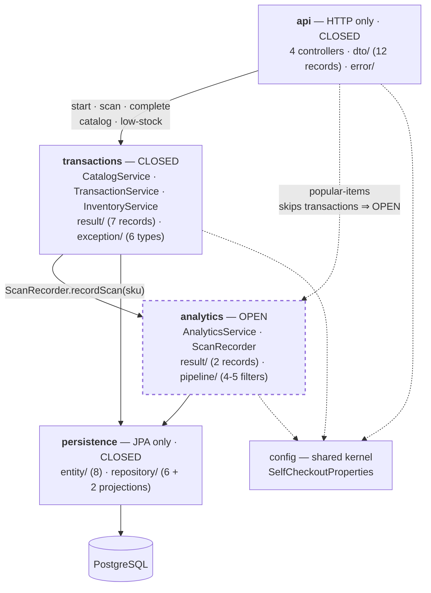
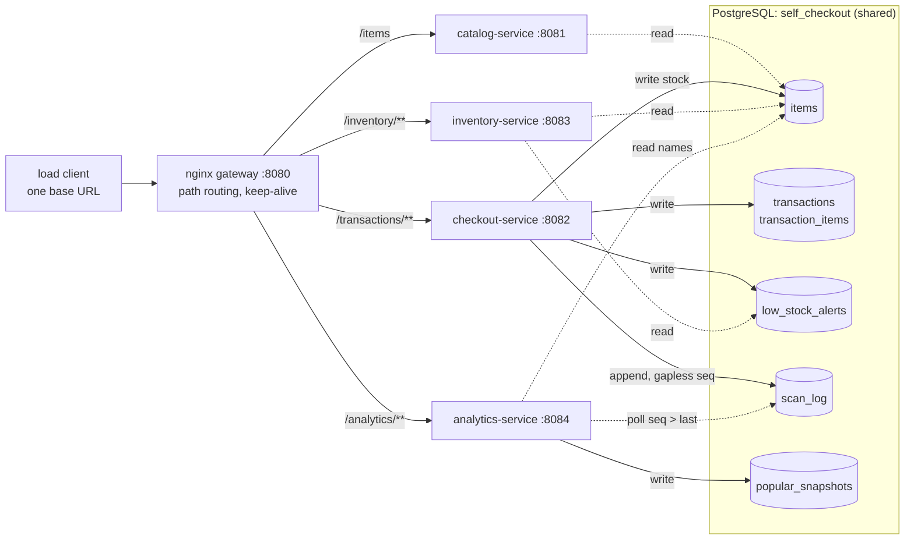

# Architecture — Self-Checkout: Layered, Pipelined, Service-Based, then Microservices

Weeks 2 to 5 of the semester project. Same API contract, same
externally visible checkout behaviour as Week 1's monolith throughout — what
changed is how the code is structured (Week 2), how the windowed analytics are
executed (Week 3, part 1), how much work a request actually does (Week 3, part 2 — the performance work, §7),
how it is deployed as four services over one shared database (Week 4,
[§ Week 4](#week-4-service-based-architecture)), and finally as four microservices with a
database each, coordinated by a saga (Week 5, [§ Week 5](#week-5-microservices)).

Week 1 organized classes by technical type (`controller/`, `service/`,
`repository/`). That reads like layers but nothing enforced it: HTTP types had
already leaked into the business code, and the services built API-shaped DTOs.
This week the layers are real packages with **dependency rules enforced by a
test that fails the build**.

All numbers come from JSON reports produced by the unmodified course load
client against the code as committed: the two graded runs in
[`reports/`](reports/), and for the Week 3 performance work every run in
`reports/perf/` — including the ones that were reverted or taken while the
machine was throttling, which are kept and labelled rather than dropped.
Anything not measured is labelled a prediction.

---

## 1. Required architectural characteristics

| # | Characteristic | Concrete, testable requirement | How it is verified |
|---|---|---|---|
| 1 | **Correctness under concurrency** | For every SKU: `starting_stock − final_stock == SUM(applied_quantity)` over COMPLETED transactions. Zero mismatching rows. | `scripts/check-invariant.sql` CHECK 2. **Measured: 0 violations in both runs.** |
| 2 | **Correctness under concurrency** | No SKU ever has `stock < 0`, even when scanned units exceed available stock. | `scripts/check-invariant.sql` CHECK 1. **Measured: 0 rows in both runs.** |
| 3 | **Correctness under concurrency** | A transaction completes at most once; concurrent completes give exactly one 200 and the rest 409, and stock moves once. | `scripts/test-oversell-and-double-complete.py`. **Measured: 20 simultaneous completes → 1×200, 19×409, stock −4 not −80.** |
| 4 | **Modifiability — enforced layer boundaries** | No class outside `api` may reference `org.springframework.http..` or `org.springframework.web..`; no class in `api` may reference `..persistence..`; `persistence` and `analytics` may not reference anything above them. | `LayeredArchitectureTest`, 6 rules, run by `./mvnw test`. **Measured: 5 of 6 failed before the refactor, 6 of 6 pass after.** |
| 5 | **Modifiability — layer isolation** | Each layer is replaceable without touching its neighbours' internals: business code must compile with no knowledge of HTTP, and the API must compile with no knowledge of JPA. | Same test, rules 2 and 3. **Measured: 47 HTTP-leak violations before, 0 after.** |
| 6 | **Behavioural equivalence with Week 1** | Every endpoint returns byte-identical bodies, status codes and error codes to the monolith, for the happy path and all 400/404/409 cases. | 27-call golden script captured from the `monolith` tag, re-run against the layered build and diffed with IDs/timestamps normalized. **Measured: identical.** |
| 7 | **Performance / latency (default load)** | At 10 stations for 60 s: `SCAN_ITEM` p95 < 10 ms, `COMPLETE_TRANSACTION` p95 < 100 ms. | Default report. **Measured (Week 3 final, pipeline-v2): scan p95 0.20 ms, complete p95 28.45 / 28.53 ms.** (Week 2: 2.19 / 32.68 ms.) |
| 8 | **Performance / latency (stress)** | At 100 stations for 120 s: `COMPLETE_TRANSACTION` p99 < 1000 ms, no request exceeds the client's 10 s timeout. | Stress report. **Measured (Week 3 final, pipeline-v2): complete p99 305.22 / 285.03 ms, max 1302 / 748 ms.** The 1,302 ms outlier is one request of 121,005; the requirement is on p99, which holds. |
| 9 | **Throughput** | Sustain ≥ 1000 scans/sec at 100 stations. | Stress report. **Measured (Week 3 final, pipeline-v2): 10,591 / 10,950 scans/sec, 1007.8 / 1040.2 transactions/sec** — 10× the requirement. (Week 2: 3,651.7 scans/sec.) |
| 10 | **Scalability** | 10 → 100 stations must not break any correctness requirement; degradation must be latency only. | Both runs pass CHECK 1 and CHECK 2 identically. **Measured: correctness unchanged.** |
| 11 | **Availability / robustness** | Zero errors on every operation for the full duration of both runs; no deadlocks, no connection-acquisition timeouts, no unhandled exceptions. | Client error counts + server log scan. **Measured (Week 3 final, pipeline-v2): 0 errors of 4,624,769 requests across four runs; 0 deadlocks; 0 WARN/ERROR lines.** |
| 12 | **Analytics consistency** | One window written per `slideInterval` scans, each covering `windowSize` scans, ranks 1-based and dense. | `scripts/test-popular-window.py` + snapshot counts. **Measured (Week 3 final, pipeline-v2): 2,629 windows for 1,314,701 scans = exactly ⌊n/500⌋; 0 dropped events; in == out at every filter.** |
| 13 | **Alerting** | An alert is recorded exactly once per SKU, at the moment stock first goes strictly below the threshold, and stays queryable with its real trigger time. | `scripts/test-low-stock.py`. **Measured: 50 does not alert, 49 does, further drops neither duplicate nor move `triggeredAt`.** |
| 14 | **Observability** | Every correctness property checkable after a run from the database alone. | `scripts/check-invariant.sql`. |
| 15 | **Simplicity / reinitializability** | A full reset to a known state is one action, no manual SQL. | Restarting the server re-runs `schema.sql` + `data.sql`. **Verified before every run here.** |
| 16 | **Contract conformance** | All seven endpoints match the OpenAPI spec in path, field names, status codes and error shape. | The unmodified load client fails fast on any unexpected status or missing field, and reported 0 errors. |

---

## 2. Top 3 prioritized characteristics, with explicit trade-offs

### Priority 1 — Correctness under concurrency

Unchanged from Week 1, and still first. A fast checkout that loses stock is
worthless, and the damage is silent: no error is raised, and it is only visible
by auditing the database afterwards. **The refactor was not allowed to touch
any of it** — same locks, same lock order, same clamping, same window logic.

**What we give up.** Completions serialize on hot rows. Under the Zipf
workload `SKU-000001` takes ~12% of all scans and appears in roughly two thirds
of baskets, so most completions queue on one row. At 100 stations
`COMPLETE_TRANSACTION` p95 is 185.50 ms against 32.68 ms at 10 stations. Locks
are held until commit, and throughput does not scale with stations.

### Priority 2 — Modifiability (this week's actual subject)

The assignment is about structure, so this is the characteristic the week is
spent buying. Concretely it means: a change confined to one concern touches one
package, and the compiler plus a test stop you from creating a shortcut.

**What we gained, measured.**

- **47 HTTP-leak violations → 0.** `TransactionService` no longer names a
  single HTTP status. The business rules could be served over gRPC, a message
  queue or a CLI without editing a line of them.
- **23 business-to-API dependencies → 0.** Services return domain records; the
  API maps them to spec shapes. The wire format can change without the business
  layer noticing.
- **The rules are executable.** `LayeredArchitectureTest` fails the build on a
  violation, so the structure cannot quietly rot back.

**What we gave up, honestly.**

- **Seven near-duplicate result records.** `CatalogItem`/`ItemDto`,
  `TransactionView`/`TransactionResponse`, `ScanOutcome`/`ScanResult`,
  `ReceiptView`/`Receipt`, `ReceiptLineView`/`ReceiptLine`,
  `LowStockView`/`LowStockResponse`, `LowStockEntry`/`LowStockAlertDto`,
  plus `PopularWindowView`/`PopularItemsResponse` and
  `PopularEntry`/`PopularItem`. Today they are field-for-field identical and
  the mapping code is pure overhead. It pays off only the first time the API
  shape and the domain shape need to differ. **Until then this is a real,
  visible cost, not a hidden one.**
- **More classes.** 42 production classes became 58.
- **Sinkholes.** Some paths now pass through a layer that adds nothing —
  see §4.3.
- **A small latency cost at low load**, see §3.2.

### Priority 3 — Simplicity and operability

Still one process and one database.

**What we gave up.** Single point of failure; vertical scaling only. And this
is worth stating plainly because layering invites the opposite assumption:

> **Layering changed nothing about deployment, scaling or fault isolation.**
> It is a *source-code* structure. There is still one JAR, one JVM, one
> Postgres, one thread pool and one connection pool. If the process dies the
> whole store stops, exactly as in Week 1. Layers bought modifiability and
> testability; they did not buy availability, elasticity or independent
> deployment. Those need the later weeks' architectures.

---

## 3. Measured results

### 3.1 The two required runs

Both runs: server restarted immediately beforehand, machine idle (1-minute load
average below 4 at start), SQL logging off.

| Metric | Default (10 stations, 60 s) | Stress (100 stations, 120 s) |
|---|---|---|
| Transactions | 19,663 | 41,866 |
| Transactions / sec | 327.4 | 348.1 |
| Items scanned | 205,130 | 439,230 |
| Scans / sec | 3,415.9 | 3,651.7 |
| **Total errors** | **0** | **0** |
| Invariant violations | **0** | **0** |
| Popular windows written | 410 | 878 |

Per-operation latency, milliseconds:

| Operation | Run | p50 | p95 | p99 | max | errors |
|---|---|---|---|---|---|---|
| START_TRANSACTION | default | 0.65 | 1.23 | 2.20 | 63.69 | 0 |
| START_TRANSACTION | stress | 15.69 | 25.45 | 35.26 | 256.42 | 0 |
| SCAN_ITEM | default | 1.24 | 2.19 | 3.55 | 240.70 | 0 |
| SCAN_ITEM | stress | 16.04 | 25.44 | 34.33 | 265.87 | 0 |
| COMPLETE_TRANSACTION | default | 15.16 | 32.68 | 47.44 | 339.50 | 0 |
| COMPLETE_TRANSACTION | stress | 114.67 | 185.50 | 326.29 | 894.20 | 0 |

### 3.2 Week 1 vs Week 2

| Metric | Week 1 (monolith) | Week 2 (layered) | Δ |
|---|---|---|---|
| **Default — transactions/sec** | 343.5 | 327.4 | −4.7% |
| Default — COMPLETE p50 | 14.99 | 15.16 | +1.1% |
| Default — COMPLETE p95 | 30.98 | 32.68 | +5.5% |
| Default — COMPLETE p99 | 43.92 | 47.44 | +8.0% |
| Default — SCAN p50 | 1.19 | 1.24 | +4.2% |
| Default — SCAN p99 | 3.13 | 3.55 | +13.5% |
| **Stress — transactions/sec** | 297.1 | 348.1 | +17.2% |
| Stress — COMPLETE p50 | 118.71 | 114.67 | −3.4% |
| Stress — COMPLETE p95 | 275.79 | 185.50 | −32.7% |
| Stress — COMPLETE p99 | 434.42 | 326.29 | −24.9% |
| Stress — SCAN p99 | 60.91 | 34.33 | −43.6% |
| **Errors** | 0 | 0 | — |

**Reading these numbers honestly — the stress column is not a layering win.**

Layering adds in-process method calls and object allocation. It cannot make
PostgreSQL row locks faster, and it plainly cannot buy 17% throughput. What
actually happened is that Week 1's *committed* stress run was a slow one:
Week 1's own lock-order A/B (ARCHITECTURE.md §3.2 at the `monolith` tag)
measured four clean runs of unchanged code spanning **324.8–347.8 tx/sec**, and
the committed 297.1 sat below that band.

Week 2's 348.1 lands at the top of that same band. Against the Week 1 *best*
clean run of 347.8 the difference is **+0.1%** — i.e. nothing. The right
conclusion is:

> **At stress, the cost of layering is indistinguishable from zero**, and the
> apparent improvement is run-to-run variance in the Week 1 baseline.

The **default** column is the more informative one, because at 10 stations the
database is not the bottleneck, so per-request CPU work shows up. There, every
number moved the *wrong* way by a small amount: throughput −4.7%, scan p99
+13.5%. That is the expected direction and rough size for the extra mapping —
each request now allocates a domain record and copies it into a DTO. Still a
single run each, so a few percent should not be over-read; the sign being
consistently negative across six metrics is the part worth noting.

### 3.3 The architecture test, before and after

`LayeredArchitectureTest` was written **before** the refactor and run against
Week 1's code:

| Rule | Before | After |
|---|---|---|
| `layerDependenciesAreRespected` | ❌ 4× "Layer *X* is empty" | ✅ |
| `apiDoesNotDependOnPersistence` | ❌ no classes matched | ✅ |
| `analyticsDependsOnNothingAbove` | ❌ no classes matched | ✅ |
| `persistenceDependsOnNothingAbove` | ❌ no classes matched | ✅ |
| `httpTypesDoNotLeakOutOfApi` | ❌ **47 violations** | ✅ |
| `configDependsOnNoLayer` | ✅ | ✅ |

Four of the five "before" failures are the same fact stated four ways: the
layers did not exist. To get a concrete picture, a temporary test mapped Week
1's package names onto the layers they were morally meant to be. It found:

- **23 violations** — the business layer constructing API DTOs
  (`CatalogService:28`, `InventoryService:45,47`, `PopularItemsService:151,175,180`,
  `TransactionService:141,230,245,262`).
- **HTTP types outside the API layer** — of which the ones that genuinely had
  to change were `TransactionService` (9 references to `HttpStatus`) and
  `ApiException` (3). The rest were controllers and the exception handler,
  which became legal simply by moving into `api`.

### 3.4 Measurement validity

The load client and server share one 8-core machine, so results are sensitive
to other CPU load. Every run reported here started with a 1-minute load average
below 4, and the server logged no `Thread starvation` warning. Both runs are
single runs; per §3.2 the Week 1 baseline's own spread was about 15%, so
differences smaller than that carry no signal.

---

## 4. The layered design

### 4.1 The layers



Every arrow is one clause in `LayeredArchitectureTest`. If the diagram and the
test ever disagree, the test is right.

### 4.2 Closed and open layers

A **closed** layer must be passed *through*: you cannot reach what is beneath
it without going via it. That is what buys isolation — change persistence and
only the business layers notice. An **open** layer may be *bypassed*.

| Layer | Closed/open | Why |
|---|---|---|
| `api` | closed | Nothing sits above it. |
| `transactions` | closed | It never lets the API reach persistence. |
| `analytics` | **open** | Reached from `api` for the read-only popular-items query, and from `transactions` via `ScanRecorder` when a scan happens. |
| `persistence` | closed | Only business layers touch JPA. |

**Why analytics is open.** `GET /analytics/popular-items` is a read-only query
that the transactions layer has no opinion about. Forcing it through
transactions would mean adding a method whose entire body is
`return analytics.latest(limit);` — a **sinkhole**: a layer that adds a hop and
nothing else. Openness is the honest choice, and it is declared in the test
(`.whereLayer("Analytics").mayOnlyBeAccessedByLayers("API", "Transactions")`)
rather than left as an undocumented shortcut.

The cost is real: the API can now reach analytics without transactions
mediating, so a future rule about who may read analytics has two call sites to
police instead of one.

### 4.3 Where our layers are sinkholes — honestly

A sinkhole is a layer that receives a call and passes it straight on. Ours has
two clear cases:

- **`GET /items`.** `CatalogService.listItems()` fetches rows, maps entity →
  `CatalogItem`; the controller maps `CatalogItem` → `ItemDto`. Two mappings,
  zero business rules. The transactions layer adds nothing here today.
- **`GET /transactions/{id}`.** A read-through with one not-found check.

`POST /transactions/{id}/complete` is the opposite — the transactions layer is
where all the locking, ordering, clamping and alerting lives.

So the layering earns its keep on the write paths and costs a little on the
read paths. The usual escape hatch is to let simple reads bypass the business
layer, which is exactly the "open layer" idea already applied to analytics. We
did not apply it to the catalog, because `api → persistence` would let entities
reach the controllers, and that is the one leak most likely to cause real harm
later.

### 4.4 Dependency rules

| Layer | May be accessed by | May depend on |
|---|---|---|
| `api` | *nothing* | transactions, analytics, config |
| `transactions` | api | analytics *(via `ScanRecorder` only)*, persistence, config |
| `analytics` | api, transactions | persistence, config |
| `persistence` | transactions, analytics | JPA / Spring Data only |
| `config` | all | nothing |

`config` sits outside the four layers as a **shared kernel**: it holds settings
and no logic. The test pins it in place — `configDependsOnNoLayer` fails if it
ever grows a dependency on a layer that reads it.

### 4.5 Why `@Transactional` stays in the business layers

Transaction boundaries are a **business** decision, not a data-access one. "Lock
the basket, subtract every line's stock, record any threshold crossings, mark it
paid — all or nothing" is a statement about what a *sale* means. The persistence
layer cannot know where a unit of work starts and ends; it only knows how to
read and write rows. Push `@Transactional` down to repositories and every
repository call becomes its own transaction, which would destroy the atomicity
the entire correctness argument rests on.

### 4.6 Why the transactions → analytics call is one narrow interface

`TransactionService` needs exactly one fact recorded: a unit of a SKU was
scanned. It has no business knowing that a `scan_log` table exists, that scans
are numbered, or that windows are recomputed every 500 of them. `ScanRecorder`
is a single-method interface, so all of that lives behind it.

The `scan_log` INSERT itself moved into the analytics layer during the refactor,
from `TransactionService.scan()` into `AnalyticsService.recordScan()`, at the
same point in the sequence. `recordScan` is deliberately **not** annotated with
`@Transactional`, so it joins the scan's existing transaction — if the scan
rolls back, the log row rolls back with it, exactly as in Week 1.

### 4.7 Why low-stock stays in the transactions layer

The low-stock alert row is written inside `complete()`, in the same database
transaction and under the same item row lock as the stock decrement. Moving it
to its own layer would split one atomic unit of work across a layer boundary.
The alert is a consequence of the sale, not a separate concern.

---

## 5. Design decisions carried over from Week 1

These are unchanged in behaviour; only the file locations moved.

### 5.1 Stock is decremented at completion, never at scan
Required by the spec, and it is what keeps the hot path fast:
`transactions/TransactionService.scan()` never reads or locks `items.stock`.
From 10 to 100 stations, scan p95 grew 2.19 → 25.44 ms (+23 ms absolute,
11.6× relative) while completion p95 grew 32.68 → 185.50 ms (+153 ms absolute,
5.7× relative).

### 5.2 Pessimistic row locking, not optimistic
Two stations paying at once are two threads on two JDBC connections in two
independent Postgres sessions. Read-in-Java → decide → write-an-absolute-value
silently loses one decrement.
`persistence/repository/ItemRepository.findBySkuForUpdate` makes it atomic.
Optimistic locking was rejected on this workload's shape: with `SKU-000001` in
two thirds of baskets, most completions would collide and retry, and the
retries would collide again. **Measured: 0 lost updates across 61,529 completed
transactions in the two runs.**

### 5.3 Basket lines are locked in ascending SKU order
Locks are held until commit, so opposite acquisition orders deadlock.
`findByTransactionIdOrderBySkuAsc` gives every transaction one global order,
which removes the circular-wait condition entirely. Prevention, not detection.
`scripts/test-concurrent-completions.py` builds half its baskets in reverse
order as bait.

### 5.4 `applied_quantity` and the sold-out case
Scans are never gated by stock, so a hot SKU can be scanned more times than it
has units. `quantity` (scanned) goes on the receipt; `applied_quantity`
(actually subtracted) is what the invariant is checked against. CHECK 3 of the
invariant script surfaces the difference instead of hiding it.

### 5.5 Two-pass lock-then-mutate
`complete()` takes every item lock in one loop, then mutates in a second.
Identical semantics to one interleaved loop, but it avoids leaving an `Item`
dirty while further lock queries are still being issued, which would make
Hibernate auto-flush UPDATEs into the middle of the locking phase.

### 5.6 Considered alternative: the single-statement CTE decrement
```sql
WITH locked AS (SELECT sku, stock FROM items WHERE sku = :sku FOR UPDATE)
UPDATE items i SET stock = i.stock - LEAST(l.stock, :qty)
FROM locked l WHERE i.sku = l.sku
RETURNING LEAST(l.stock, :qty) AS applied;
```
Correct and cheaper — one round trip, shorter lock hold — and it works on
PostgreSQL 16 because the CTE captures the pre-update stock (`OLD.*` in
`RETURNING` would need PG 18). **Not adopted for readability, not because it is
impossible.**

### 5.7 Hopping window and BIGSERIAL gaps
Windows are `(start, end]`, width 1000, step 500. Boundaries are detected by
asking which multiple of the step a scan's `seq` has passed and claiming it with
`AtomicLong.compareAndSet` — **not** `seq % 500 == 0`, because a `BIGSERIAL`
burns numbers on rollback and an exact multiple may never appear. The aggregate
runs on one dedicated background thread, handed off via `afterCommit`.

### 5.8 Low-stock semantics: strict `<`
The spec says "drops below", so 50 is not low and 49 is; the reference mock
server agrees. Unlike the mock server, alerts are recorded at the moment of the
crossing so `triggeredAt` is a real trigger time. Ad-hoc `?threshold` applies to
one query and persists nothing; a SKU with no recorded crossing reports
`generatedAt`.

### 5.9 Assumption: one station drives one transaction sequentially
The basket upsert in `scan()` is a read-then-write, race-free only because a
station issues one scan at a time and waits for the response. An
`INSERT ... ON CONFLICT DO UPDATE` would remove the assumption.

### 5.10 Configuration
`spring.jpa.open-in-view=false`; Hikari `maximum-pool-size=32`; SQL logging off.
Unchanged from Week 1 so the two weeks are comparable. Week 1's thread dumps
showed this pool saturated at 100 stations with roughly two thirds of request
threads queued on it, which remains the dominant latency factor.

---

## 6. Week 3 — the analytics pipeline

### 6.1 Why only analytics

Checkout is not a pipeline and should not be forced into one. `complete()` is a
single atomic unit of work: lock the basket, lock each item row in SKU order,
clamp and decrement, record any threshold crossing, mark it paid — all or
nothing. Splitting that across stages connected by queues would mean splitting
one database transaction across threads, which either breaks atomicity or
reinvents a distributed commit for no gain.

The windowed analytics are the opposite: a stream of independent events, each
one cheap, where the answer is a periodic aggregate and a few hundred
milliseconds of lag costs nothing. That is exactly the shape a pipeline fits,
so that is the part that was refactored.

### 6.2 The design

Five filters, one thread each, connected by five bounded
`ArrayBlockingQueue`s behind a `Pipe<T>` interface. Full description and
diagram in **[PIPELINE.md](PIPELINE.md)**.

```
request thread --offer--> [ingest] --+--> [window] --> [rank] --> [sink] --> popular_snapshots
                                     |
                                     +--> [scan-log writer] --------------> scan_log
```

The pipeline lives entirely inside the `analytics` layer. The transactions
layer still calls exactly one method, `ScanRecorder.recordScan(sku)`, and knows
nothing about sequences, windows, queues or threads. `LayeredArchitectureTest`
still passes unchanged.

### 6.3 Correctness rules

1. **Only committed scans enter** — the handover is registered on
   `afterCommit`, so a rolled-back scan never reaches the pipeline. Same
   guarantee as Week 2.
2. **Thread confinement** — each filter's state is touched by one thread only,
   so there are no locks inside filters; every message between them is an
   immutable record.
3. **Identical window semantics** — size 1000, slide 500, half-open
   `(start, end]`, top 10, ties by SKU ascending.
4. **Asymmetric backpressure, deliberately** — see §6.4.
5. **Graceful shutdown drains** — the front of the pipeline is poisoned, each
   stage finishes its backlog before poisoning the next, and the writer flushes
   its final batch.
6. **A bad message never kills a stage** — caught per message, logged with the
   event, counted, loop continues.
7. **Duplicate windows fail loudly** — `UNIQUE (window_end)` on
   `popular_snapshots`, and the sink does **not** use `ON CONFLICT DO NOTHING`.
   One thread owns boundaries, so a duplicate could only be a bug; swallowing
   it would hide exactly what the constraint exists to catch.

**Why the Week 2 `AtomicLong` boundary logic is gone.** It existed because
`scan_log.seq` was a `BIGSERIAL`, and a rolled-back insert burns its number, so
an exact multiple of 500 might never appear and a window could be skipped
forever. The ingest filter numbers only committed scans, one at a time, on one
thread, so the sequence is gapless and `seq % 500 == 0` is now exactly right.

**One consequence to be careful about:** `scan_log.seq` is now assigned by the
application and the counter restarts at 1 on every boot. That is safe only
because `schema.sql` drops and recreates the table on every start. If
`spring.sql.init.mode` were ever turned off, the second start would collide on
the primary key. The warning is in `schema.sql` too.

### 6.4 Two kinds of backpressure

| Boundary | Behaviour | Why |
|---|---|---|
| **Between filters** | blocking `put` | A slow stage should make the stage above it wait. Nothing is discarded and the backlog stays inside the pipeline. |
| **Request thread → ingest** | non-blocking `offer`, 10 ms ceiling | A request thread must never wait on analytics. In Week 2 an analytics failure could not touch checkout, and that property is preserved: a refused event is counted, logged at WARN, and the scan completes normally. |

Without that split, a wedged analytics stage would fill 65,536 slots and then
block **every scan** — turning an analytics outage into a checkout outage. The
asymmetry is the price of keeping "analytics can never take checkout down"
true, and the drop counter makes any loss impossible to miss rather than
silent.

### 6.5 Observability — the evidence

Per-filter in/out/error counters, per-pipe depth, high-water depth and
full-wait counts, plus a drop counter, logged as one line every 10 seconds.

**Stress run (100 stations, 120 s), final line:**

```
ingest  in=456040 out=456040   window in=456040 out=912   rank in=912 out=912
sink    in=912    out=912      scanlog in=7298  out=456040
ingestPipe  max=5/65536     windowPipe max=5/65536     scanLogPipe max=238/65536
rankPipe    max=1/256       sinkPipe   max=1/256
droppedAtIngress=0
```

Reading it: **in == out at every stage**, so nothing was lost or stuck. The
deepest any pipe ever got was **238 of 65,536** (0.4 %), so backpressure never
engaged — **0 full-pipe waits, 0 drops, 0 stage errors, 0 WARN/ERROR lines**.
`scanlog in=7298` counts *batches* and `out=456040` counts *rows*, i.e. an
average of **62.5 rows per INSERT** — the adaptive batching working. At 10
stations the same average is 1.46, because the writer drains faster than events
arrive and there is simply nothing to batch.

Independently confirmed in the database: `scan_log` held exactly 456,040 rows
with `max(seq) = 456040` and 456,040 distinct values — gapless, no duplicates,
no loss.

**Shutdown test:** 1,200 scans sent, `SIGTERM` immediately after, process
exited cleanly; `scan_log` then held exactly 1,200 gapless rows.

### 6.6 Measured results

Both runs: server restarted beforehand, machine idle (1-minute load average
below 4), invariant check run before any restart.

| Metric | Default (10 st, 60 s) | Stress (100 st, 120 s) |
|---|---|---|
| Transactions | 20,545 | 43,436 |
| Transactions / sec | 342.3 | 361.2 |
| Items scanned | 216,507 | 456,040 |
| Scans / sec | 3,606.7 | 3,792.6 |
| **Total errors** | **0** | **0** |
| Invariant violations | **0** | **0** |
| Events dropped | **0** | **0** |
| Windows written | 433 | 912 |

| Operation | Run | p50 | p95 | p99 | max |
|---|---|---|---|---|---|
| START_TRANSACTION | default | 0.63 | 1.05 | 1.83 | 58.79 |
| START_TRANSACTION | stress | 15.23 | 24.40 | 33.64 | 235.59 |
| SCAN_ITEM | default | 1.08 | 1.67 | 2.52 | 30.21 |
| SCAN_ITEM | stress | 15.41 | 24.51 | 32.82 | 171.67 |
| COMPLETE_TRANSACTION | default | 17.25 | 34.78 | 45.46 | 92.65 |
| COMPLETE_TRANSACTION | stress | 113.21 | 173.70 | 305.87 | 731.03 |

0 errors across **800,509 total requests**.

### 6.7 Week 2 vs Week 3

| Metric | Week 2 | Week 3 | Δ |
|---|---|---|---|
| **Default — transactions/sec** | 327.4 | 342.3 | +4.6 % |
| Default — SCAN p50 | 1.24 | 1.08 | **−12.9 %** |
| Default — SCAN p99 | 3.55 | 2.52 | **−29.0 %** |
| Default — COMPLETE p50 | 15.16 | 17.25 | +13.8 % |
| Default — COMPLETE p99 | 47.44 | 45.46 | −4.2 % |
| **Stress — transactions/sec** | 348.1 | 361.2 | +3.8 % |
| Stress — SCAN p50 | 16.04 | 15.41 | −3.9 % |
| Stress — SCAN p99 | 34.33 | 32.82 | −4.4 % |
| Stress — COMPLETE p50 | 114.67 | 113.21 | −1.3 % |
| Stress — COMPLETE p99 | 326.29 | 305.87 | −6.3 % |
| **Errors** | 0 | 0 | — |

**Reading these honestly.** Week 2 measured roughly 15 % run-to-run variance on
throughput for unchanged code, so the **+4.6 % and +3.8 % throughput figures sit
inside the noise band and should not be claimed as a win**. Each configuration
was therefore run twice:

| | run 1 | run 2 | Week 2 |
|---|---|---|---|
| default tx/sec | 342.3 | 347.8 | 327.4 |
| default SCAN p99 | 2.52 | 2.40 | 3.55 |
| stress tx/sec | 361.2 | 355.0 | 348.1 |
| stress SCAN p99 | 32.82 | 34.05 | 34.33 |

The signal that *is* consistent and outside the noise is **scan latency at low
load**: SCAN p99 fell from 3.55 ms to 2.52 and 2.40 ms across both repeats, a
~30 % reduction, with p50 down ~13 %. That is the one thing the pipeline
actually targets — the per-scan `INSERT` left the request's transaction
entirely — and it is exactly where the design predicted the gain would show.

At 100 stations the picture is flatter, also as predicted: the binding
constraint there is the hot-row lock on `SKU-000001` during `complete` plus the
saturated connection pool, and the pipeline does not touch that path. The small
COMPLETE improvements are a plausible second-order effect of the scan path no
longer competing for pool connections, but they are within noise and are **not**
claimed as a result.

### 6.8 The async `scan_log` trade-off

`scan_log` rows are now written on a background thread in batches. On a hard
kill (`SIGKILL`, power loss) up to one unflushed batch plus whatever sat in the
pipes would be lost. This is analytics data only: checkout remains fully
transactional, and stock, receipts and the invariant are untouched.

A graceful stop loses nothing — verified. Every test run in this course starts
from a freshly recreated database, so there is no recovery-on-restart to build.
A production version would replay from a durable append-only log or a broker
with publisher confirms and manual acknowledgements.

### 6.9 Why not RabbitMQ or Kafka this week

The pipeline is in-process, so an in-memory queue hands a message to the next
filter in nanoseconds. A network broker would add a serialization step, a
socket round trip and a second process to operate — real latency and real
operational cost — in exchange for durability this workload does not need,
given the database is wiped before every run anyway.

The `Pipe<T>` interface exists precisely so that decision stays reversible: a
`RabbitPipe<T>` would be one more implementation and no change to any filter.
That is a worthwhile A/B experiment, but on a separate branch, not in the
submission.

### 6.10 What Week 3 did not change

Checkout behaviour is untouched: same schema for `items`/`transactions`/
`transaction_items`, same pessimistic row locks, same ascending SKU lock order,
same two-pass lock-then-mutate, same clamping and `applied_quantity`, same
low-stock semantics, same Hikari pool size of 32. Verified by a 27-call golden
response diff (byte-identical, including every 400/404/409 case) and by all
three checkout behaviour scripts passing unchanged.

---

## 7. Performance — making it do less, not making it work harder

The performance work (the second half of Week 3) kept the architecture and the contract exactly as they were and went
after throughput. Every claim here is backed by a run recorded in
[`perf-results.md`](perf-results.md), with the raw JSON in `reports/perf/`.

### 7.1 Result

| | baseline (`pipeline-v1`) | final | change |
|---|---|---|---|
| tx/s, 10 stations | 404.6 / 407.2 | **1031.8 / 1028.5** | **×2.54** |
| tx/s, 100 stations | 420.3 / 431.9 | **1007.8 / 1040.2** | **×2.40** |
| `SCAN` p50 / p99 | 0.85 / 2.86 ms | **0.09 / 0.40 ms** | −89 % / −86 % |
| `COMPLETE` p50, 100 st | 90.84 ms | **76.51 ms** | −16 % |
| errors | 0 | **0** of 4,624,769 requests | — |
| stock invariant | PASS | **PASS** | — |

### 7.2 A note on how these were launched

The Week 1–3 reports in [`reports/`](reports/) were produced with
`./mvnw spring-boot:run`. That plugin starts the JVM with
`-XX:TieredStopAtLevel=1`, which caps the JIT at C1 — worth about 20 % of
throughput. Every performance-work number, **including the baseline it is compared
against**, was taken from the packaged jar instead, so the comparison is
like-for-like. The earlier submitted reports have not been re-run or altered.

### 7.3 The one idea behind all of it

Nothing here is a faster algorithm. Every change removes database work from a
path that did not need it:

| | statements, `pipeline-v1` | statements, final |
|---|---|---|
| `POST /transactions` | 4 | **0** |
| `POST /{id}/items` (scan) | 7–8 + 3 background | **0** |
| `POST /{id}/complete` (L SKUs) | 3L + 5 ≈ 33 | **6** |
| `GET /items` | 1 | **0** |
| held under the item lock | 3L + 2 ≈ 30 | **3** |

Three structural changes got there:

1. **An unpaid basket is not a database row.** It lives in memory until the
   customer pays (`OpenBasket`, `OpenTransactionStore`). The database only
   ever sees baskets that were actually paid for.
2. **The catalog is immutable, so it is cached.** 2,000 rows, read once.
3. **One checkout, one round of bulk statements.** One `SELECT ... IN (...)
   ORDER BY sku FOR NO KEY UPDATE` for the whole basket instead of one per
   SKU, then bulk `UPDATE`/`INSERT`s, instead of Hibernate's per-row
   merge-then-write.

### 7.4 What actually limits it now, measured

`CheckoutTimings` splits a completion's database time in two:

| | 10 stations | 100 stations |
|---|---|---|
| lock **wait** | 7.2 ms | 93–96 ms |
| **critical section** (lock granted → commit) | 1.02 ms | 1.01–1.04 ms |

The wait grows 13× with load; the critical section does not move. At 100
stations roughly **99 % of a completion's database time is queueing** for the
hottest SKU's row and about 1 % is work.

CPU confirms it is not a resource problem — sampled during the final runs, out
of 800 % available: server ~100 %, Postgres ~95–134 %, load client ~111–126 %,
**total ~310–360 %**. The server uses about one core. (The baseline burned
~505 % to do 405 tx/s; most of the removed work was round trips, not
computation.)

Because every basket containing the hottest SKU passes through that critical
section one at a time, it is what sets the ceiling:

```
ceiling ≈ 1 / (critical section × fraction of baskets holding that SKU)
```

which is why the only change that raised it was taking a statement *out* of
the critical section (writing the transaction header before the lock:
−9.8 % critical section, +3.7 % throughput at 10 stations).

### 7.5 Trade-offs accepted

These are costs, stated as costs:

| Change | What it buys | What it costs |
|---|---|---|
| Baskets in memory | ~87 statements per basket gone (4 to start + 7–8 per scan) | **An unpaid basket does not survive a restart**, and the design is now firmly single-process: two servers would not see each other's baskets. A *paid* basket is as durable as before. |
| Catalog cached | every price lookup is a map read | **Price and name changes need a restart.** Safe only because this catalog is seeded once and never updated. |
| Raw scan persistence off by default | ~1.25 M inserts per stress run gone | **No row-level audit trail** unless switched back on. The graded requirement — top-10 windows in the database — is unaffected, because windows are computed from the event stream, not from those rows. |
| Separate 2-connection pool for the pipeline | sink write 66.9 ms → 0.43 ms | Two more Postgres connections, and a second pool to reason about. |
| Pool size 32, not 16 | ~2.3 % more throughput | **A worse tail**: p99 307 ms vs 229 ms at 16. If tail latency mattered more than throughput, 16 is the better setting (§7.6). |

### 7.6 Choices measured and *not* taken

- **Connection pool 64.** 10.6 % *worse* than 32, with p99 doubling to 511 ms.
  More connections do not make a serialized row less serial; they just move
  the queue into Postgres, and with 8 cores they make the critical section
  itself slower (1,065 → 1,159 µs).
- **Plain `FOR UPDATE` on the bulk lock.** Collapsed the server to 2.9 tx/s
  with 9,239 errors and deadlocks. `scan_log`, `transaction_items` and
  `low_stock_alerts` all have a foreign key to `items`, so Postgres takes a
  `FOR KEY SHARE` lock on the parent row when it checks one — compatible with
  `FOR NO KEY UPDATE`, in conflict with `FOR UPDATE`. Reverted.
- **Folding the stock `UPDATE` and the line `INSERT` into one CTE.** Would
  remove a round trip from the critical section; rejected because it fuses two
  cleanly separated persistence classes into one SQL string for an expected
  few percent.
- **`synchronous_commit = off`.** Would cut the commit cost, which is a large
  part of the remaining 1.0 ms. Rejected: a crash could lose paid
  transactions.

### 7.7 Measurement honesty

Two things are worth stating rather than hiding.

**The machine throttles.** After ~45 minutes of continuous stress runs,
throughput on an *unchanged* binary fell from ~1,036 to 805 tx/s and in the
worst period to ~330. The critical section — the server's own work — grew from
1,013 to 1,318 µs, and operations that touch no database slowed by the same
fraction, so this is the machine, not the code. The pool-size sweep was
therefore re-run **interleaved** (16, 32, 64, 16, 32, 64, …) after a cooldown,
so drift is shared across arms rather than charged to whichever ran last.
Every contaminated run is kept in `reports/perf/contaminated-thermal/` and
labelled, not deleted.

**One change at a time.** Each phase was measured on its own, and one was
reverted outright. The reverted run is in the results table with its real
numbers.

### 7.8 A regression this work introduced, and how it was caught

Moving baskets into memory silently changed the order of `lines[]` on a
receipt. `OpenBasket` stored lines in a `LinkedHashMap` — correctly, so they
appear in the order first scanned — but published snapshots with
`Map.copyOf`, whose iteration order is unspecified. No test covered line
order; the 28-response golden diff against the pipeline-v1 build did. Fixed,
and now locked down by `OpenBasketTest.linesKeepFirstScanOrder`, which was
confirmed to fail against the old code.

---

## Week 4: service-based architecture

The single application is split into **four domain services**: catalog, checkout,
inventory and analytics. Each is its own Maven module, Spring Boot jar, JVM process and
port. All four share **one PostgreSQL database**. An nginx gateway on `:8080` keeps the
single base URL. The OpenAPI contract, the load client and every response body are
unchanged: the 29-response golden diff through the gateway is identical to the
pre-split application. [SERVICES.md](SERVICES.md) is the one-page service list.

### W4.1 Why these four

The four services follow the four business capabilities the contract already exposes,
one URL prefix each: what is sold (`/items`), selling it (`/transactions`), watching
stock (`/inventory`) and measuring popularity (`/analytics`). Each one maps to tables it
can own:

- **Checkout** owns everything that must change together in one ACID transaction at
  payment: the stock decrement, the transaction and its lines, and the low-stock alert.
  Splitting any of those across services would have turned one local commit into a
  distributed one.
- **Catalog and inventory** only read.
- **Analytics** only writes its own windows.

Splitting finer (a separate "stock" service, say) would have put a network call inside
the lock-late, commit-early critical section that bounds throughput (§7.4). That is the
one place this system cannot afford one.

### W4.2 The design



No arrow goes from one service to another. The services share two **library** modules
(`shared-data`: the read-only catalog cache and configuration; `shared-web`: the error
JSON and domain exceptions), which are compiled into each jar and never run on their
own.

### W4.3 Ownership matrix

| Table | catalog | checkout | inventory | analytics |
|---|---|---|---|---|
| `items` | R | **W** (stock only) + R | R | R (names) |
| `transactions` | | **W** + R | | |
| `transaction_items` | | **W** | | |
| `low_stock_alerts` | | **W** | R | |
| `scan_log` | | **W** (append) + R (`MAX(seq)` at startup) | | R |
| `popular_snapshots` | | | | **W** + R |

Every table has exactly one writer. This is enforced at three levels:

1. **The module graph.** No service module depends on another service module, so a
   service *cannot* call another service's classes. The compiler refuses.
2. **ArchUnit, per service.** catalog-service and inventory-service contain no database
   write calls at all. The test matches every JDBC `update`/`batchUpdate`/`execute`,
   `executeUpdate`/`executeBatch`, JPA `persist`/`merge`/`remove` and Spring Data
   `save*`/`delete*`/`flush*`. In analytics-service, only `JdbcSnapshotWriter` writes.
   The predicate was checked to be non-vacuous: removing the exception makes the rule
   fail on `JdbcSnapshotWriter.executeUpdate`.
3. **PostgreSQL roles.** Each service connects as its own role (`catalog_svc`,
   `checkout_svc`, `inventory_svc`, `analytics_svc`). `db/roles.sql` grants each one
   exactly its column of the matrix above, and `db/reset.sh` re-applies the grants after
   every reset. The database itself now refuses a write from the wrong service. For
   example, `UPDATE items SET price = …` as `checkout_svc` fails with `permission denied`,
   because its UPDATE grant covers the `stock` column only
   (`reports/service-based/roles/permission-check.txt`). Homebrew PostgreSQL uses trust
   authentication, so the roles have no passwords: they separate privileges, not
   identities.

### W4.4 The scan hand-off

This is the one live data flow between services. In Week 3 it was an in-process pipe
from `TransactionService.scan()` into the ingest filter. A pipe cannot cross a process
boundary, and the plan rules out service-to-service calls, so **the table is the pipe**:

- **checkout-service** does exactly what Week 3's ingest did, and then persists the
  result. A scan offers its SKU to a bounded in-memory queue (65,536 entries, at most a
  10 ms wait; if full it is dropped and counted, and the scan still succeeds). A single
  writer thread then numbers the events with a gapless `seq` and writes them as one
  multi-row INSERT of up to 1,000 rows, collecting for at most 50 ms.
- **analytics-service** polls `SELECT seq, sku, scanned_at FROM scan_log WHERE seq > :last
  ORDER BY seq LIMIT 5000` every 50 ms and feeds the unchanged window → rank → sink
  filters.

**`scan_log` is therefore always written.** The Week 3 `persist-raw-scans` flag is gone.
In Week 3 it defaulted to off, so the Week 3 numbers below did **not** pay for these
inserts; Week 4 writes about one row per scan.

The windows must stay *exactly* what Week 3 computed. That depends on `seq` having no
holes and being seen in order, which three rules guarantee:

1. **One numbering thread, numbering at batch time.** A dropped event never takes a
   number.
2. **Strictly ordered commits.** Batch N+1 is built only after batch N has committed. A
   failed INSERT is retried with the *same* seqs, so the committed rows are always
   exactly `1..K`. A reader using `seq > last` can never see seq 7 before seq 6 is
   visible.
3. **The poller refuses to skip.** It hands rows on only while `seq = last + 1`, and
   otherwise stops and re-reads (`gapStalls`, which stays 0 in every run).

`scripts/check-windows.sql` verifies the outcome after every load run. It checks that
`scan_log` holds exactly `1..max`, and that **every** stored window equals a brute-force
SQL recount of `scan_log` over the same `(start, end]`.

**Batching was measured, not assumed.** The first version wrote whatever was queued the
moment the writer woke up. Under load that averaged **2 rows per INSERT**: about 3,200
commits a second, each a WAL flush competing with the payments' own commits. Collecting
for up to 50 ms raised the average to **540–590 rows per INSERT** in the official runs.
An unofficial 20 s smoke run went from 710.3 to 791.1 tx/s; both of those started at
load ≈ 4–5, so they show the direction, not the size. The cost is up to 50 ms more
analytics lag, and it changes no window.

**The `scan_log → items` foreign key was measured and dropped.** Every FK check takes a
`FOR KEY SHARE` lock on the item row, and an UPDATE of a row that is share-locked has to
record both lockers in a MultiXact. Those are exactly the hot rows that every checkout
queues for (§7.4). At 100 stations, with about a million scan rows per run, the cost
was large:

| 100 stations × 120 s | run 1 | run 2 | mean |
|---|---|---|---|
| with the FK | 707.2 | 665.2 | 686.2 tx/s |
| FK dropped (measurement runs) | 800.6 | 877.8 | 839.2 tx/s |
| Week 3 jar, same afternoon | 1000.4 | 1033.1 | 1016.8 tx/s |

At 10 stations the difference was within noise (963.8 with vs 986.9 without). The FK
guarded nothing: checkout logs a scan only after resolving its SKU in the catalog, and
the catalog never changes. So it was dropped (with approval), and the final runs below
were taken without it. The Week 3 rows show the machine was not the problem: the
Week 3 jar reproduced its submitted 1,007.8 tx/s between the Week 4 runs.

**Restarts.** Analytics resumes from the newest stored window: it reloads the 1,000
scans before that window's end and carries on polling from there. A checkout restart
carries on numbering from `MAX(seq)`.

### W4.5 The gateway

nginx, configured in `gateway/nginx.conf` (Homebrew nginx 1.31). It routes by path and
holds no logic:

| Path | Service |
|---|---|
| `/items` | catalog |
| `/transactions/**` | checkout |
| `/inventory/**` | inventory |
| `/analytics/**` | analytics |
| anything else | catalog |

Unmatched paths go to catalog so that an unknown route still gets the same Spring 404
body as before; the golden diff includes one. HTTP/1.1 keep-alive is used to every
upstream (`proxy_http_version 1.1`, an empty `Connection` header and a keep-alive pool
per upstream). Without that, every request would open a new TCP connection to the
service. Access logging is off, because at ~12,000 requests/s it would be pure overhead.

**What the hop costs, measured.** `scripts/measure-gateway-hop.py` sends the same scan
request 5,000 times straight to checkout on :8082 and 5,000 times through :8080,
alternating in blocks over keep-alive connections. Median: 0.124 ms direct vs 0.155 ms
through the gateway, so **+0.031 ms per request**. (The p99 came out *lower* through the
gateway, 0.389 vs 0.588 ms. That is noise at this sample size, and is not claimed as a
gain.) At about 12.5 requests per transaction (a start, ~10.5 scans, a complete) that is
~0.39 ms on a 9.8 ms cycle at 10 stations, about 4 % of closed-loop throughput. nginx itself used 30–37 % of one core under load.

### W4.6 The shared-data decision

**One database, shared, rather than a database per service.** This was deliberate:

- **The payment is one ACID transaction.** The stock decrement, the transaction row and
  its lines, and the low-stock alert commit together today. That is how the stock
  invariant (`10000 − stock = Σ applied_quantity`) holds under 100 concurrent stations.
  With separate databases, a payment would need a saga or two-phase commit, and the
  invariant would become eventually true.
- **The readers need the writer's data, fresh.** Inventory reports alerts written by
  checkout. With a database each, those would have to be copied, which means a broker
  or a service call. Both are ruled out.
- **One table is a perfectly good queue at this scale.** `scan_log` with a gapless key
  gives ordered, durable, replayable hand-off with no new infrastructure.

What keeps the sharing from becoming a free-for-all is that each table has **one
writer** (W4.3), checked by tests rather than by convention. DB access logic is shared
only where it is read-only and identical: the catalog cache in `shared-data`. Everything
that writes lives in the one service that owns the table.

### W4.7 Trade-offs

| Gained | Paid |
|---|---|
| **Failure isolation.** Stopping any one service takes down only its own routes (502). While analytics was stopped for 10 s, checkout ran 860.7 tx/s with 0 errors, and analytics then caught up from `scan_log` (`scripts/test-service-restart.sh`). | **More moving parts.** Five processes instead of one. `start-all.sh` has to start them in order and health-check each one. |
| **Independent deployability.** Each service is its own jar; one can be rebuilt and restarted while the others keep serving. | **The hop.** Every request crosses nginx: one more loopback round trip and two more socket copies (W4.5). |
| **Smaller blast radius per change.** A service only compiles against the shared libraries, so changes cannot leak between services through code. | **More database work.** `scan_log` is now always written: one row per scan, about 1.2 M rows per stress run. Week 3's default runs did not write it. |
| **Analytics can no longer slow a scan**, even in theory. The offer is bounded, and the writer runs in a different process from the windowing. | **Analytics lag.** Windows appear a little later: up to the 50 ms linger, plus the 50 ms poll interval, plus the window compute (W4.8). |
| | **Checkout is pinned to one instance.** Open baskets live in that process's memory (Week 3, §7.5), and the `scan_log` seq has one writer. Two checkout instances would need sticky routing by transaction id *and* a shared sequence. Today the gateway has exactly one checkout upstream, and that is a known scaling limit. |
| | **An open basket does not survive a checkout restart.** After a restart, `GET` and scan on an open basket return 404 `TRANSACTION_NOT_FOUND`. Stock is untouched, because it is decremented only at payment. Paid transactions are in the database and unaffected. |
| | **Memory.** Four JVMs: 1 GB checkout and 512 MB for each of the others, instead of one 1 GB JVM. |

### W4.8 Results

All runs go through the gateway with the packaged jars, after `db/reset.sh` and a
restart of every service. Each one is followed by `check-invariant.sql` and
`check-windows.sql`. Every run started below load 3 (1-minute average). Load rose to
4–5 between runs because of macOS background work; it is recorded in each
`*-summary.txt` under `reports/service-based/`.

**The submitted pair** (`reports/report-default-10stations-60s.json`,
`reports/report-stress-100stations-120s.json`) is the better of two runs for each
configuration. Both runs are listed:

| Run | tx/s | errors | dropped scans | scan_log gapless | windows matching brute force | invariant |
|---|---|---|---|---|---|---|
| default 10 st × 60 s, run 1 | 950.7 | 0 | 0 | yes (601,419) | 1,202 / 1,202 | PASS |
| **default 10 st × 60 s, run 2 (submitted)** | **1015.8** | **0** | 0 | yes (639,819) | 1,279 / 1,279 | PASS |
| **stress 100 st × 120 s, run 1 (submitted)** | **960.1** | **0** | 0 | yes (1,207,935) | 2,415 / 2,415 | PASS |
| stress 100 st × 120 s, run 2 | 954.7 | 0 | 0 | yes (1,203,076) | 2,406 / 2,406 | PASS |
| default, after adding the per-service roles | 1012.1 | 0 | 0 | yes (639,097) | 1,278 / 1,278 | PASS |

**Week 3 vs Week 4** (the submitted reports):

| | Week 3 (`pipeline-v2`) | Week 4 | change |
|---|---|---|---|
| tx/s, 10 stations | 1031.8 | **1015.8** | −1.6 % |
| tx/s, 100 stations | 1007.8 | **960.1** | −4.7 % |
| `SCAN` p50, 10 st | 0.094 ms | 0.122 ms | +0.028 ms (the hop) |
| `SCAN` p50, 100 st | 0.101 ms | 0.129 ms | +0.028 ms |
| `COMPLETE` p50, 10 st | 4.437 ms | 4.207 ms | ≈ |
| `COMPLETE` p50, 100 st | 76.510 ms | 81.447 ms | +6 % |
| `COMPLETE` p99, 100 st | 305.22 ms | 303.57 ms | ≈ |
| `scan_log` rows written | 0 (flag off) | every scan (1.2 M per stress run) | the hand-off |
| errors | 0 | **0** | |
| stock invariant | PASS | **PASS** | |

Week 4 does strictly more work than Week 3: one more network hop per request, and a
`scan_log` row per scan. It is within 1.6–4.7 % of Week 3. The `SCAN` p50 difference is the
measured gateway hop almost exactly. The stress `COMPLETE` difference is the `scan_log`
inserts competing with payments for WAL and CPU in the one shared PostgreSQL, which ran
at 120–130 % of a core under stress.

**Analytics lag** (from analytics-service's log, sampled every second as `MAX(seq)` in
`scan_log` minus the last seq the poller handed on):

| Run | behind `scan_log`, mean | max | read lag mean / max | gapStalls |
|---|---|---|---|---|
| default run 1 | 161 scans | 689 scans | 59 / 649 ms | 0 |
| default run 2 | 54 scans | 688 scans | 58 / 160 ms | 0 |
| stress run 1 | 127 scans | 667 scans | 57 / 288 ms | 0 |
| stress run 2 | 140 scans | 646 scans | 58 / 296 ms | 0 |

At ~10,000 scans a second, a few hundred scans behind is a few tens of milliseconds.
"Read lag" is the time from a scan to the poller reading it back; it is dominated by
the 50 ms linger plus the 50 ms poll. A window therefore appears on
`/analytics/popular-items` about 0.1 s after its 500th scan, against effectively
immediately in Week 3. Every run ended with `behind scan_log now=0` and every window
correct.

**Per-service CPU** (process CPU time over the run, as % of one core; mean of the two
final runs of each kind):

| | default | stress |
|---|---|---|
| checkout-service | 100 % | 100 % |
| PostgreSQL (all backends) | 84 % | 124 % |
| nginx | 31 % | 36 % |
| analytics-service | 4.5 % | 3.6 % |
| catalog-service | 0.1 % | 0.1 % |
| inventory-service | 0.2 % | 0.1 % |

Checkout and the database do the work. Catalog and inventory are almost idle, because
the load client calls their endpoints only a few times per run. That is the honest
answer to "would splitting them out let them scale independently": for this workload
there is nothing there to scale.

**Restarts** (`scripts/test-service-restart.sh`, output in
`reports/service-based/roles/restart-test/`):
- Stopping catalog or inventory makes only their own route return 502; each was back
  within about 3 s.
- While analytics was stopped for 10 s of load, checkout ran 860.7 tx/s with 0 errors
  (856.0 in the run before the roles).
  The restarted analytics restored its window and caught up.
- A checkout restart lost the open basket (404) and continued `scan_log` at
  `MAX(seq) + 1`.
- Afterwards: gapless `scan_log`, every window matching, invariant PASS.

**Behaviour.** The 29-response golden diff through the gateway is identical to the
single application, before and after the roles. All five behavioural scripts pass
through the gateway (`reports/service-based/verification/`, and again under the roles
in `reports/service-based/roles/`).

### W4.9 Removed in the split

Dead code, or code replaced by `scan_log`:
- the Week 3 `IngestFilter`, `IngestTee` and `ScanLogWriterFilter` (with their tests);
- the `ScanLog` entity and `ScanLogRepository`;
- `TransactionItem`/`TransactionItemId` and `TransactionItemRepository`;
- `ItemRepository` (the catalog cache now uses plain JDBC);
- `ScanCount`;
- the old single-application test and its root `src/`;
- the `selfcheckout.analytics.persist-raw-scans` flag.

`Item.setStock` is gone too: inventory's `Item` entity is read-only, and only checkout's
`JdbcStockUpdater` changes stock.

---

## Week 5: microservices

The four services are now **independently deployable microservices, each with its own data
store**. They share one PostgreSQL server but have four databases (`catalog_db`,
`inventory_db`, `checkout_db`, `analytics_db`), and each database can be opened by exactly
one role. The contract, the load client and every response body are unchanged: the
29-response golden diff through the gateway is identical.
[MICROSERVICES.md](MICROSERVICES.md) is the one-page description.

### W5.1 What had to change, and why

In Week 4 the database was the only coupling: services never called each other, they shared
tables. With a database per service that coupling is gone. Three things depended on it:

| Week 4 relied on | Week 5 replacement |
|---|---|
| checkout locking and decrementing `items.stock` in the shared database | **stock moves to inventory-service**, the natural owner, and checkout calls `POST /internal/stock/commit` (the saga's pivot) |
| checkout writing `scan_log`, analytics reading it | checkout **pushes** numbered batches to `POST /internal/scans`; analytics stores them in its own `scan_log` |
| every service reading `items` for prices and names | catalog-service owns `items`; the others load `GET /items` once and cache it |

The one update that now spans two databases is **paying**: units leave inventory's shelf, and
the sale is recorded in checkout's database.

### W5.2 The payment saga

The full steps are in [MICROSERVICES.md](MICROSERVICES.md#how-the-multi-database-update-is-coordinated-the-payment-saga).
The design decisions:

- **Orchestration, with checkout as orchestrator.** The `complete` request must return a
  receipt with the applied quantities, in the same HTTP response. One owner that calls, waits
  and decides keeps the saga's state in one place. Choreography (PaymentRequested →
  StockCommitted → …) would make a synchronous request wait on asynchronous events, and
  spread the state across services. It fits next week's event-driven design better.
- **A saga log before the pivot.** Tx A writes the sale as PENDING with its lines *before*
  calling inventory. Without it, a crash after the stock commit would lose everything needed
  to finish the sale: the station, scanned quantities, prices and start time all lived in the
  in-memory basket. Reconciling from inventory's `stock_commits` alone cannot rebuild the
  sale.
- **The pivot is idempotent.** `stock_commits.transaction_id` is a primary key, claimed with
  `INSERT … ON CONFLICT DO NOTHING` *before* any lock is taken. A retry, or a duplicate still
  in flight, waits for the first commit and then gets its stored answer. Stock is never taken
  twice.
- **Forward recovery, not compensation.** After the pivot only tx B remains, a local write
  that is retried until it succeeds. A crash between the pivot and tx B is repaired at
  startup: the resolver re-sends the same commit (inventory answers from its record) and
  runs tx B. Compensation (putting stock back) was rejected for two reasons. It is a second
  distributed step that can itself fail halfway. And a release can overtake the original
  commit while that commit is still in flight inside inventory.
- **Failure handling follows what checkout knows.**
  - *Certainly not committed* (connection refused, or an error answer, which inventory sends
    only after rolling back): undo tx A, reopen the basket, return **503**.
  - *Unknown* (sent, no answer): reopening the basket could sell the same units twice. So it
    stays closed; the client gets 503 and a retry gets 409. The resolver finishes the sale
    once inventory answers, and `GET /transactions/{id}` then shows COMPLETED.

  503 was chosen because the spec has no 5xx response at all, and 409 would wrongly claim the
  basket is in the wrong state.
- **No connection held across the network call.** Tx A commits, *then* checkout calls
  inventory, *then* tx B runs. Holding a checkout connection while inventory's row-lock queue
  drains would tie up checkout's pool for as long as that queue is.

### W5.3 Scans: batched HTTP push

The publisher, its gapless numbering, its bounded queue (with drops counted), the batching
and the retry-with-the-same-seqs rule are all unchanged from Week 4. Only the last hop
differs: an HTTP POST instead of an INSERT. Analytics makes the guarantees on its side:
- a batch that would leave a gap is refused with 409, and checkout renumbers from analytics'
  maximum;
- a retried batch is absorbed by the primary key;
- the 200 answer is sent only after the commit.

Two Week 4 behaviours had to be re-designed:
- **Resuming the seq after a restart.** Checkout no longer has `MAX(seq)` in its own database,
  so it asks analytics (`GET /internal/scans/max-seq`). It asks from the writer thread, not at
  startup, so **checkout starts and serves customers even while analytics is down**, buffering
  scans until analytics answers.
- **A broker** (RabbitMQ or Kafka) would add durability across a checkout crash, but needs an
  install. It is left for next week's event-driven design. Until then, scans still in the
  queue are lost if checkout is killed, as in Week 4.

### W5.4 Enforcement

| Level | What stops a service using another's data |
|---|---|
| Database | `REVOKE CONNECT … FROM PUBLIC` and `GRANT CONNECT` to one role per database, so `psql -U checkout_svc inventory_db` is refused. Inside each database, `grants.sql` limits each role to the columns it changes (inventory may UPDATE only `stock.qty`). |
| Gateway | `location ^~ /internal/ { return 404; }`: the service-to-service endpoints can't be reached from outside |
| Code | ArchUnit, per service. One writing class per table. A new `remote` layer is the only one besides `api` allowed to touch HTTP types, and it depends on nothing above it. |

### W5.5 Trade-offs

| Gained | Paid |
|---|---|
| **Real data ownership.** No service can read or write another's tables. Each database can change its schema, size or engine without the others noticing. | **Paying costs three commits instead of one** (tx A, the stock commit, tx B), all fsynced, all on the same server's WAL. Inventory's commit happens while it holds the hot SKU's row lock, so busier WAL means a longer critical section. |
| **Failure isolation with clear behaviour.** Inventory down → a clean 503 and a reopened basket. Analytics down → checkout serves and counts drops. A crash mid-payment → repaired on restart. | **An HTTP round trip and JSON on every payment**, plus a more complex code path: saga log, idempotency, a resolver and a test hook. |
| **Inventory is the single owner of stock decisions.** The lock, the clamp and alerts live in one place. | **The ambiguous case is visible to the client**: a 503 whose sale may still complete moments later. It is documented, tested, and only possible while inventory is unreachable. |
| | **Five JVMs plus Postgres plus the load client on 8 cores** (4 performance, 4 efficiency). Checkout's JIT alone used ~65% of a core in the first 20 s of a run. |
| | **Still pinned**: checkout to one instance (in-memory baskets, one scan numberer), and stock to the hottest SKU's row lock |

**Measured and not taken.** Turning off commit durability for checkout's two commits raised
an unofficial 20 s run from 638.6 to 690.4 tx/s, and shortened inventory's critical section
from 1.60 to 1.41 ms. That confirms the WAL cost. But tx A must be durable *before* the
pivot, or a database crash could leave stock taken with no record of the sale. An
asynchronous tx B *would* be safe, because a lost tx B leaves a PENDING row that recovery
finishes. But it is only repaired at checkout's next restart, and until then a paid sale reads
as OPEN. Correctness first, so both commits stay synchronous.

**Fixed along the way.** JFR showed Spring's `JdkClientHttpRequestFactory` starting a new
thread for every request body, because the JDK `HttpClient` had no executor. Each client now
has a reusable executor. The measured throughput change was small (628.2 → 638.6 tx/s in
unofficial runs), but the fix is free.

### W5.6 Results

All runs go through the gateway with the packaged jars, after `db/reset.sh` and a restart
of every service, and are followed by `scripts/check-invariant-micro.sh`. Every run
started below load 3 (1-minute average); load rose to about 4–5 between runs. Raw runs are
in `reports/microservices/`. The submitted pair is the better of two runs for each
configuration, and all four are listed:

| Run | tx/s | errors | saga retries / rollbacks / ambiguous / recovered | scans dropped | cross-DB invariant |
|---|---|---|---|---|---|
| **default 10 st × 60 s, run 1 (submitted)** | **852.4** | **0** | 0 / 0 / 0 / 0 | 0 of 538,345 | PASS |
| default 10 st × 60 s, run 2 | 826.9 | 0 | 0 / 0 / 0 / 0 | 0 of 519,137 | PASS |
| **stress 100 st × 120 s, run 1 (submitted)** | **806.0** | **0** | 0 / 0 / 0 / 0 | 0 of 1,016,852 | PASS |
| stress 100 st × 120 s, run 2 | 764.8 | 0 | 0 / 0 / 0 / 0 | 0 of 964,998 | PASS |

The test hook was off in every run (`haltHook=off` in each `saga |` line). No stock-commit
call came near the 2.5 s timeout: the slowest was 1.4 s, under stress.

**Week 4 vs Week 5** (the submitted reports):

| | Week 4 (`service-based-v1`) | Week 5 | change |
|---|---|---|---|
| tx/s, 10 stations | 1015.8 | **852.4** | −16.1 % |
| tx/s, 100 stations | 960.1 | **806.0** | −16.0 % |
| `START` p50, 10 st | 0.132 ms | 0.168 ms | |
| `SCAN` p50, 10 st | 0.122 ms | 0.152 ms | |
| `COMPLETE` p50, 10 st | 4.207 ms | 7.282 ms | +3.1 ms |
| `COMPLETE` p50, 100 st | 81.447 ms | 96.994 ms | +19 % |
| `COMPLETE` p99, 10 st | 47.51 ms | 37.34 ms | |
| errors | 0 | **0** | |
| stock invariant | PASS | **PASS** (across two databases) | |

**Where the time goes.**
- **Inventory's lock timings.** At 10 stations a payment's stock call takes 7.7 ms on
  average. Of that, 6.2 ms is waiting for the hottest SKU's row lock and 1.15 ms is holding
  it (`stock commit timings` in inventory's log). The rest is the HTTP round trip.
- **Why the wait grew.** The critical section includes inventory's commit, which now shares
  the server's WAL with checkout's tx A and tx B. Every millisecond added inside the lock is
  paid by every basket containing the hottest SKU, about two thirds of them. That is why
  COMPLETE grows more than the extra work alone would suggest.
- **Stress.** At 100 stations the lock wait dominates: 117–124 ms of a 119–126 ms stock call.
  CPU is also close to the machine's limit: Postgres used 173–182 % of a core, checkout about
  125 %, and nginx about 35 %, alongside the load client's 100 threads on 8 cores.

**Prediction vs measurement.** In Phase 1 I predicted ~870–970 tx/s default and ~860–960
stress, counting one extra hop and one extra commit. After the go-ahead it was pointed out
that a payment now has *three* fsynced commits instead of one. I did not write a revised
figure down before the first smoke run, so I am not claiming one. Measured: default came in
below even the original range, and stress at the bottom of it.

**Analytics lag** (analytics-service's log; sampled every second as `MAX(seq)` in its
`scan_log` minus the last seq the poller handed on):

| Run | behind, mean | max | read lag mean / max | gapStalls |
|---|---|---|---|---|
| default run 1 | 25 scans | 706 scans | 67 / 221 ms | 0 |
| default run 2 | 55 scans | 634 scans | 65 / 140 ms | 0 |
| stress run 1 | 46 scans | 663 scans | 68 / 402 ms | 0 |
| stress run 2 | 88 scans | 637 scans | 66 / 471 ms | 0 |

The push adds no measurable lag compared with Week 4's shared table: a window still appears
about 0.1 s after its 500th scan. Batches averaged 486–551 scans per push.

**Per-service CPU** (process CPU over the run, % of one core; mean of the two runs of each kind):

| | default | stress |
|---|---|---|
| checkout-service | 133 % | 125 % |
| PostgreSQL (all four databases) | 152 % | 178 % |
| inventory-service | 38 % | 35 % |
| nginx | 35 % | 36 % |
| analytics-service | 17 % | 13 % |
| catalog-service | 0.1 % | 0.1 % |

#### Re-run and explored settings (2026-10-24)

The day after the submitted runs, the same version was run again with the same procedure,
4 runs. A database setting, group commit, was then tried. Raw runs, the harness and per-run
notes are in [`reports/microservices/experiments/`](reports/microservices/experiments/README.md).

| | default, 10 st × 60 s | stress, 100 st × 120 s | errors | cross-DB invariant |
|---|---|---|---|---|
| submitted (2026-10-23), runs 1 / 2 | 852.4 / 826.9 | 806.0 / 764.8 | 0 | PASS ×4 |
| **re-run (2026-10-24), runs 1 / 2** | **803.2 / 809.5** | **817.0 / 814.2** | **0** | **PASS ×4** |
| `commit_delay` 10 µs | 808.8 / 841.3 | 732.6 / 800.0 | 0 | PASS ×4 |
| `commit_delay` 50 µs | 839.2 / 823.9 | 761.8 / 637.0 † | 0 / 501 † | PASS ×4 |
| `commit_delay` 100 µs (one run each) | 841.3 | 829.8 | 0 | PASS ×2 |

All numbers are tx/s. `commit_siblings` was 5 and `synchronous_commit` was on throughout.

**The result reproduces.** Today's runs are within the submitted runs' spread:
- the re-run means are 806 tx/s default and 816 stress, against 840 and 785 for the
  submitted pairs;
- COMPLETE p50 was 7.9 ms default and 97 ms stress (submitted: 7.3 and 97 ms);
- there were 0 errors, no saga retries or rollbacks, no dropped scans, and the invariant
  passed every time.

**Group commit**, in plain English:
- **The setting.** A commit is durable once PostgreSQL has flushed its WAL to disk.
  `commit_delay` lets a committing transaction wait a few microseconds so that others
  committing at the same moment share that one flush. `commit_siblings = 5` means it only
  waits when at least 5 other transactions are active.
- **Durability.** No commit is acknowledged before it is on disk; the commits just share
  flushes.
- **Why it seemed worth trying.** Since Week 5 a payment makes three durable commits on one
  server, and inventory's commit happens while it holds the hottest SKU's row lock (above).

**The group-commit results are inconclusive:**
- **The machine wasn't idle.** Those runs started on a busier laptop than the re-run: load
  2.9–4.1 against 2.5–3.2, with a browser tab using a full core.
- **The differences go both ways.** −6 % to +4 % against the re-run, which is within that
  noise.
- **Too few runs.** 100 µs has one run of each kind.
- **† One run isn't a group-commit result.** The second 50 µs stress run took 1,105 s of real
  time for a 120 s test, because the machine stalled. Its 501 errors are nginx 504s and
  client timeouts from that stall; the invariant still passed.

Group commit was therefore **not adopted**. The PostgreSQL defaults stay
(`commit_delay = 0`).

Two other changes were prototyped and not measured, and are not in this version:
- `inventory_db` on a separate PostgreSQL instance (own data directory and WAL, port 5433);
- a circuit breaker on checkout's stock-commit call.

### W5.7 Correctness evidence

- **Golden diff:** identical to the single application (29/29) through the gateway.
- **Behavioural scripts:** all five pass (`reports/microservices/verification/`). Their database checks now say which service's database they read.
- **Cross-database invariant:** `scripts/check-invariant-micro.sh` passes after every load run.
  - inventory: no negative stock, and `10000 − stock = Σ applied`;
  - checkout vs inventory: identical committed lines, and no PENDING sale left;
  - analytics: a gapless `scan_log`, with every window equal to a brute-force recount.
- **Failure tests:** `scripts/test-failures.sh`, all PASS (`reports/microservices/failure-tests.txt`).

| Case | What happened |
|---|---|
| A. inventory stopped | 503 `SERVICE_UNAVAILABLE` + `Retry-After: 1` after 1.6 s. Basket reopened, a further scan accepted, stock untouched, no sale row left. The same payment succeeded after restart, and stock was taken once. |
| B. inventory frozen (`SIGSTOP`) | 503 after 5.1 s, sale PENDING. A retry got 409, and a scan got 409 (basket stayed closed). About 1 s after `SIGCONT`, GET showed COMPLETED. Exactly one stock commit; the resolver's retry was a replay (`ambiguous=1 resolved=1 replayed=1`). |
| C. checkout halted after the stock commit (test hook) | Before restart the databases disagreed (inventory committed, checkout PENDING), and the invariant failed as expected. After a normal restart: `recovery: 1 payment(s)…`, the sale COMPLETED with the right applied quantities, still one stock commit, and the invariant passed. |
| D. analytics stopped under load | Checkout served 431.1 tx/s with 0 errors. 3,115 scans dropped and counted once the queue filled. Every accepted scan reached analytics after it restarted; gapless, windows correct. |
| E. checkout started while analytics was down | Healthy and took a payment. Its 3 scans were buffered (`synced=false`), then delivered as seq 1..3 once analytics answered. |
| F. `/internal/**` via :8080 | 404 for all three internal endpoints. Each is still reachable directly on its service's own port. |

---

## 8. Known limitations

1. **Layering changed nothing operational.** One process, one database, one
   point of failure, vertical scaling only (§2, priority 3).
2. **Seven near-duplicate result records** and their mapping code are pure
   overhead today (§2, priority 2).
3. **Two read paths are sinkholes** (§4.3).
4. **`analytics` is open**, so "who may read analytics" has two call sites.
5. **Single measurement runs**, against a Week 1 baseline whose own spread was
   about 15% (§3.2, §3.4).
6. **Client and server share one machine.**
7. **~~The pool size is reasoned, not optimized~~** — measured in the Week 3 performance work
   (§7.6). 32 is a deliberate throughput-over-tail-latency choice; 16 would
   give a better p99.
8. **Analytics are eventually consistent** by design (§5.7).
9. **The basket upsert assumes sequential scans per transaction** (§5.9).
10. **`scan_log` is written asynchronously** — a hard kill can lose up to one
    unflushed batch of analytics rows (§6.8). *(Still true in Week 4, where
    `scan_log` is the hand-off: a hard kill of checkout-service loses whatever
    sat in its publisher queue, and analytics never sees those scans. A graceful
    stop drains the queue first.)*
11. ~~**The scan sequence restarts at 1 on every boot**~~ — fixed in Week 4:
    checkout-service continues from `MAX(seq)` in `scan_log`, because a restart
    no longer recreates the schema.
12. **The throughput gain is within run-to-run noise** (§6.7); only the
    low-load scan latency improvement is outside it. *(Week 3, part 1
    statement. The performance work's gain is ×2.4–2.5 and far outside noise —
    see §7.)*
13. **An unpaid basket is lost on restart**, and the in-memory basket store
    makes the single-process assumption explicit rather than incidental
    (§7.5).
14. **The catalog is cached at first use**, so price or name changes require a
    restart (§7.5).
15. **The ceiling is one row's serialization.** At 100 stations ~99 % of a
    completion's database time is spent queueing for the hottest SKU. Going
    materially faster means sharding that row, not tuning the server (§7.4).
16. **Measurements are sensitive to machine thermal state** (§7.7).
17. **(Week 5) Paying costs three durable commits and an HTTP call** (W5.5). That is
    16 % of throughput at both 10 and 100 stations compared with Week 4.
18. **(Week 5) The ambiguous case reaches the client.** If inventory takes a stock-commit
    request but never answers, the client gets 503, and the sale may still complete moments
    later (a retry gets 409; `GET /transactions/{id}` then shows COMPLETED). This is only
    possible while inventory is unreachable (W5.2).
19. **(Week 5) A PENDING sale reads as OPEN.** Between a checkout crash and its recovery,
    `GET /transactions/{id}` reports a payment in progress as OPEN. The contract has no
    "being paid" status.
20. **(Week 5) `scan_log` grows without pruning** in analytics_db: about a million rows per
    stress run, cleared only by `db/reset.sh`.
21. **(Week 5) Scans still in checkout's queue are lost if checkout is killed** (analytics
    resumes from what it stored, so the sequence stays gapless). A durable broker would fix
    that, and is next week's subject.
22. **(Week 5) Group commit and a separate PostgreSQL instance for inventory were explored
    but not measured on an idle machine** (W5.6, "Re-run and explored settings"). Neither is
    part of the submitted version.
