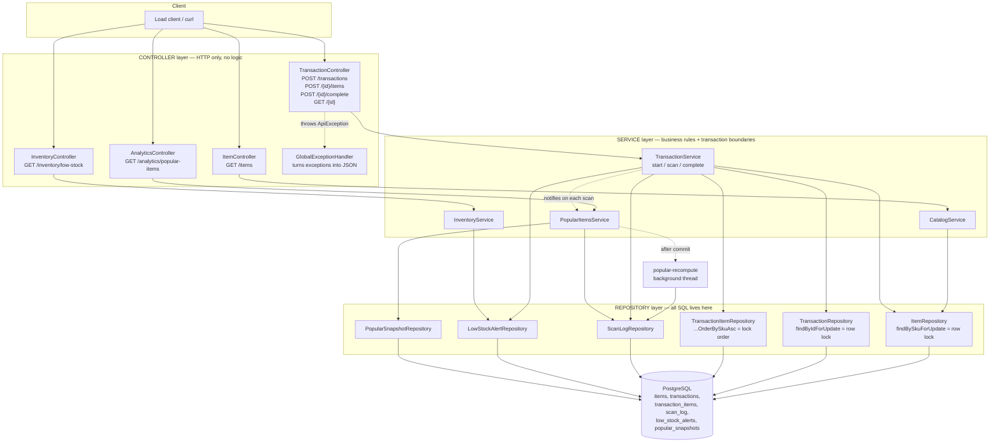
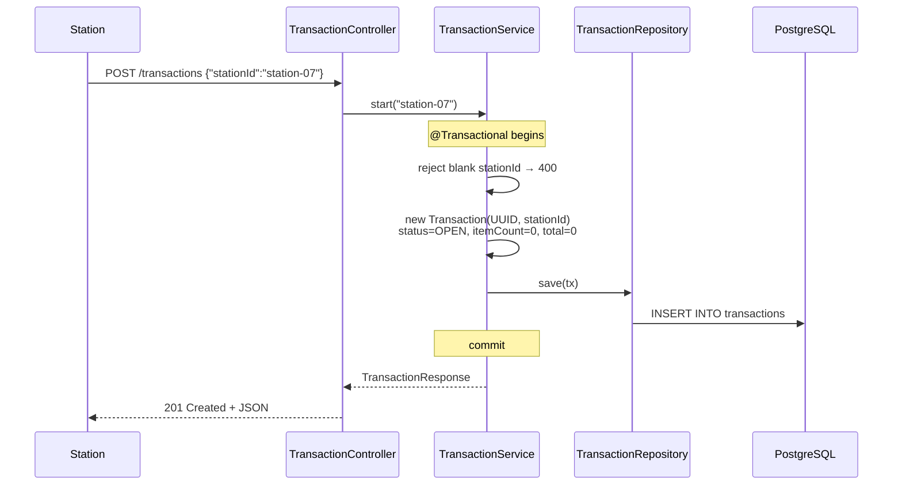
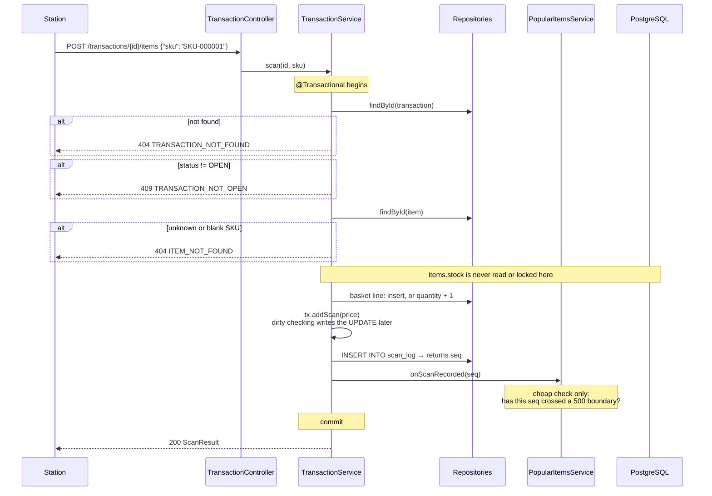
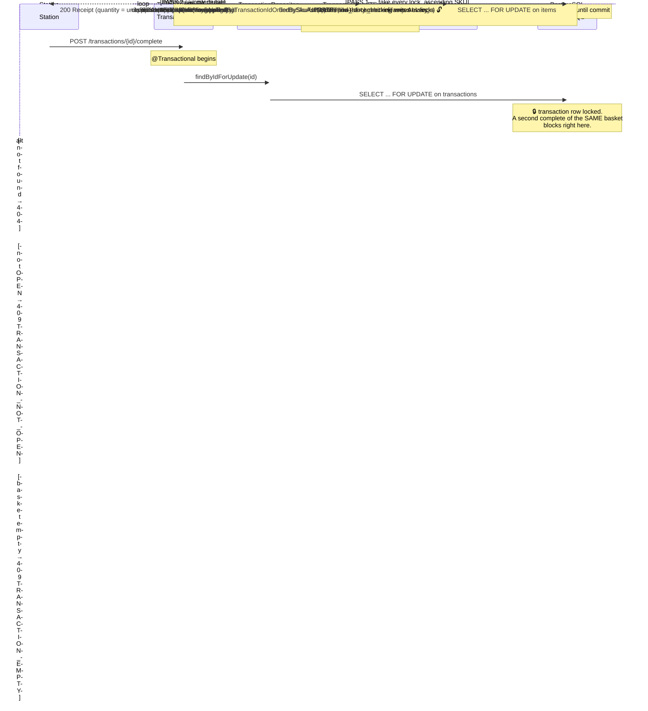
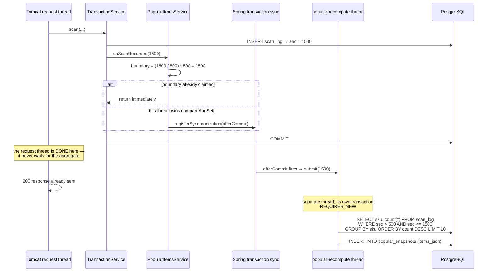

# Developer Guide — Self-Checkout Monolith

A walkthrough of the whole project: what it does, how it is built, why each
decision was made, and how to run and explain it.

For **measured results and architectural trade-offs**, see
[ARCHITECTURE.md](ARCHITECTURE.md). This guide deliberately does not repeat the
numbers — it explains the *machinery* that produced them.

---

## Table of contents

1. [What the system does](#1-what-the-system-does)
2. [Tech stack, and why each piece](#2-tech-stack-and-why-each-piece)
3. [Architecture](#3-architecture)
4. [How a request flows](#4-how-a-request-flows)
5. [The database](#5-the-database)
6. [API reference](#6-api-reference)
7. [File-by-file walkthrough](#7-file-by-file-walkthrough)
8. [Deep dives](#8-deep-dives)
9. [How to run everything](#9-how-to-run-everything)
10. [Troubleshooting](#10-troubleshooting)
11. [Glossary](#11-glossary)
12. [Where the results live](#12-where-the-results-live)

---

## 1. What the system does

A supermarket self-checkout system, as a backend service.

A customer walks up to one of the checkout stations and:

1. **Starts a transaction** — the station tells the server "a customer is here".
   The server creates an empty basket and hands back an id.
2. **Scans items**, one physical beep at a time. Each scan looks up the price
   and returns the running total, so the screen can update.
3. **Pays.** The server finalizes the basket, subtracts what was bought from
   the shelf count, and returns a receipt.

Around that, the store needs two pieces of reporting:

- **Low-stock alerts** — "we're nearly out of milk", recorded the moment it
  happens so someone can go and restock.
- **Popular items** — what's selling right now, over a rolling view of the
  most recent scans.

Two rules drive almost every design decision in the codebase:

> **Stock is subtracted when the customer pays, not when they scan.**
> The customer is already holding the item — the backend's job is to keep an
> accurate count, not to refuse the scan.

> **Stock must never go wrong, no matter how many stations run at once.**
> For every product: `what we started with − what's left == what we sold`.
> Ten stations run by default, one hundred in the stress test. This is the
> property that naive implementations quietly break, and most of §8 is about
> making sure ours doesn't.

---

## 2. Tech stack, and why each piece

| Piece | Version | Why it's here |
|---|---|---|
| **Java** | 21 | Long-term-support release. Gives us `record`, which makes the DTOs one-liners instead of 40-line classes. |
| **Spring Boot** | 4.1.1 | Bundles the web server, the database wiring and the configuration system, and auto-configures them. Without it there'd be a lot of setup code that has nothing to do with checkouts. |
| **Spring Web MVC** | (bundled) | The HTTP layer. It maps URLs to methods and converts objects to JSON, so no request parsing is written by hand. Uses an embedded Tomcat with a **thread pool** — which is exactly why concurrency is a real concern here. |
| **Spring Data JPA + Hibernate** | 7.x | Maps Java objects to table rows. Saves writing SQL for ordinary reads and writes, and — importantly — gives a clean way to ask for a **row lock** (`@Lock(PESSIMISTIC_WRITE)`) without hand-writing `SELECT ... FOR UPDATE`. |
| **PostgreSQL** | 16 | A real relational database with real transactions and real row-level locking. The correctness guarantee in this project is *enforced by the database*, not by Java code, so the database choice matters. Also easy to reinitialize from a `.sql` file. |
| **HikariCP** | (bundled) | The connection pool. Opening a database connection is slow, so the app keeps a set of them open and lends them out. Worth knowing about: under heavy load this pool becomes the bottleneck — see §8.7. |
| **Maven** | wrapper (`./mvnw`) | Builds the project and downloads dependencies. The *wrapper* means nobody has to install Maven — `./mvnw` fetches the right version itself. |
| **Jackson** | 3.x | Turns objects into JSON and back. Note: Jackson 3 moved to the `tools.jackson` package — the old `com.fasterxml` imports do not work on Spring Boot 4. |

**Why a monolith at all?** This is week one of a semester that rebuilds the
same API in a different architecture each week. One process and one database
is the simplest thing that can possibly work, which makes it the honest
baseline everything else gets compared against.

---

## 3. Architecture

Three layers, each allowed to talk only to the one below it.



**The rules this diagram encodes:**

- Controllers contain **no** business logic and **no** `try/catch`. They map a
  URL to a service call and return the result.
- Services own the **transaction boundaries** — `@Transactional` appears only
  here. They are also the only place that throws `ApiException`.
- Repositories own **all** SQL. Nothing above them writes a query.
- DTOs cross the boundary outward; entities never leave the service layer.
  That's why `GET /items` cannot accidentally leak the stock count.

---

## 4. How a request flows

### 4.1 Start a transaction

The simplest path — nothing is locked, nothing can conflict.



### 4.2 Scan an item

Still no locks. This is the hot path — it runs ~10x more often than the others,
so it deliberately does as little as possible.



### 4.3 Complete the transaction — the important one

This is where the locks are, and where the sort matters.



### 4.4 Popular-items window recompute

The only asynchronous thing in the system.



**Why `afterCommit` and not just "run it now":**

- If the scan rolls back, `afterCommit` never fires, so a rolled-back scan can
  never end up counted in a window.
- The request thread hands the work off and returns. Checkout never pays for
  analytics.
- One dedicated thread means analytics can never use more than one extra
  database connection, however heavy the checkout load gets.

---

## 5. The database

```mermaid
erDiagram
    ITEMS ||--o{ TRANSACTION_ITEMS : "appears in"
    ITEMS ||--o{ SCAN_LOG : "is scanned as"
    ITEMS ||--o| LOW_STOCK_ALERTS : "may trigger"
    TRANSACTIONS ||--o{ TRANSACTION_ITEMS : "contains"

    ITEMS {
        varchar sku PK
        varchar name
        numeric price
        integer stock "CHECK >= 0"
    }
    TRANSACTIONS {
        varchar id PK
        varchar station_id
        varchar status
        integer item_count
        numeric running_total
        timestamptz started_at
        timestamptz completed_at "null until paid"
    }
    TRANSACTION_ITEMS {
        varchar transaction_id PK_FK
        varchar sku PK_FK
        integer quantity "scanned"
        integer applied_quantity "actually subtracted"
    }
    SCAN_LOG {
        bigserial seq PK
        varchar sku FK
        timestamptz scanned_at
    }
    LOW_STOCK_ALERTS {
        varchar sku PK_FK
        timestamptz triggered_at
    }
    POPULAR_SNAPSHOTS {
        bigserial id PK
        bigint window_start
        bigint window_end
        timestamptz computed_at
        text items_json
    }
```

`POPULAR_SNAPSHOTS` has no foreign keys on purpose — it's a computed report,
not part of the transactional model.

### Every column, explained

**`items`** — the catalog. The only table holding stock.

| Column | Type | What it is |
|---|---|---|
| `sku` | `VARCHAR(32)` PK | Product code, e.g. `SKU-000001`. The string itself is the key. |
| `name` | `VARCHAR(255)` | Display name on screen and receipt. |
| `price` | `NUMERIC(10,2)` | Unit price. `NUMERIC`, not `FLOAT` — money must be exact. |
| `stock` | `INTEGER` | Units on the shelf. `CHECK (stock >= 0)` is a last line of defence: even a bug cannot write a negative value, the statement just fails. |

**`transactions`** — one customer's basket.

| Column | Type | What it is |
|---|---|---|
| `id` | `VARCHAR(64)` PK | A UUID generated by the app. |
| `station_id` | `VARCHAR(64)` | Which checkout the customer is at. |
| `status` | `VARCHAR(16)` | `OPEN`, `COMPLETED` or `CANCELLED`. Stored as text so rows are readable in `psql`. |
| `item_count` | `INTEGER` | Units scanned — **not** distinct SKUs. Three tins of beans = 3. |
| `running_total` | `NUMERIC(12,2)` | Kept up to date on every scan, so the receipt total never has to be recomputed. |
| `started_at` | `TIMESTAMPTZ` | When the basket opened. |
| `completed_at` | `TIMESTAMPTZ` | `NULL` until paid. |

**`transaction_items`** — the basket lines. **The two quantity columns are the
subtle part of the whole project.**

| Column | Type | What it is |
|---|---|---|
| `transaction_id` | `VARCHAR(64)` PK, FK | Which basket. |
| `sku` | `VARCHAR(32)` PK, FK | Which product. Composite key with the above, so scanning the same item twice bumps `quantity` instead of adding a row. |
| `quantity` | `INTEGER` | Units **scanned**. This is what the receipt prints — what the customer is physically holding. |
| `applied_quantity` | `INTEGER` | Units **actually subtracted** from stock. Usually the same as `quantity`, but smaller if the product sold out. **The stock invariant is checked against this column.** See §8.4. |

**`scan_log`** — one row per beep, across all stations.

| Column | Type | What it is |
|---|---|---|
| `seq` | `BIGSERIAL` PK | The global scan counter. Always increases, but **can skip numbers**. See §8.5. |
| `sku` | `VARCHAR(32)` FK | What was scanned. |
| `scanned_at` | `TIMESTAMPTZ` | When. |

**`low_stock_alerts`** — recorded threshold crossings.

| Column | Type | What it is |
|---|---|---|
| `sku` | `VARCHAR(32)` PK, FK | The product. Being the primary key means at most one alert per product, ever. |
| `triggered_at` | `TIMESTAMPTZ` | The real moment stock crossed below the threshold — not the time somebody asked. |

**`popular_snapshots`** — computed windows, append-only.

| Column | Type | What it is |
|---|---|---|
| `id` | `BIGSERIAL` PK | Append-only, so the largest id is the current window. |
| `window_start` | `BIGINT` | A scan **sequence number**, not a timestamp. |
| `window_end` | `BIGINT` | Ditto. The window is `seq` in `(window_start, window_end]`. |
| `computed_at` | `TIMESTAMPTZ` | When the aggregate ran. |
| `items_json` | `TEXT` | The ranked top 10 as a JSON array. Written once, read whole, never queried by field — so JSON is simpler than ten child rows. |

---

## 6. API reference

Base URL `http://localhost:8080`. All bodies are JSON.

Errors always look like this:

```json
{ "error": "TRANSACTION_NOT_OPEN", "message": "Transaction abc is COMPLETED" }
```

| Code | Status | Means |
|---|---|---|
| `INVALID_REQUEST` | 400 | Missing `stationId`, or a missing/malformed request body. |
| `TRANSACTION_NOT_FOUND` | 404 | No transaction with that id. |
| `ITEM_NOT_FOUND` | 404 | No such SKU — including when `sku` was blank or absent. |
| `TRANSACTION_NOT_OPEN` | 409 | Already completed or cancelled. |
| `TRANSACTION_EMPTY` | 409 | Tried to pay for an empty basket. |

### `GET /items`

The full catalog. The load client calls this once at startup.

```bash
curl -s localhost:8080/items
```
```json
{ "items": [ { "sku": "SKU-000001", "name": "Item 1", "price": 1.37 } ] }
```
**200** always. Note there is no `stock` field — the catalog is not an
inventory endpoint.

### `POST /transactions`

```bash
curl -s -X POST localhost:8080/transactions \
  -H 'Content-Type: application/json' -d '{"stationId":"station-07"}'
```
```json
{ "transactionId": "f518f161-...", "stationId": "station-07", "status": "OPEN",
  "itemCount": 0, "runningTotal": 0, "startedAt": "2026-09-25T21:23:17.912797Z" }
```
**201** created · **400** `INVALID_REQUEST` if `stationId` is missing or blank.

### `POST /transactions/{id}/items`

One call = one physical unit. To scan two of the same thing, call it twice.

```bash
curl -s -X POST localhost:8080/transactions/$TX/items \
  -H 'Content-Type: application/json' -d '{"sku":"SKU-000001"}'
```
```json
{ "transactionId": "f518f161-...", "sku": "SKU-000001", "name": "Item 1",
  "unitPrice": 1.37, "itemCount": 1, "runningTotal": 1.37 }
```
**200** · **404** unknown transaction or SKU · **409** basket not open.
`itemCount` and `runningTotal` already include this unit.

### `POST /transactions/{id}/complete`

No request body. Payment always succeeds in this simulation.

```bash
curl -s -X POST localhost:8080/transactions/$TX/complete
```
```json
{ "transactionId": "f518f161-...", "stationId": "station-07", "itemCount": 2,
  "totalAmount": 3.11, "startedAt": "...", "completedAt": "...",
  "lines": [ { "sku": "SKU-000001", "name": "Item 1", "unitPrice": 1.37, "quantity": 1 } ] }
```
**200** · **404** unknown · **409** not open, or basket empty.
`quantity` is what was **scanned**, even if the shelf ran short.

### `GET /transactions/{id}`

Debugging only; the load client never calls it. Returns the same shape as
`POST /transactions`. **200** or **404**.

### `GET /inventory/low-stock`

```bash
curl -s "localhost:8080/inventory/low-stock"
curl -s "localhost:8080/inventory/low-stock?threshold=100"
```
```json
{ "threshold": 50, "generatedAt": "2026-09-25T21:30:00Z",
  "alerts": [ { "sku": "SKU-000001", "name": "Item 1", "currentStock": 0,
                "threshold": 50, "triggeredAt": "2026-09-25T21:24:11Z" } ] }
```
**200** always. `?threshold=` applies to this query only and is never saved.
`triggeredAt` is the real crossing time when one was recorded, otherwise it
falls back to `generatedAt`. See §8.6.

### `GET /analytics/popular-items`

```bash
curl -s "localhost:8080/analytics/popular-items?limit=10"
```
```json
{ "windowSize": 1000, "slideInterval": 500, "windowStart": 500, "windowEnd": 1500,
  "computedAt": "2026-09-25T21:25:00Z",
  "items": [ { "sku": "SKU-000001", "name": "Item 1", "scanCount": 375, "rank": 1 } ] }
```
**200** always — before any window has been computed you get a well-formed
response with an empty `items` list, never a 404.
`windowStart`/`windowEnd` are **scan sequence numbers**, not timestamps.

---

## 7. File-by-file walkthrough

### Entry point and configuration

| File | What it does |
|---|---|
| `SelfCheckoutApplication.java` | `main()`. `@SpringBootApplication` turns on component scanning (which is why every class must live under `com.selfcheckout.self_checkout`). Starting it also rebuilds the database. |
| `config/SelfCheckoutProperties.java` | A record bound to the `selfcheckout.*` keys, so services get one typed, immutable settings object instead of scattered `@Value` strings. |
| `config/RecomputeExecutorConfig.java` | Defines the single daemon thread used for analytics recomputes. Single-threaded on purpose — windows must be written in order, and analytics must never grab more than one extra DB connection. |

### Controllers — HTTP only

| File | Endpoints | Notes |
|---|---|---|
| `ItemController` | `GET /items` | Two lines of logic. |
| `TransactionController` | `POST /transactions`, `POST /{id}/items`, `POST /{id}/complete`, `GET /{id}` | Returns `ResponseEntity` only for the 201; everything else returns the record directly. No `try/catch` anywhere. |
| `InventoryController` | `GET /inventory/low-stock` | `Integer threshold` not `int`, so "absent" is distinguishable from "zero". |
| `AnalyticsController` | `GET /analytics/popular-items` | Only reads the newest stored window; never computes. |

### Services — the business rules

| File | Key methods | Notes |
|---|---|---|
| `CatalogService` | `listItems()` | Maps entities → DTOs so stock never leaks. Its **sort order matters**: the load client treats catalog position as popularity rank, making `SKU-000001` the hottest item. |
| `TransactionService` | `start`, `scan`, `complete`, `get` | **The core of the project.** `scan` deliberately touches no locks; `complete` holds all of them. Read this file first. |
| `InventoryService` | `lowStock(Integer)` | Resolves the effective threshold, then stamps it onto each row. Only *reads* alerts — they're *written* by `complete()`. |
| `PopularItemsService` | `onScanRecorded`, `recomputeWindow`, `latest` | Boundary detection on the hot path, the aggregate on a background thread, and the read-back for the endpoint. |

### Repositories — all the SQL

| File | Notable method | Why it matters |
|---|---|---|
| `ItemRepository` | `findBySkuForUpdate` | `@Lock(PESSIMISTIC_WRITE)` → `SELECT ... FOR UPDATE`. **This is the lock that prevents lost updates.** |
| `TransactionRepository` | `findByIdForUpdate` | Serializes two completes of the same basket. |
| `TransactionItemRepository` | `findByTransactionIdOrderBySkuAsc` | The `OrderBySkuAsc` **is** the deadlock prevention. Don't "tidy" the name. |
| `ScanLogRepository` | `topInWindow(start, end, limit)` | The windowed aggregate. Half-open `(start, end]`. |
| `LowStockAlertRepository` | `findBelowThreshold` | `LEFT JOIN` + `coalesce` so SKUs without a recorded crossing fall back to "now". |
| `PopularSnapshotRepository` | `findFirstByOrderByIdDesc` | Newest window. Append-only table, so highest id wins. |
| `ScanCount`, `LowStockRow` | — | Query *projections*: small records to receive results, instead of loading whole entities. |

### Entities — one class per table

`Item`, `Transaction`, `TransactionItem` (+ `TransactionItemId` for its
two-column key), `ScanLog`, `LowStockAlert`, `PopularSnapshot`, and the
`TransactionStatus` enum. All use explicit `@Column(name = ...)` so a change in
naming defaults can't silently break the mapping.

`TransactionItem` stores its foreign keys as plain `String`s rather than
`@ManyToOne` objects. Two reasons: `@ManyToOne` defaults to EAGER fetching, so
reading a 7-line basket would fire 7 extra SELECTs; and it would load
*unlocked* copies of `Item` right before we deliberately re-read those rows
*with* a lock.

### DTOs — the API's vocabulary

Thirteen records in `dto/`, one per schema in the OpenAPI spec. They exist so
the JSON contract is independent of the database shape — the entity field is
`id`, the JSON field is `transactionId`, and the mapping is explicit.

### Everything else

| File | What it does |
|---|---|
| `exception/ApiException.java` | Carries HTTP status + error code + message. Unchecked, so `@Transactional` rolls back automatically. |
| `exception/GlobalExceptionHandler.java` | `@RestControllerAdvice` that converts exceptions to the spec's error JSON. This is why controllers have no `try/catch`. |
| `resources/schema.sql` | Drops and recreates all six tables. Runs on **every** boot. |
| `resources/data.sql` | Seeds 2000 items × 10,000 units using `generate_series`. |
| `resources/application.properties` | Datasource, domain tunables, performance settings — each with its reasoning inline. |
| `scripts/check-invariant.sql` | The three correctness checks. Run after a load test, **before** restarting. |
| `scripts/_client.py` | Shared stdlib-only HTTP + `psql` helper. |
| `scripts/test-*.py` | Four behavioural tests; each file's header says what it proves. |
| `reports/*.json` | The two committed load-test reports. |

---

## 8. Deep dives

### 8.1 The lost-update race — what goes wrong without a lock

This is the bug the whole design exists to prevent.

**The setup.** Tomcat serves each HTTP request on its own thread. Each thread
borrows its own database connection. So two stations paying at the same moment
are two *independent* database sessions that cannot see each other's
uncommitted work.

Two customers both buy `SKU-000001`. Stock is 10,000. Alice buys 3, Bob buys 2.

| Time | Alice's thread | Bob's thread | Row value |
|---|---|---|---|
| t1 | `SELECT stock` → **10000** | | 10000 |
| t2 | | `SELECT stock` → **10000** | 10000 |
| t3 | computes 10000 − 3 = 9997 | | 10000 |
| t4 | | computes 10000 − 2 = 9998 | 10000 |
| t5 | `UPDATE stock = 9997`, commit | | 9997 |
| t6 | | `UPDATE stock = 9998`, commit | **9998** |

Five units left the shop. Only two were subtracted. **No error was raised** —
both customers got a valid receipt, both requests logged 200. The only way to
find it is to audit the database afterwards, which is exactly what
`check-invariant.sql` does.

**The fix.** `SELECT ... FOR UPDATE` takes an exclusive lock on the row. Now at
t2 Bob *blocks*. When Alice commits at t5, Bob wakes up and — this is the key
part — **re-reads the current committed value**, 9997, not the 10000 from
before. He computes 9995. Correct.

> Worth understanding: the bug lives in the *read into Java → decide in Java →
> write back an absolute number* pattern. A bare `UPDATE items SET stock = stock - 3`
> would already be safe, because PostgreSQL re-reads the row after waiting.

### 8.2 Why sorting the basket prevents deadlock

A lock is held until the transaction commits. So two baskets can trap each
other:

| Time | Transaction 1, basket {A, B} | Transaction 2, basket {B, A} |
|---|---|---|
| t1 | locks **A** ✅ | |
| t2 | | locks **B** ✅ |
| t3 | wants **B** → blocks | |
| t4 | | wants **A** → blocks |

Neither can move. PostgreSQL notices after `deadlock_timeout` (1 second here),
kills one transaction, and that customer gets a 500.

**Sorting makes the cycle impossible.** If *every* transaction takes its locks
in ascending SKU order, a deadlock would require someone to hold a higher SKU
while waiting for a lower one — which sorted acquisition never does. This
breaks the "circular wait" condition, one of the four things a deadlock needs.

It costs one `ORDER BY`. It's prevention, not detection.

`scripts/test-concurrent-completions.py` tests this on purpose by building half
its baskets in reverse order and completing them all simultaneously.

> Any *total order* works — descending would be just as deadlock-free. That's
> why descending was worth A/B testing (see ARCHITECTURE.md §3.2).

### 8.3 Pessimistic vs optimistic locking

| | Pessimistic (what we use) | Optimistic |
|---|---|---|
| How | Take the lock up front: `SELECT ... FOR UPDATE` | No lock. Add a `@Version` column; on write, check nobody changed it. If they did, throw and retry. |
| Good when | Conflicts are **common** | Conflicts are **rare** |
| Cost of a conflict | One wait, in an orderly queue | Throw away all the work and redo it |

The load client's sampler is **Zipf-weighted**: item *i* gets weight 1/*i*. With
2000 items that means `SKU-000001` takes ~12% of all scans and appears in
roughly **two thirds of all baskets**.

So conflicts aren't rare — they're the normal case. Under optimistic locking at
100 stations, most completions would lose the race on that one row, retry, and
collide again on the retry. Throughput collapses while CPU usage goes *up*, and
an unlucky transaction can be starved indefinitely because a retry race has no
fairness.

Pessimistic locking turns the same contention into a **FIFO queue**: one wait
and one write per completion, bounded work, nobody starves. We pay for it in
tail latency on completions, which is measured in ARCHITECTURE.md §2.

### 8.4 Selling out, and why `applied_quantity` exists

Scans are never gated by stock. So a popular item can be *scanned* more times
than it has units — and in a real run this happens routinely; four SKUs sold
out in the stress test.

If we simply clamped the subtraction at zero, the books would stop balancing:
`10000 − stock` would no longer equal what the system thinks it sold, and the
invariant check couldn't tell an honest sell-out from a genuine lost-update bug.

So each basket line records **two** numbers:

- `quantity` — units **scanned**. Printed on the receipt, because that's what
  the customer is holding.
- `applied_quantity` — units **actually subtracted**. What the invariant is
  checked against.

```java
int before  = item.getStock();
int applied = Math.min(before, line.getQuantity());  // clamp: never below zero
item.setStock(before - applied);
line.setAppliedQuantity(applied);                    // remember what really happened
```

CHECK 3 of `check-invariant.sql` lists the difference per SKU, so a sell-out is
*visible* rather than hidden inside a passing CHECK 2.

### 8.5 The hopping window, and why `BIGSERIAL` has gaps

**Hopping window** = a window of fixed *width* that jumps forward in fixed
*steps*. Width 1000 scans, step 500 scans, so windows overlap:

```
scans:    0 ────────── 500 ────────── 1000 ────────── 1500 ────────── 2000
window 1: (   0 , 500 ]
window 2: (   0 , 1000 ]
window 3:           ( 500 , 1500 ]
window 4:                     ( 1000 , 2000 ]
```

Half-open `(start, end]` so consecutive windows neither double-count nor skip
the scan sitting exactly on the boundary.

**The trap.** The obvious way to detect a boundary is `if (seq % 500 == 0)`.
That is **broken**, because a `BIGSERIAL` is not gapless — a rolled-back INSERT
still consumes its number permanently. If scan 1000 happens to be the one that
rolls back, the number 1000 never appears in the table and that window is
skipped *forever*.

**The fix** — ask which boundary this scan has *passed*, then claim it:

```java
long boundary = (seq / slide) * slide;          // 1499 → 1000, gaps don't matter
if (boundary <= lastBoundary.get()) return;     // nothing new
if (!lastBoundary.compareAndSet(previous, boundary)) return;  // someone else won
```

`compareAndSet` is an atomic "set it only if nobody changed it since I read
it". Exactly one thread wins per boundary, so a window is never computed twice
even with 100 threads scanning at once.

### 8.6 Low-stock semantics

The spec says alerts fire when stock "drops **below**" the threshold, so the
comparison is strict `<`. Landing exactly on 50 is **not** low; 49 is. The
reference mock server uses `<` too.

Where we deliberately differ from the mock server: it recomputes from current
stock on every request and stamps `triggeredAt` with "now" — so its trigger
time is really just the query time. The spec asks for alerts that are
"queryable after the fact", which needs a *real* trigger time. So we write a
row at the moment of the crossing, from inside the completing transaction while
that item's row lock is held — which guarantees exactly one completer can
observe any given crossing.

An ad-hoc `?threshold=` applies to that one query and is never persisted. If a
SKU qualifies under it but never actually crossed, it has no genuine trigger
time, so it reports `generatedAt`.

### 8.7 Connection-pool saturation — the measured surprise

At 100 stations, `START_TRANSACTION` and `SCAN_ITEM` went from ~1 ms to ~17 ms
at p50 — even though **neither takes an item lock**. Why?

Thread dumps during a live 100-station run answered it:

```
http-nio threads   waiting in HikariPool.getConnection   inside JDBC
      103                      65                            31
      103                      68                            31
      103                      67                            32
```

About **two thirds of all request threads were parked waiting for a database
connection**, with exactly 31–32 inside JDBC — the pool's maximum of 32,
saturated continuously.

The mechanism: a completion holds its connection for as long as it holds its
row locks. So a lock-free scan ends up queuing behind lock-holding completions
**at the pool**. That's how contention on `items` rows reaches operations that
never touch `items` at all.

A sanity check with Little's Law confirms nothing else is going on. Each
station does one start, ~10.5 scans and one complete, strictly in sequence:

```
cycle ≈ 20 + 10.5 × 19.7 + 111 ≈ 337 ms
100 stations / 0.337 s ≈ 297 transactions/sec      (measured: 297.1)
```

The stations are simply serialized by their own round-trip latency.

---

## 9. How to run everything

### Prerequisites

- A full **JDK 21** (not just a JRE — the load client needs `javac`)
- **PostgreSQL 16**
- No Maven install needed; use the bundled `./mvnw`

### Create the database — once

```bash
brew services start postgresql@16
createdb self_checkout
```

That's the only manual database step ever.

### Start the server

```bash
./mvnw spring-boot:run
```

Listens on `http://localhost:8080`.

### Reset — just restart

**Restarting the server IS the reset.** On every boot `schema.sql` drops and
recreates all six tables and `data.sql` reseeds 2000 items × 10,000 units.

> Because a restart wipes everything, **run the invariant check before
> restarting** if you care about a load test's results.

### Run the load client

```bash
cd ../CS6510-2026/load-client
bash build.sh                      # once

# Default: 10 stations, 60 seconds
bash run.sh --baseUrl=http://localhost:8080 --stations=10 --duration=60

# Stress: 100 stations, 120 seconds
bash run.sh --baseUrl=http://localhost:8080 --stations=100 --duration=120
```

Restart the server before **every** run so each starts from a full catalog.
The client and server share one machine, so check the load average is low
first — a busy machine changes the numbers a lot.

### Check correctness after a load test

```bash
psql self_checkout -f scripts/check-invariant.sql
```

| Check | What it proves | Expected |
|---|---|---|
| 1 | No SKU has negative stock | **0 rows** |
| 2 | `10000 − stock == SUM(applied_quantity)` for every SKU | **0 rows** |
| 3 | Sold-out SKUs and how many scanned units the shelf couldn't cover | informational |

Plus a summary line: violations, completed transactions, total scans, windows
written, alerts recorded.

### Run the behavioural tests

Restart the server first (they assume full stock), then:

| Command | What it proves |
|---|---|
| `python3 scripts/test-concurrent-completions.py` | 60 baskets completing simultaneously on shared SKUs decrement stock **exactly**, with no lost updates and no deadlocks. Half the baskets are built in reverse SKU order as deadlock bait. |
| `python3 scripts/test-oversell-and-double-complete.py` | Stock clamps at zero and never goes negative when a SKU sells out, `applied_quantity` records what really happened, the receipt still shows the scanned quantity — and 20 threads completing one basket produce exactly one 200 and 19 409s. |
| `python3 scripts/test-low-stock.py` | Strict `<` (50 doesn't alert, 49 does), alerts don't duplicate or move as stock keeps falling, and an ad-hoc `?threshold` persists nothing. |
| `python3 scripts/test-popular-window.py` | One window per 500 scans, each spanning exactly 1000, ranks 1-based and dense, counts matching a raw SQL aggregate — and the window genuinely **slides** (the winner changes when the scan mix changes halfway through). |

Each prints `PASS`/`FAIL` per assertion and exits non-zero on failure.

---

## 10. Troubleshooting

Real problems hit while building this, and what they actually meant.

### `FATAL: database "Self_Checkout_Local" does not exist`

The name in a GUI like pgAdmin is just a **connection label**, not the database
name. The app needs the real database that `createdb` made.

```bash
psql -l                       # list the real database names
createdb self_checkout        # if it's genuinely missing
```
Then make sure `spring.datasource.url` ends in the real name:
`jdbc:postgresql://localhost:5432/self_checkout`.

### `Failed to configure a DataSource: 'url' attribute is not specified`

Spring can't see your datasource settings. Almost always one of:

1. **The properties file wasn't saved.** The most common cause by far — the
   editor shows the setting, the file on disk doesn't have it. Save and rerun.
2. The file is in the wrong place. It must be
   `src/main/resources/application.properties`.
3. A typo in the key, e.g. `spring.datasource.urls`.

### `cannot drop table items because other objects depend on it`

Usually an **orphaned table from a rename**. If a table was renamed, the old
one still exists but `schema.sql` no longer mentions it, so the script never
drops it — and its foreign key still points at `items`.

```bash
psql self_checkout -c "\dt"      # find the table that shouldn't be there
psql self_checkout -c "DROP TABLE the_orphan;"
```

Drop it by name, **once**, by hand. Don't reach for `DROP ... CASCADE` — it
will happily remove things you didn't intend.

### `cannot find symbol: class Xyz`

A file is missing or was renamed and something still refers to the old name.

```bash
find src/main/java -name "*.java" | sort    # is the file actually there?
grep -rn "Xyz" src/main/java                # who still references it?
```

Also check the `package` line matches the folder path, and that the class is
under `com.selfcheckout.self_checkout` — component scanning starts there, so a
class outside it compiles but is never wired up.

### `curl: (23) Failed writing body`

Not a server error at all. It happens when you pipe `curl` into something that
stops reading early:

```bash
curl -s localhost:8080/items | head -c 200     # ← error 23
```

`head` closes the pipe once it has enough, and `curl` complains it can't finish
writing. The request succeeded. Either ignore it, or avoid the early close:

```bash
curl -s localhost:8080/items -o /tmp/items.json && head -c 200 /tmp/items.json
```

### Latency looks terrible / load test reports errors

Check what else is using the machine — the load client and server share one
CPU. A background app spinning up mid-run has produced timeouts that looked
like server bugs but weren't.

```bash
uptime                        # load average; want it low before a run
ps aux | sort -nrk3 | head    # top CPU consumers
```

The server log will say `Thread starvation or clock leap detected` when the JVM
itself was starved — that's a host problem, not a code problem.

---

## 11. Glossary

| Term | Plain meaning |
|---|---|
| **Entity** | A Java class mapped to a database table; one object = one row. `Item`, `Transaction`. |
| **DTO** | Data Transfer Object. A simple record shaped for the *API*, not the database. Keeps the JSON contract independent of the tables. |
| **Repository** | The interface that holds the queries. Spring generates the implementation; we just declare the methods. |
| **Derived query** | A repository method whose **name** defines the SQL — `findByTransactionIdOrderBySkuAsc` becomes a `WHERE` + `ORDER BY`. Rename it carelessly and you change the query. |
| **Projection** | A small record used to receive query results, instead of loading whole entities you don't need. |
| **`@Transactional`** | "Everything in this method is one database transaction." It all commits together, or none of it does. Also the boundary at which row locks are released. |
| **Dirty checking** | Hibernate remembers what a loaded object looked like. At commit it compares, and writes `UPDATE`s for whatever changed — which is why `complete()` has no `save()` calls. |
| **Managed entity** | An object Hibernate is currently tracking. Changing its fields is enough; you don't have to save it. |
| **Row lock** | An exclusive claim on one table row, taken by `SELECT ... FOR UPDATE`, held until commit. Others wanting that row wait. |
| **Pessimistic locking** | Assume a conflict; take the lock up front. Best when conflicts are common. |
| **Optimistic locking** | Assume no conflict; detect it at write time and retry. Best when conflicts are rare. |
| **Deadlock** | Two transactions each holding what the other wants, so neither can move. PostgreSQL detects it and kills one. |
| **Lost update** | Two writers both read the same value and both write back, so one update vanishes silently. §8.1. |
| **Connection pool** | A set of pre-opened database connections lent out to threads, because opening one is slow. Ours is HikariCP, max 32. |
| **Zipf distribution** | A "few things are hugely popular" pattern: rank *i* gets weight 1/*i*. Real retail looks like this, and the load client copies it. |
| **p50 / p95 / p99** | Percentiles. p95 = 95% of requests were faster than this. The **tail** (p99) is where contention shows up; an average hides it. |
| **Little's Law** | `items in system = arrival rate × time in system`. Used here to check that throughput is fully explained by per-request latency. |
| **Hopping window** | A fixed-width window that jumps forward in fixed steps, so consecutive windows overlap. Width 1000 scans, step 500. |
| **BIGSERIAL** | PostgreSQL auto-incrementing 8-byte integer. Always increases, but **can skip** numbers. §8.5. |
| **Invariant** | Something that must always be true. Here: `starting stock − current stock == units actually sold`. |

---

## 12. Where the results live

This guide covers *how it works*. For **what it measured** — the two load runs,
the latency percentiles, the lock-order A/B, the prioritized architectural
characteristics and their trade-offs — see:

### → [ARCHITECTURE.md](ARCHITECTURE.md)

Raw data: [`reports/report-default-10stations-60s.json`](reports/report-default-10stations-60s.json)
and [`reports/report-stress-100stations-120s.json`](reports/report-stress-100stations-120s.json).
