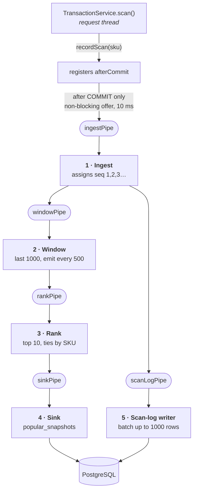

# Pipeline Architecture — Windowed Analytics

Week 3 refactors the **windowed analytics** of the self-checkout system into
**filters connected by pipes**. Checkout itself (start / scan / complete, row
locking, stock decrement) is unchanged — only the analytics path is pipelined.

---

## The graded description

> The system has a **5-stage pipeline**: **ingest** (numbers each committed scan
> with a gapless global sequence and tees it to two downstream pipes) →
> **window** (keeps the last 1000 scans in a ring buffer with running per-SKU
> counts, emitting a snapshot every 500 scans) → **rank** (turns those counts
> into the top 10, ties broken by SKU ascending, with item names attached) →
> **sink** (writes one `popular_snapshots` row per window), with **ingest** also
> teeing to **scan-log writer** (batches events and writes them to `scan_log` in
> a single multi-row INSERT). The pipes are implemented with bounded Java
> `ArrayBlockingQueue`s, one thread per filter.

---

## The filters

| # | Filter | Purpose | State it owns |
|---|---|---|---|
| 1 | **Ingest** | Assigns the global scan sequence (1, 2, 3 …) and tees each event to both downstream pipes. That sequence *is* the `windowStart`/`windowEnd` the API reports, and the `scan_log` primary key. | a `long` counter |
| 2 | **Window** | Ring buffer of the last 1000 SKUs plus a running `HashMap<sku,count>`, updated incrementally (add the new scan, evict the one falling out). Emits an immutable `WindowCounts` every 500 scans. | ring buffer + count map |
| 3 | **Rank** | Counts → top 10, ordered by count descending then SKU ascending, with catalog names attached (loaded lazily, once). | none |
| 4 | **Sink** | Inserts one `popular_snapshots` row per window. | none |
| 5 | **Scan-log writer** | Drains everything waiting (up to 1000 rows) and writes it as one multi-row `INSERT` into `scan_log`. | the current batch |

Each filter runs on **exactly one thread**, so no filter needs a lock: its state
is thread-confined, and every message passed between filters is an immutable
record.

## The pipes

Five bounded `ArrayBlockingQueue`s behind a small `Pipe<T>` interface
(`put`, `offer`, `poll`, `drainTo`, `poison`). The interface is the seam: an
in-process queue is the right transport for a single JVM, and swapping in a
message broker later means writing one more implementation without touching a
single filter.

| Pipe | Carries | Capacity |
|---|---|---|
| `ingestPipe` | `ScanEvent` | 65,536 |
| `windowPipe` | `SequencedScanEvent` | 65,536 |
| `scanLogPipe` | `SequencedScanEvent` | 65,536 |
| `rankPipe` | `WindowCounts` | 256 |
| `sinkPipe` | `RankedWindow` | 256 |

## Two kinds of backpressure, on purpose

This is the one asymmetry in the design and it is deliberate:

- **Between filters: blocking `put`.** If a downstream stage falls behind, the
  stage above it waits. Nothing is thrown away, and the backlog stays inside
  the pipeline.
- **At the request boundary: non-blocking `offer` with a 10 ms ceiling.** A
  request thread must never be made to wait on analytics. In Week 2 a failing
  analytics path could not affect checkout, and that stays true: if the ingest
  pipe were ever full, the event is counted as a drop, logged at WARN, and the
  scan completes normally.

Measured across both committed load runs: **0 drops, 0 full-pipe waits**, peak
`scanLogPipe` depth **238 of 65,536**.

## Correctness

1. **Only committed scans enter.** The handover is registered on
   `afterCommit`, so a rolled-back scan never reaches the pipeline.
2. **The sequence is gapless.** Only committed scans are numbered, one at a
   time, by one thread. Week 2 used a `BIGSERIAL`, which burns numbers on
   rollback — hence its `AtomicLong` "which boundary have I passed" logic. That
   is gone: the window filter can now test `seq % 500 == 0` directly.
3. **Identical window semantics to Week 2:** size 1000, slide 500, half-open
   `(start, end]`, top 10, ties by SKU ascending.
4. **A bad message never kills a stage.** Each loop catches per message, logs
   it with the event, counts it, and continues.
5. **Shutdown drains.** The front of the pipeline is poisoned and each stage
   finishes its backlog before poisoning the next; the writer flushes its last
   batch. Verified by killing the server mid-burst: 1200 scans sent, 1200 rows
   in `scan_log`, gapless, none lost.
6. **Duplicate windows fail loudly.** `popular_snapshots` has a `UNIQUE`
   constraint on `window_end`. One thread owns boundaries, so a duplicate could
   only be a bug — it is logged and counted, not silently ignored.

## The trade-off

`scan_log` is now written **asynchronously**. If the process were killed
hard (`SIGKILL`, power loss), up to one unflushed batch plus whatever sat in
the pipes would be lost. That is analytics data — checkout correctness is
untouched and still fully transactional, and stock can never be affected.

A graceful stop loses nothing (point 5 above). In this course every test run
starts from a freshly recreated database, so there is no recovery-on-restart to
implement; a production version would replay from a durable append-only log or
a broker with acknowledgements, which is exactly what the `Pipe` interface
leaves room for.
