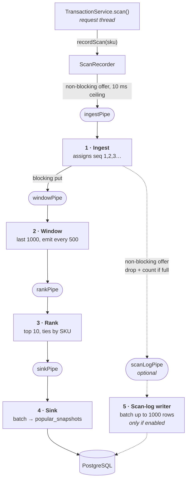

# Pipeline Architecture — Windowed Analytics

Week 3 refactors the **windowed analytics** of the self-checkout system into
**filters connected by pipes**. Checkout itself (start / scan / complete, row
locking, stock decrement) is unchanged — only the analytics path is pipelined.

> **Week 4 update.** The shape below is unchanged, but two things about the
> scan-log branch are: it is now **optional and off by default**
> (`selfcheckout.analytics.persist-raw-scans`), and the tee to it is
> **non-blocking**. Both are marked where they apply, and §"What Week 4
> changed" at the end explains why.

---

## The graded description

> The system has a **5-stage pipeline**: **ingest** (numbers each committed scan
> with a gapless global sequence and tees it to two downstream pipes) →
> **window** (keeps the last 1000 scans in a ring buffer with running per-SKU
> counts, emitting a snapshot every 500 scans) → **rank** (turns those counts
> into the top 10, ties broken by SKU ascending, with item names attached) →
> **sink** (writes computed windows to `popular_snapshots`), with **ingest** also
> teeing to **scan-log writer** (batches events and writes them to `scan_log` in
> a single multi-row INSERT). The pipes are implemented with bounded Java
> `ArrayBlockingQueue`s, one thread per filter.

---

## The filters

| # | Filter | Purpose | State it owns |
|---|---|---|---|
| 1 | **Ingest** | Assigns the global scan sequence (1, 2, 3 …) and tees each event to both downstream pipes. That sequence *is* the `windowStart`/`windowEnd` the API reports, and the `scan_log` primary key. | a `long` counter |
| 2 | **Window** | Ring buffer of the last 1000 SKUs plus a running `HashMap<sku,count>`, updated incrementally (add the new scan, evict the one falling out). Emits an immutable `WindowCounts` every 500 scans. | ring buffer + count map |
| 3 | **Rank** | Counts → top 10, ordered by count descending then SKU ascending, with catalog names attached (loaded lazily, once). | none |
| 4 | **Sink** | Drains everything waiting (up to 512 windows) and writes it as one multi-row `INSERT` into `popular_snapshots`. | the current batch |
| 5 | **Scan-log writer** | Drains everything waiting (up to 1000 rows) and writes it as one multi-row `INSERT` into `scan_log`. **Only exists when raw scan persistence is on.** | the current batch |

Each filter runs on **exactly one thread**, so no filter needs a lock: its state
is thread-confined, and every message passed between filters is an immutable
record.

## The pipes

Four bounded `ArrayBlockingQueue`s — five with the scan-log branch on —
behind a small `Pipe<T>` interface
(`put`, `offer`, `poll`, `drainTo`, `poison`). The interface is the seam: an
in-process queue is the right transport for a single JVM, and swapping in a
message broker later means writing one more implementation without touching a
single filter.

| Pipe | Carries | Capacity |
|---|---|---|
| `ingestPipe` | `ScanEvent` | 65,536 |
| `windowPipe` | `SequencedScanEvent` | 65,536 |
| `scanLogPipe` | `SequencedScanEvent` | 65,536 *(only when raw scans are on)* |
| `rankPipe` | `WindowCounts` | 4,096 |
| `sinkPipe` | `RankedWindow` | 4,096 |

## Two kinds of backpressure, on purpose

This is the one asymmetry in the design and it is deliberate:

- **Between filters: blocking `put`.** If a downstream stage falls behind, the
  stage above it waits. Nothing is thrown away, and the backlog stays inside
  the pipeline.
- **At the request boundary: non-blocking `offer` with a 10 ms ceiling.** A
  request thread must never be made to wait on analytics. In Week 2 a failing
  analytics path could not affect checkout, and that stays true: if the ingest
  pipe were ever full, the event is counted as a drop, logged at WARN, and the
  scan completes normally.
- **(Week 4) At the tee, into the scan-log branch: non-blocking `offer`.** The
  audit trail must not be able to starve the branch the API is served from.
  See below.

Measured on the Week 4 final stress run (100 stations, 120 s, 1,314,701
scans): **0 drops, 0 stage errors**, deepest pipe **39 of 65,536 (0.06 %)**,
`rankPipe` and `sinkPipe` never above **1 of 4,096**.

## Correctness

1. **Only committed scans enter.** The handover is registered on
   `afterCommit`, so a rolled-back scan never reaches the pipeline.
2. **The sequence is gapless.** Only committed scans are numbered, one at a
   time, by one thread. Week 2 used a `BIGSERIAL`, which burns numbers on
   rollback — hence its `AtomicLong` "which boundary have I passed" logic. That
   is gone: the window filter can now test `seq % 500 == 0` directly.
3. **Identical window semantics to Week 2:** size 1000, slide 500, half-open
   `(start, end]`, top 10, ties by SKU ascending.
4. **A bad message never kills a stage.** Each loop catches per message, logs
   it with the event, counts it, and continues.
5. **Shutdown drains.** The front of the pipeline is poisoned and each stage
   finishes its backlog before poisoning the next; the writer flushes its last
   batch. Verified by killing the server mid-burst: 1200 scans sent, 1200 rows
   in `scan_log`, gapless, none lost.
6. **Duplicate windows fail loudly.** `popular_snapshots` has a `UNIQUE`
   constraint on `window_end`. One thread owns boundaries, so a duplicate could
   only be a bug — it is logged and counted, not silently ignored. Batching
   does not weaken this: a batch is one statement, so a duplicate anywhere in
   it still fails the whole insert rather than being skipped.
7. **(Week 4) Dropping is visible.** Rows the scan-log branch could not accept
   are counted in `droppedRawScans` and logged at WARN, separately from
   `droppedAtIngress`. The two mean different things: the first is a hole in
   the audit trail, the second is a window event genuinely lost.

## The trade-off

`scan_log` is now written **asynchronously**. If the process were killed
hard (`SIGKILL`, power loss), up to one unflushed batch plus whatever sat in
the pipes would be lost. That is analytics data — checkout correctness is
untouched and still fully transactional, and stock can never be affected.

A graceful stop loses nothing (point 5 above). In this course every test run
starts from a freshly recreated database, so there is no recovery-on-restart to
implement; a production version would replay from a durable append-only log or
a broker with acknowledgements, which is exactly what the `Pipe` interface
leaves room for.

---

## What Week 4 changed, and why

Checkout got about 2.4× faster, which pushed the scan rate from ~3,600/s to
~10,900/s. The pipeline had been sized for the old rate and two stages buckled.

**1. The sink was the bottleneck, and it was waiting, not working.** With
one row per commit it managed ~18 windows/s against ~18 arriving; `sinkPipe`
filled (256/256, 1,299 full-waits) and the backlog pushed up to the window
stage. Timing the write in three parts showed where the time went:

| per window | before | after |
|---|---|---|
| waiting for a pooled connection | 66,480 µs | 11 µs |
| executing the `INSERT` | 230 µs | 204 µs |
| commit | 156 µs | 216 µs |

99.4 % of it was queueing behind checkout for a connection. Two fixes, for two
different problems: **batching** (shared with the scan-log writer as
`BatchingLoop`) removed the backpressure, and a **dedicated 2-connection pool**
removed the wait.

**2. The tee could starve the branch that matters.** Both branches used a
blocking `put`, so when the raw-scan writer saturated it stalled the shared
ingest thread — and the window branch with it. The two branches are not equally
important: losing a window loses an answer the API serves, while losing a
`scan_log` row loses an audit record. So they now behave differently, which is
the whole reason `IngestTee` is its own class with its own test.

**3. Raw scans are off by default.** The assignment requires the top-10 windows
in the database. Those are computed in memory from the event stream — the raw
rows are not an input to anything. At ~10,900 scans/s that was ~1.3 M inserts
per stress run for an audit trail nobody reads live. With the flag off the
stage does not exist: no pipe, no thread, no writer. Turning it on still works
and is still verified by `scripts/test-popular-window.py`, which cross-checks
the in-memory window against a raw SQL aggregate over `scan_log`.
