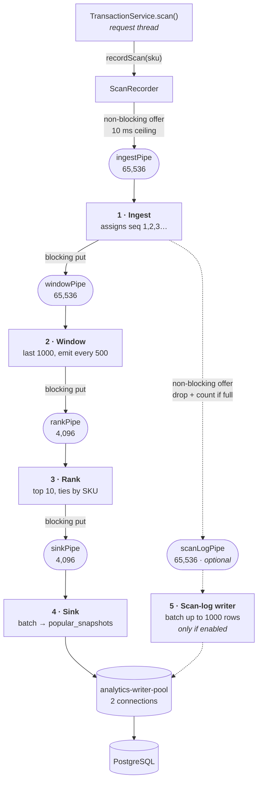

# Pipeline Architecture — Windowed Analytics

The **windowed analytics** of the self-checkout system are built as **filters
connected by pipes**. Checkout itself (start / scan / complete, row locking,
stock decrement) is not pipelined — it is a synchronous request/response path,
and section ["Beyond the pipeline"](#beyond-the-pipeline) explains what changed
there separately.

---

## The graded description

> The system has a **4-stage pipeline**: **ingest** (numbers each scan with a
> gapless global sequence) → **window** (keeps the last 1000 scans in a ring
> buffer with running per-SKU counts, emitting a snapshot every 500 scans) →
> **rank** (turns those counts into the top 10, ties broken by SKU ascending,
> with item names attached) → **sink** (batches computed windows and writes them
> to `popular_snapshots`). **Ingest** optionally also tees to a fifth filter, the
> **scan-log writer** (batches events and writes them to `scan_log` in a single
> multi-row INSERT), which is disabled by default. The pipes are implemented
> with bounded Java `ArrayBlockingQueue`s, one thread per filter.

The pipeline is **4 stages by default and 5 when raw scan persistence is turned
on**. Both are real configurations; the default is the one the submitted load
runs used.

---

## The filters

| # | Filter | Purpose | State it owns |
|---|---|---|---|
| 1 | **Ingest** | Assigns the global scan sequence (1, 2, 3 …) and tees each event downstream. That sequence *is* the `windowStart`/`windowEnd` the API reports, and the `scan_log` primary key. | a `long` counter |
| 2 | **Window** | Ring buffer of the last 1000 SKUs plus a running `HashMap<sku,count>`, updated incrementally (add the new scan, evict the one falling out). Emits an immutable `WindowCounts` every 500 scans. | ring buffer + count map |
| 3 | **Rank** | Counts → top 10, ordered by count descending then SKU ascending, with catalog names attached from the in-memory catalog. | none |
| 4 | **Sink** | Drains everything waiting (up to 512 windows) and writes it as one multi-row `INSERT` into `popular_snapshots`, on a dedicated connection. | the current batch |
| 5 | **Scan-log writer** | Drains everything waiting (up to 1000 rows) and writes it as one multi-row `INSERT` into `scan_log`. **Only exists when `persist-raw-scans` is on.** | the current batch |

Each filter runs on **exactly one thread**, so no filter needs a lock: its state
is thread-confined, and every message passed between filters is an immutable
record (`ScanEvent`, `SequencedScanEvent`, `WindowCounts`, `RankedWindow`).

The filters are plain classes with no threading in them. The thread half lives
in `FilterLoop` (one message at a time) or `BatchingLoop` (sweep up everything
queued, write it in one statement), which is why the filters unit-test without
Spring or a database.

## The pipes

Bounded `ArrayBlockingQueue`s behind a small `Pipe<T>` interface (`put`,
`offer`, `poll`, `drainTo`, `poison`, plus depth/`maxDepth`/`fullWaits`
counters). The interface is the seam: an in-process queue is the right
transport for a single JVM, and swapping in a message broker later means
writing one more implementation without touching a single filter.

| Pipe | Carries | Capacity | Overflow policy when full |
|---|---|---|---|
| `ingestPipe` | `ScanEvent` | 65,536 | **Non-blocking** — `offer` with a 10 ms ceiling, then drop + count + WARN. This is the request-thread boundary. |
| `windowPipe` | `SequencedScanEvent` | 65,536 | **Blocking** `put` — backpressure |
| `rankPipe` | `WindowCounts` | 4,096 | **Blocking** `put` — backpressure |
| `sinkPipe` | `RankedWindow` | 4,096 | **Blocking** `put` — backpressure |
| `scanLogPipe` | `SequencedScanEvent` | 65,536 | **Non-blocking** — `offer` with no wait, then drop + count + WARN. Only exists when raw scans are on. |



## Three kinds of handover, on purpose

The asymmetry is the design, not an accident:

- **Between filters: blocking `put`.** If a downstream stage falls behind, the
  stage above it waits. Nothing is thrown away and the backlog stays inside the
  pipeline.
- **At the request boundary: non-blocking `offer`, 10 ms ceiling.** A request
  thread must never be made to wait on analytics. If `ingestPipe` were ever
  full, the event is counted in `droppedAtIngress`, logged at WARN, and the scan
  completes normally.
- **At the tee into the scan-log branch: non-blocking `offer`, no wait.** The
  two branches are not equally important. Losing a window loses an answer the
  API serves; losing a `scan_log` row loses an audit record. When both branches
  blocked, a saturated raw-scan writer stalled the shared ingest thread — and
  the window branch with it. Drops here are counted separately, in
  `droppedRawScans`, because they mean something different.

## The `persist-raw-scans` flag

`selfcheckout.analytics.persist-raw-scans` — **default `false`**.

The assignment requires the top-10 windows to reach the database. Those are
computed in memory from the event stream; the raw `scan_log` rows are an audit
trail and not an input to anything. At the ~10,600 scans/sec this server now
reaches, writing them was ~1.27 M inserts per stress run.

- **Off (default):** the branch does not exist — no pipe, no thread, no writer.
  The pipeline is ingest → window → rank → sink.
- **On:** `scanLogPipe` and the scan-log writer thread are created and the tee
  starts feeding them, non-blocking as described above.

Turning it on still works and is still verified: `scripts/test-popular-window.py`
runs with the flag on and cross-checks each stored window against a brute-force
SQL aggregate over `scan_log` for the same `(start, end]` range.

```bash
java -Xmx1g -jar target/self-checkout-0.0.1-SNAPSHOT.jar \
  --selfcheckout.analytics.persist-raw-scans=true
```

## The batched sink and its own connection pool

The sink originally wrote one row per commit. That was fine until checkout got
faster and the scan rate roughly tripled: `sinkPipe` sat full at 256/256 with
1,299 full-waits, and the backlog pushed all the way up to the window stage.

"The sink is slow" is not a diagnosis, so `JdbcSnapshotWriter` was changed to
take a raw `Connection` and time the three costs apart:

| Per window write | shared pool | dedicated pool |
|---|---|---|
| waiting for a pooled connection | **66,480 µs** | 11 µs |
| executing the `INSERT` | 230 µs | 204 µs |
| commit | 156 µs | 216 µs |
| **total** | **66,866 µs** | **431 µs** |

**99.4 % of it was queueing, not working.** At 100 stations, checkout keeps the
main 32-connection pool saturated while it waits on item row locks, and the
sink was simply last in that queue. No amount of tuning the `INSERT` would have
touched it.

Two fixes, for two different problems:

1. **Batching** (`BatchingLoop`, shared with the scan-log writer) removed the
   *backpressure*. Draining everything queued into one multi-row `INSERT` means
   a backlog makes the next write cheaper per row, so falling behind is
   self-correcting. `sinkPipe` max depth went from 256/256 to **1/4096**.
2. **A dedicated 2-connection pool** (`AnalyticsWriterPool`) removed the *wait*
   — 155× per window. Two connections cover the two writer threads, and each
   holds its connection for well under a millisecond.

Honest footnote: the dedicated pool did **not** raise checkout throughput. The
sink only took a connection about 20 times a second, so checkout was never
really waiting on it. It is kept because it makes the analytics branch
independent of checkout pressure — the entire point of separating them — and
because with raw scans on the writer does ~1.27 M inserts instead of ~2,500.

## Correctness

1. **Only committed scans enter.** `ScanRecorder` defers to `afterCommit` when
   the caller has a transaction open, so a rolled-back caller never reaches the
   pipeline. Scanning no longer opens a transaction at all (the basket is in
   memory and the scan is already final), so that path submits directly.
2. **The sequence is gapless.** Events are numbered one at a time by one thread.
   A `BIGSERIAL` would burn numbers on rollback; this does not, so the window
   filter can test `seq % 500 == 0` directly.
3. **Window semantics unchanged:** size 1000, slide 500, half-open
   `(start, end]`, top 10, ties by SKU ascending.
4. **A bad message never kills a stage.** Each loop catches per message (or per
   batch), logs it with the event, counts it, and continues.
5. **Shutdown drains.** The front of the pipeline is poisoned and each stage
   finishes its backlog before poisoning the next; both batching writers flush
   their last batch before stopping.
6. **Duplicate windows fail loudly.** `popular_snapshots` has a `UNIQUE`
   constraint on `window_end`. One thread owns boundaries, so a duplicate could
   only be a bug. Batching does not weaken this: a batch is one statement, so a
   duplicate anywhere in it fails the whole insert rather than being skipped.
7. **Drops are visible, and the two kinds are distinct.** `droppedAtIngress`
   means a window event was genuinely lost; `droppedRawScans` means a hole in
   the audit trail. Both are logged at WARN and reported every 10 s.

## Measured pipeline metrics — the two submitted runs

Taken from the server's own 10-second metrics line, on the runs in
[`reports/`](reports/).

| | default (10 st, 60 s) | stress (100 st, 120 s) |
|---|---|---|
| scans ingested | 651,181 | 1,271,593 |
| windows emitted / ranked / written | 1,302 | 2,543 |
| `ingestPipe` max depth | 8 / 65,536 (0.01 %) | **39 / 65,536 (0.06 %)** |
| `windowPipe` max depth | 11 / 65,536 (0.02 %) | 39 / 65,536 (0.06 %) |
| `rankPipe` max depth | 1 / 4,096 | 1 / 4,096 |
| `sinkPipe` max depth | 1 / 4,096 | 1 / 4,096 |
| `droppedAtIngress` | **0** | **0** |
| `droppedRawScans` | **0** | **0** |
| stage errors | **0** | **0** |
| full-pipe waits | **0** | **0** |

**In == out at every filter:**

| stage | default in → out | stress in → out |
|---|---|---|
| ingest | 651,181 → 651,181 | 1,271,593 → 1,271,593 |
| window | 651,181 → 1,302 | 1,271,593 → 2,543 |
| rank | 1,302 → 1,302 | 2,543 → 2,543 |
| sink | 1,302 → 1,302 | 2,543 → 2,543 |

`window` is the one stage where in ≠ out by design — it aggregates, emitting one
window per 500 scans (1,271,593 / 500 = 2,543). Every window it emitted was
ranked, and every ranked window reached `popular_snapshots`. No pipe exceeded
0.06 % of its capacity, so nothing ever came close to backpressure.

## The trade-off

With `persist-raw-scans` on, `scan_log` is written **asynchronously**. A hard
kill (`SIGKILL`, power loss) would lose up to one unflushed batch plus whatever
sat in the pipes. That is analytics data — checkout correctness is untouched and
still fully transactional, and stock can never be affected. A graceful stop
loses nothing (correctness point 5).

In this course every test run starts from a freshly recreated database, so there
is no recovery-on-restart to implement. A production version would replay from a
durable append-only log or a broker with acknowledgements — which is exactly
what the `Pipe` interface leaves room for.

## Why not RabbitMQ or Kafka here

Everything runs in one JVM, so a network broker would add a round trip to every
scan event to solve a problem this system does not have. The value a broker adds
is durability across process death and fan-out to other consumers; neither is
required by the assignment. `Pipe<T>` exists precisely so that decision can be
revisited by writing one more implementation, without touching a filter.

---

## Beyond the pipeline

The load-test numbers in [`reports/`](reports/) are substantially higher than
the earlier `pipeline-v1` tag, and the pipeline is **not** the reason. The
pipeline work removed the per-scan `scan_log` INSERT from the request path; a
separate round of performance work then went after the checkout path itself.
Listing it here so the numbers are not mistaken for a pipeline result.

| Change | What it did |
|---|---|
| **Scan/complete race fix** | `scan()` and `complete()` now serialize on the same basket. Previously a scan that lost the race wrote a stale `OPEN` status back over a basket that had already been paid for — 199 of 200 paid baskets reverted in a reproducer. A correctness fix, measured as free. |
| **Catalog cached in memory** | The 2,000-row catalog is immutable, so it is read once. `GET /items` and every scan's price lookup now issue no SQL. |
| **Open baskets in memory** | An unpaid basket is no longer a database row. `start` went from 4 statements to **0**, `scan` from 7–8 to **0**. The database only ever sees baskets that were actually paid for. |
| **Lock late, batch the checkout** | One bulk `SELECT … WHERE sku IN (…) ORDER BY sku FOR NO KEY UPDATE` for the whole basket, then bulk `UPDATE`/`INSERT`s, instead of Hibernate's per-row merge-then-write. `complete` went from `3L + 5` ≈ 33 statements to **6**, constant in basket size, with **3** held under the item lock instead of ~30. |

| | `pipeline-v1` | this branch |
|---|---|---|
| tx/s, 10 stations | 342.3 | **1031.8** |
| tx/s, 100 stations | 361.2 | **1007.8** |
| `SCAN` p50, 10 st | 1.077 ms | **0.094 ms** |
| `SCAN` p50, 100 st | 15.408 ms | **0.101 ms** |
| `COMPLETE` p50, 10 st | 17.246 ms | **4.437 ms** |
| `COMPLETE` p50, 100 st | 113.213 ms | **76.510 ms** |
| errors | 0 | **0** |
| stock invariant | PASS | **PASS** |

**One caveat on that comparison, stated rather than buried.** The `pipeline-v1`
reports were produced with `./mvnw spring-boot:run`, which starts the JVM with
`-XX:TieredStopAtLevel=1` and caps the JIT at C1. Measured on the *same*
commit, switching to the packaged jar alone was worth about +20 % (353 → 425
tx/s). So roughly a fifth of the gap in the first two rows is the launcher, not
the code. Every number in the right-hand column, and every before/after
comparison in `perf-results.md`, uses the packaged jar on both sides. The
submitted `pipeline-v1` reports have not been re-run or altered.

Checkout behaviour is unchanged where it is observable: a 28-response golden
diff against the pre-performance build is byte-for-byte identical, and all five
behavioural scripts in `scripts/` pass, including the stock invariant after
every run.

Full detail — every change, what it measured before and after, the ones that
were tried and reverted, and the measurement caveats — is in
**[perf-results.md](perf-results.md)** and **[ARCHITECTURE.md](ARCHITECTURE.md) §7**.
