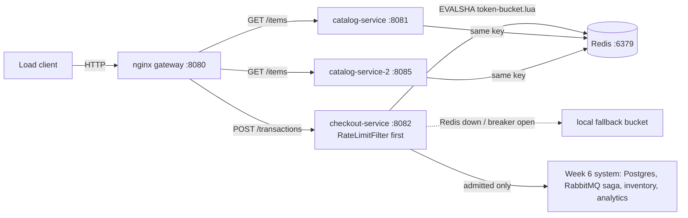
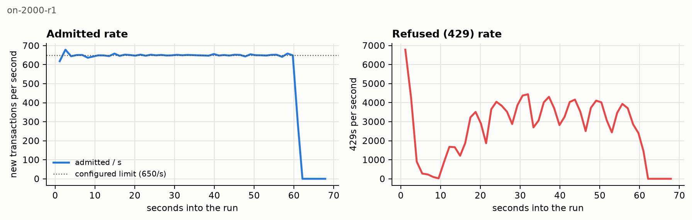
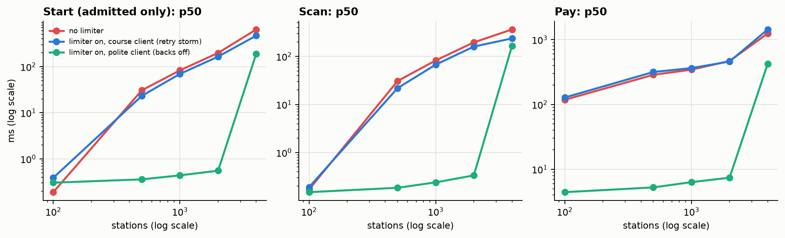

# Rate limiter

This adds a server-side rate limiter to the Week 6 event-driven version of the self-checkout
system. It is a token bucket kept in Redis, so every instance of a service shares one limit,
and it falls back to a local bucket if Redis goes away, so losing Redis never takes the
system down with it.

[](docs/diagrams/rate-limiter.png)

The interactive version is [docs/diagrams/interactive/rate-limiter.html](docs/diagrams/interactive/rate-limiter.html).
If the image doesn't render, here is the same picture in Mermaid:



## What is limited, and why only that

By default exactly one thing is limited: **`POST /transactions` (starting a new
transaction) on checkout-service, 650 per second, burst 50, one global bucket.**
Scans, `complete` and every read go through untouched. Catalog-service has a second rule
(`GET /items`, 100/s, burst 20), which is there for the distributed demo with two catalog
instances; the load client only calls `GET /items` once at start-up, so it never matters in
a load run.

I limit the *start* of a transaction and nothing after it, for two reasons:

1. **Wasted work.** A customer who has started a basket has already cost us a row and some
   scans. Refusing their `complete` halfway through throws that work away and makes them
   start over. Refusing at the door costs almost nothing, and everyone who gets in can
   finish.
2. **The basket leak.** Checkout never expires an open basket, and the course load client
   abandons its basket on *any* non-2xx answer and starts a new one. So a 429 on a scan or
   on `complete` would leave an open transaction behind forever, and under a retry storm
   that is thousands of leaked baskets a second. A 429 on `POST /transactions` happens
   before any basket exists, so nothing leaks.

## How a request is checked

The check is a servlet filter registered with the highest precedence, so it runs before
Spring MVC, before the request body is read and before any controller or database code.
A refused request costs one Redis call (or none, see the deny cache) and a short JSON answer.

For a request that matches a rule:

1. **Deny cache.** If this process was told less than a few milliseconds ago that the bucket
   is empty until time T, and it is not T yet, answer 429 without asking Redis.
2. **Redis.** Otherwise run the token-bucket script ([`token-bucket.lua`](rate-limit/src/main/resources/ratelimit/token-bucket.lua))
   with one `EVALSHA`. Redis runs a script atomically, so two instances can never both take
   the last token. The script refills the bucket for the time that has passed (using Redis's
   own clock, so instance clocks don't matter), takes a token if there is one, and returns
   allowed / tokens left / time until the next token / time until full.
3. **Local fallback.** If Redis is down (the call failed or the circuit breaker is open), use
   a token bucket in this process's memory instead, at `rate / fallback-instances`.

Anything that goes wrong inside the limiter itself (a bad rule, an unexpected exception) lets
the request through and logs an error. The limiter can refuse a request with 429, but it can
never cause a 5xx on its own.

### Memory

The bucket is a Redis hash with two fields (`t` tokens, `ts` last update), and it expires
one second after it would be full again. A full bucket and a missing key mean the same
thing, so nothing is lost when it expires, and Redis only holds keys that are in use. With
the default global keys that is one key per rule. With `key=client-ip` it is one key per
active client IP, each gone a few seconds after that client goes quiet.

### The deny cache: a small accuracy trade-off

When Redis says "empty, the next token is in 1.5 ms", the process remembers that for 1.5 ms
and refuses locally. Under a retry storm that saves most Redis calls (78 to 91% of refusals
never reached Redis in my runs). The cost is a little accuracy: for those 1.5 ms this process can't see a
token that another instance's refusal didn't take, and with more than one instance the
bucket could sit full-ish for a moment longer. It errs on the side of admitting *fewer*, never
more, and the results below show the admitted rate still lands on the configured rate.

### What a throttled client gets

```
HTTP/1.1 429
Content-Type: application/json
Content-Length: 135
X-RateLimit-Limit: 650
X-RateLimit-Remaining: 0
X-RateLimit-Reset: 1
Retry-After: 1
X-RateLimit-Retry-After-Ms: 1

{"error":"RATE_LIMITED","message":"Too many requests for POST /transactions: the limit is 650 per second (burst 50). Retry after 1 s."}
```

(That is the real answer from `curl -i` in demo step 4, through the gateway.)

Admitted requests get the same three `X-RateLimit-*` headers on their normal answer, and
nothing else changes: an admitted request's status, headers defined by the API and body are
exactly what the OpenAPI spec says (checked with the golden diff, which is identical).

**`Retry-After` is in whole seconds**, because that is all the standard (RFC 9110) allows.
At 650 tokens a second the real wait is about 1.5 ms, so `Retry-After: 1` overstates it by
several hundred times. A client that obeys it exactly leaves capacity unused: in Phase 3 my
polite client used only 484 of 550 tokens a second.

**`X-RateLimit-Retry-After-Ms` is non-standard.** It is my own header, carrying the same
"earliest moment trying again can work" in milliseconds. Standard clients ignore it and use
`Retry-After`, so adding it breaks nobody. I kept the name in the same family as the
`X-RateLimit-*` headers that many APIs use.

There is a catch I only found under load, described in the results: with one global bucket,
"the next token exists in 2 ms" is true, but it is true for *one* waiting client. A client
that sleeps exactly that long comes back together with every other waiting client. The
header is a lower bound, not an appointment, and a well-behaved client should back off on
top of it.

## Where the code is

Everything is in one shared module, [`rate-limit/`](rate-limit/), which checkout-service and
catalog-service depend on:

- [`ratelimit/`](rate-limit/src/main/java/com/selfcheckout/self_checkout/ratelimit/): the limiter
  itself, with no HTTP in it: `RateLimiter` (deny cache, Redis, fallback), `RedisTokenBucket` and the
  Lua script, `LocalTokenBucket`, `CircuitBreaker`, the properties and the Redis client settings.
- [`api/ratelimit/`](rate-limit/src/main/java/com/selfcheckout/self_checkout/api/ratelimit/): the
  HTTP side: `RateLimitFilter` (headers and the 429), its registration as the first filter, and the
  internal stats / on-off endpoints. It lives in the API layer because the services' ArchUnit rules
  only let the API layer touch HTTP types.

36 unit tests cover it, including Redis tests against a real Redis (database 15): exact burst,
refill, two connections sharing one bucket, and 2,000 concurrent calls taking exactly 100 tokens.

## Fault tolerance

Redis is a dependency the limiter can lose, and losing it must not hurt the system.

- **Short timeouts.** Commands time out after 20 ms (a normal check takes well under 1 ms)
  and connecting times out after 100 ms.
- **Fail fast while disconnected.** Lettuce is set to reject commands while it has no
  connection, instead of queueing them until it reconnects.
- **Circuit breaker.** After 5 failures in a row the breaker opens and the limiter stops
  calling Redis for 1 second; then one probe call goes through, and if it works the breaker
  closes again.
- **Local fallback.** While Redis is unusable each process limits on its own at
  `rate / fallback-instances`. With `fallback-instances` set to the number of instances, the
  total stays close to the shared limit. The system keeps limiting; it just isn't shared for
  that moment.
- **Fast reconnect.** Lettuce reconnects every 500 ms (its default backs off exponentially,
  which made recovery take about 7 s); the shared limit is back about a second after Redis is.

The limiter logs one line per state change:

```
ratelimit | redis=DOWN (RedisException: Connection disconnected) -> local fallback, each process allows rate / 1 on its own; retrying Redis every 1000 ms
ratelimit | redis=UP again -> shared limit restored
```

## Configuration

Everything is in each service's `application.properties` under `ratelimit.*`:

| Property | Default | Meaning |
|---|---|---|
| `ratelimit.enabled` | `true` | master switch (also switchable live, see below) |
| `ratelimit.rules[i].name` | | names the Redis key `rl:<name>:<key>` |
| `ratelimit.rules[i].method`, `.path` | | exact match on method and path |
| `ratelimit.rules[i].key` | `global` | `global` (one bucket) or `client-ip` (one per `X-Real-IP`) |
| `ratelimit.rules[i].rate-per-second` | | refill rate, may be fractional |
| `ratelimit.rules[i].burst` | | bucket size |
| `ratelimit.fallback-instances` | `1` | divide the limit by this while Redis is down |
| `ratelimit.breaker-failure-threshold` | `5` | failures in a row that open the breaker |
| `ratelimit.breaker-open-for` | `1s` | how long it stays open |
| `ratelimit.deny-cache` | `true` | the deny cache described above |
| `ratelimit.log-interval` | `5s` | how often the summary line is logged |
| `spring.data.redis.timeout` | `20ms` | command timeout |

A rule with a missing field is skipped with an ERROR in the log rather than failing requests.

One Spring Boot detail cost me a bug: overriding `--ratelimit.rules[0].rate-per-second=…` on
the command line *replaces the whole list*, leaving a rule with only a rate. So checkout's rate
is a placeholder, `${checkout.new-transactions-rate:650}`, and scripts change it with
`--checkout.new-transactions-rate=N` (or `start-all.sh --checkout-rate=N`).

Each instance has two internal endpoints (not reachable through the gateway, which answers
404 for `/internal/**`):

- `GET /internal/ratelimit/stats`: counters, Redis status, and check-latency percentiles.
- `POST /internal/ratelimit/enabled?value=true|false`: switches the limiter live, used by the demo.

Every 5 seconds each instance logs a line like:

```
ratelimit | rule=new-transactions key=global allowed=3250 rejected=26355 (no Redis call: 23171) fallback=0 redis=UP check p50<=1us p99<=1000us | last 5s
```

## Why 650 per second

Without the limiter this laptop completes about 694 transactions a second at 2,000 stations
(two runs: 678 and 709) and around 710 to 740 at lighter loads. I set the limit a little under
that, at 650, so the limiter is the thing that says no before the services start queueing.

I also tried 550 at 2,000 stations. It didn't make admitted customers any faster, because the
course client retries every 429 at once: at 550 it made 8,391 refusals a second against 3,278 at
650, for less throughput (542 against 631 tx/s). A lower limit just made the retry storm bigger.
Those two runs are in [reports/rate-limiter/phase4/explore](reports/rate-limiter/phase4/explore).

The burst is 50, so a quiet system can take a short spike without refusing anyone.

## Results

Every measured run used the packaged jars, 60 seconds of load, the Mac on the charger with at least
10 GB free and a 1-minute load below 3 before starting (the harness waits for that and records it).
Each configuration ran twice, interleaved, and the numbers below are averages of the two. The
runs, the per-second samples and the limiter logs are all in
[reports/rate-limiter/](reports/rate-limiter/), made by
[scripts/ratelimit-bench/](scripts/ratelimit-bench/). The invariant check passed after every run.

Three clients are compared:

- **no limiter**: the course load client, limiter off.
- **limiter, course client**: the course load client with the limiter on. It retries every 429
  immediately and ignores `Retry-After`, so each refusal turns straight into another request.
- **limiter, polite client**: my [RateLimitClient.java](scripts/demo/RateLimitClient.java),
  which does the same checkout work but waits after a 429 (at least the ms hint, plus backoff).

### Accuracy

The admitted rate lands on the configured rate. With the limit at 650/s:

| Stations | Course client: admitted/s | Polite client: admitted/s |
|---|---|---|
| 100 | 621 | 644 |
| 500 | 636 | 646 |
| 1,000 | 639 | 652 |
| 2,000 | 648 | 655 |

The course client at 100 stations doesn't quite reach 650 because there aren't enough stations
asking at any moment, not because the limiter refuses too much. Second by second the admitted rate
is flat on the limit, even while 3,000 to 4,000 requests a second are being refused:



Over 2,000 stations about 78% of refusals were answered from the deny cache without asking Redis,
and the admitted rate still matched the limit, so the deny cache's accuracy cost doesn't show up.

**Distributed:** two catalog instances with one shared 100/s rule admitted 2,029 requests in
20 seconds (1,026 + 1,003), against an expected 2,020 (100/s plus the burst of 20). Limiting on
their own, they would have admitted about 4,000.

### Do admitted customers stay fast?

This is the honest part. **During the course client's retry storm, admitted customers are not
faster than with no limiter at all.** Time to pay (the `complete` call), in ms:

| Stations | No limiter p50 / p99 | Limiter, course client p50 / p99 | Limiter, polite client p50 / p99 |
|---|---|---|---|
| 100 | 118 / 397 | 128 / 435 | **4** / 243 |
| 500 | 287 / 639 | 317 / 674 | **5** / 558 |
| 1,000 | 344 / 710 | 364 / 782 | **6** / 609 |
| 2,000 | 468 / 865 | 460 / 887 | **7** / 726 |



Why: the course client is a closed loop. Each station always has exactly one request outstanding,
and a refusal comes back in under a millisecond, so the station is straight back in the queue. With
2,000 stations there are always about 2,000 requests waiting to be served, limiter or not
(Little's law: requests in the system = arrival rate x time in the system). The limiter caps how
many *transactions* are started, but it can't shorten the queue that admitted requests wait in,
because the refused stations are standing in the same queue a millisecond later. Checkout spends
its time accepting connections and writing 429s.

With the polite client the same limiter, same rate and same load give a pay p50 of 4 to 7 ms. The
refused stations go away for a while, the queue is short, and admitted customers are fast. So the
limiter does its job; whether admitted customers feel it depends on whether the clients respect the
429.

The p99s are much closer together than the p50s. The polite client's p99 is the payment saga itself
(the stock commit through RabbitMQ and inventory), which a rate limiter doesn't change.

### The ms hint and the thundering herd

My first polite client slept exactly `X-RateLimit-Retry-After-Ms` after each 429. With one global
bucket that hint is about 2 ms ("the next token exists in 2 ms"), so every waiting station came back
at once, every 2 ms. At 500 to 2,000 stations that was around 15,000 requests a second, nginx ran out
of local ports to reach checkout, and throughput fell to 230 to 415 tx/s with 100,000 to 190,000
gateway errors per run. Those runs are kept in
[reports/rate-limiter/phase4/polite-exact-wait](reports/rate-limiter/phase4/polite-exact-wait).

The hint is true, but only for one of the waiting clients. The client now treats it as a minimum
and adds exponential backoff with random jitter on top (a 50 ms window that doubles on every 429 in
a row, capped at 2 s, reset after an admitted request). That is the version in the tables above.
`--wait=exact` still runs the old behaviour, to show the herd.

### When the system really breaks: 4,000 stations

At 4,000 stations the system collapses, and the limiter only rescues it when the clients back off:

| 4,000 stations | Run 1 tx/s | Run 2 tx/s | Failed requests per run (5xx + no answer) |
|---|---|---|---|
| No limiter | 22.8 | 26.1 | about 195,000 |
| Limiter, course client | 9.4 | 10.9 | about 166,000 |
| Limiter, polite client | 280 | 155 | 0 failed transactions (about 128,000 retried gateway errors) |

The collapse happens at the connection level, before requests reach the limiter:

- **Tomcat's accept backlog overflows.** nginx logs "Connection reset by peer" while connecting to
  checkout, and "4096 worker_connections are not enough". A refused connection never gets as far as
  the servlet filter, so the limiter can't refuse it cheaply; it is simply dropped.
- **nginx runs out of ephemeral ports.** With thousands of concurrent requests, nginx opens more
  upstream connections than its keepalive pool holds and closes the extras, which then sit in
  TIME_WAIT for 30 s. There are only about 16,000 local ports, so connects start failing with
  "Can't assign requested address".
- **The course client's instant retries make it worse.** Every failure or 429 is a new request at
  once, so the flood never eases. With the limiter on it was actually worse than off. My reading is
  that a 429 comes back so fast that the station is back even sooner, so the flood is denser.

The polite client backs off, so the flood eases and checkout gets to serve real customers: 155 to
280 tx/s and no failed transaction. The two runs varied a lot (280 against 155) because how far the
system recovers depends on how the backoffs happen to line up with the port exhaustion; I'm giving
both rather than picking the better one.

The same port limit shows up in a smaller way at 500 to 2,000 stations: a few dozen 502s in the
first second while 2,000 stations connect at once, with or without the limiter.

### Fault tolerance: Redis down under load

With 300 polite stations and Redis stopped for 10 seconds in the middle (demo step 6, at 650/s):

- the admitted rate stayed at 652 to 672 per second the whole time, now decided by the local
  fallback;
- the client saw 0 errors, only 201s and 429s;
- the limiter logged `redis=DOWN` within about 2 seconds, and `redis=UP again` 2 seconds after Redis
  came back;
- the invariant check passed afterwards.

In Phase 3 the same test against the course client held the limit at exactly the configured rate
in every 5-second interval while Redis was down (2,795 / 2,752 / 2,750 per 5 s at 550/s), with only
429s as errors.

### Cost: latency, memory, CPU

**When nothing is refused** (limit raised to 100,000/s so every request pays for the Redis check):

| Stations | | tx/s | Start p50 | Start p99 | Check p99 (typical 5 s interval) | checkout CPU |
|---|---|---|---|---|---|---|
| 100 | limiter off | 736 | 0.20 ms | 0.61 ms | | 116% |
| 100 | limiter on | 697 | 0.36 ms | 1.44 ms | 0.5 ms or less | 124% |
| 500 | limiter off | 712 | 31.6 ms | 109 ms | | 105% |
| 500 | limiter on | 714 | 31.9 ms | 82 ms | 1 ms or less | 121% |

The check adds about 0.16 ms to the median `POST /transactions` and under 1 ms to its p99. At 100
stations throughput came out about 5% lower with the limiter, but the two runs *without* it differed
by the same amount (755 and 718), and at 500 stations there was no difference, so I read it as noise
more than cost. It does cost CPU: about 8 to 16 percentage points of one core in checkout. In the
first seconds of a 500-station run a few checks hit the 20 ms Redis timeout while 500 connections
started at once; the local fallback decided those, so nothing was refused.

**Memory:**
- Redis: one bucket is a 2-field hash, 79 bytes by `MEMORY USAGE`, about 124 bytes counting Redis's
  own overhead (measured with 10,000 keys). The default rules use 2 keys in total. Redis's memory
  stayed at 2 MB through every run.
- An idle key expires about a second after its bucket refills, so `key=client-ip` would cost about
  124 bytes per client that was active in the last second or two.
- In each JVM: one entry per bucket in the deny cache and in the fallback map (each capped at
  10,000 keys, cleared if exceeded), a histogram of a few dozen counters, and the breaker's state.
  checkout's RSS was the same with and without the limiter within run-to-run noise (430 to 530 MB).
- Redis's CPU under the heaviest storm was about 5% of one core.

## What I'd add next

**A connection limit at the edge, in front of the application-level limiter.** The 4,000-station
runs show the gap: my limiter lives inside checkout, so it can only refuse a request that has already
been accepted on a connection. When the flood is big enough to exhaust connections and ports, the
damage happens before the limiter is reached. An edge limit at the gateway or load balancer (nginx
`limit_conn` and `limit_req`, or the load balancer's own connection cap) would turn the excess away
at the first hop, cheaply, and leave the application limiter to do the fine-grained, shared,
per-rule work it already does well. I would keep both: the edge protects the machine, the app limiter
protects the business logic.

Smaller things:
- Per-client keys (`key=client-ip`) with a real client population. The load client sends every
  station from one address, so in these tests `global` and `client-ip` behave the same.
- A `Retry-After-Ms` that spreads clients out by itself, for example the hint multiplied by the
  number of clients recently refused, so a client that sleeps exactly the hint doesn't cause a herd.
- Exporting the limiter's counters to a metrics system instead of a log line and an internal endpoint.
