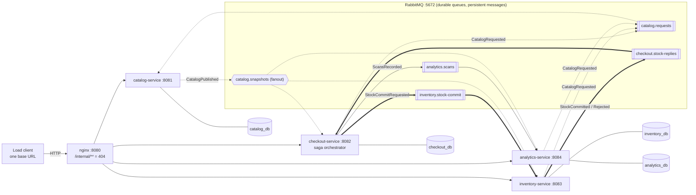

# Self-Checkout System — Event-Driven Microservices

A backend for a supermarket self-checkout: customers start a transaction at a station, scan
items one unit at a time, then pay. Stock is decremented at payment, low-stock alerts are
recorded as they happen, and item popularity is tracked over a hopping window. The same
system is rebuilt each week in a different architecture style against one unchanged API
contract (`CS6510-2026/spec/self-checkout-openapi.yaml`).

**This branch is Week 6: event-based architecture.** The four microservices from Week 5 each
keep their own database, but they no longer call each other over HTTP: **all cross-service
communication is events through a RabbitMQ broker.** Spring Boot 4.1.1, Spring AMQP 4.1.1,
RabbitMQ 4.4.0, Java 21, PostgreSQL 16, nginx.

> ## Week 6 submission
>
> - **Load-test reports** in [`reports/`](reports/):
>   - [`report-default-10stations-60s.json`](reports/report-default-10stations-60s.json): 10 stations, 60 s, **667.2 tx/s, 0 errors**
>   - [`report-stress-100stations-120s.json`](reports/report-stress-100stations-120s.json): 100 stations, 120 s, **653.6 tx/s, 0 errors**
> - **Architecture diagram (microservices + event broker):** [`docs/diagrams/architecture-events.svg`](docs/diagrams/architecture-events.svg), shown [below](#architecture)
> - **The broker, the events and the saga over events:** [EVENTS.md](EVENTS.md)
> - Every raw run, check output and failure test is in [`docs/perf/week6-raw/`](docs/perf/week6-raw/).

---

## Architecture

[![Load client to the nginx gateway on :8080, which routes to four services: catalog :8081, inventory :8083, checkout :8082 and analytics :8084, each with its own database. Inside RabbitMQ :5672: checkout publishes StockCommitRequested to the inventory.stock-commit queue, consumed by inventory; inventory publishes StockCommitted or StockCommitRejected to checkout.stock-replies, consumed by checkout; checkout publishes ScansRecorded to analytics.scans, consumed by analytics. At startup, inventory, checkout and analytics send CatalogRequested to catalog.requests, consumed by catalog, which publishes CatalogPublished on the catalog.snapshots fanout exchange to all three.](docs/diagrams/architecture-events.svg)](docs/diagrams/architecture-events.png)

<details>
<summary>Text version (Mermaid), if the image does not load</summary>



</details>

Interactive versions for local viewing are in [`docs/diagrams/interactive/`](docs/diagrams/interactive/); click an image for its high-resolution PNG.

---

## The services, their data stores, and the broker

| Service | Business function | Public endpoints (via :8080) | Port | Own database | Publishes | Consumes |
|---|---|---|---|---|---|---|
| **catalog-service** | What the store sells | `GET /items` | 8081 | `catalog_db` | `CatalogPublished` | `CatalogRequested` |
| **checkout-service** | Running a sale; orchestrates payment | `POST /transactions`<br>`POST /transactions/{id}/items`<br>`POST /transactions/{id}/complete`<br>`GET /transactions/{id}` | 8082 | `checkout_db` | `StockCommitRequested`, `ScansRecorded`, `CatalogRequested` | `StockCommitted` / `StockCommitRejected`, `CatalogPublished` |
| **inventory-service** | Stock and low-stock alerts | `GET /inventory/low-stock` | 8083 | `inventory_db` | `StockCommitted` / `StockCommitRejected`, `CatalogRequested` | `StockCommitRequested`, `CatalogPublished` |
| **analytics-service** | Top 10 of the last 1,000 scans, every 500 | `GET /analytics/popular-items` | 8084 | `analytics_db` | `CatalogRequested` | `ScansRecorded`, `CatalogPublished` |
| *RabbitMQ* | The event broker | — | 5672 | — | — | — |
| *gateway (nginx)* | Routing only | all of the above | 8080 | — | — | — |

**No service can read another's data, and no service calls another.**
- **Databases:** `db/reset.sh` creates the four databases on one PostgreSQL server, and each
  can be opened by **one role only**.
- **Everything else is an event through RabbitMQ:**

  | Data | Event | Queue / exchange |
  |---|---|---|
  | **Prices and names** | `CatalogRequested`, answered by `CatalogPublished` | `catalog.requests` → `catalog.snapshots` (fanout) |
  | **Stock** | `StockCommitRequested`, answered by `StockCommitted` | `inventory.stock-commit` → `checkout.stock-replies` |
  | **Scans** | `ScansRecorded` batches | `analytics.scans` |

- **Proof:** [`scripts/check-connections.sh`](scripts/check-connections.sh) shows each
  service's TCP connections going only to its own database (`:5432`) and the broker (`:5672`).
- **No internal endpoints:** the `/internal/**` endpoints of Week 5 are gone, and nginx still
  answers 404 for that path.

---

## Paying: a saga over events

[![Sequence: the station calls complete; checkout writes the sale as PENDING (tx A), publishes StockCommitRequested to RabbitMQ and gets a publisher confirm. RabbitMQ delivers it to inventory, which claims the transaction id, locks the rows, clamps and decrements, records the lines and low-stock alerts and commits, publishes StockCommitted to checkout.stock-replies, and only then acks the request. The reply reaches checkout, matched by transaction id; checkout records tx B (COMPLETED) and returns the receipt, or 503 if the request was not queued or no reply came.](docs/diagrams/flow-payment-saga-events.svg)](docs/diagrams/flow-payment-saga-events.png)

`complete` must still return the receipt in the same HTTP response, so checkout
**orchestrates** the saga and waits for inventory's answer:

1. **Claim the basket in memory** (OPEN → COMPLETING), then **tx A** saves the sale as
   PENDING in `checkout_db`.
2. **Publish `StockCommitRequested`** (persistent, publisher-confirmed) and wait for the reply,
   matched by transaction id.
3. **Inventory** runs the same idempotent transaction as Week 5:
   1. claim the transaction id;
   2. lock the basket's rows in SKU order;
   3. clamp to what is in stock, then decrement;
   4. record the lines and any low-stock alerts;
   5. commit.

   It then publishes `StockCommitted`, and **acks the request only after both**.
4. **Tx B** records what inventory took and marks the sale COMPLETED; checkout returns the
   receipt.

**What keeps it correct:**
- **At-least-once delivery and idempotent consumers:**
  - a redelivered request is answered from inventory's stored commit, so no stock is taken twice;
  - a reply nobody is waiting for is counted and dropped;
  - tx B only changes a sale that is still PENDING.
- **No outbox needed:** if inventory crashes between its commit and its ack, the broker
  redelivers the request, and the stored commit answers it.
- **Forward recovery:** on restart, checkout re-sends the request for every PENDING sale.

**When something is down:**

| Situation | Client gets | Then |
|---|---|---|
| the broker is unreachable, or refuses the message (certainly not queued) | **503** + `Retry-After: 1` | the basket is open again and stock is untouched; pay again |
| no publisher confirm in time, or no reply (e.g. inventory down) | **503** after about 3–5 s | the request may be, or is, in a durable queue, so the basket stays closed and a retry gets **409**. The sale **completes in the background** once inventory processes it, and `GET /transactions/{id}` shows COMPLETED. |

All of these are tested in [`scripts/test-failures.sh`](scripts/test-failures.sh). The
results are in [`docs/perf/week6-raw/failure-tests.txt`](docs/perf/week6-raw/failure-tests.txt):
- the broker stopped under load;
- inventory down;
- checkout crashing between inventory's commit and tx B;
- analytics down under load;
- duplicated messages;
- a publisher-confirm timeout.

<details>
<summary>Text version (Mermaid)</summary>

```mermaid
sequenceDiagram
    autonumber
    participant S as Station (via nginx)
    participant C as checkout-service
    participant CD as checkout_db
    participant Q as RabbitMQ
    participant I as inventory-service
    participant ID as inventory_db
    S->>C: POST /transactions/{id}/complete
    C->>C: claim basket OPEN -> COMPLETING (memory)
    C->>CD: tx A: INSERT transactions (PENDING) + transaction_items
    C->>Q: StockCommitRequested -> inventory.stock-commit (persistent)
    Q-->>C: publisher confirm
    Q->>I: deliver (one of 32 consumers)
    I->>ID: claim id, lock in SKU order, clamp, decrement, record lines + alerts, COMMIT
    I->>Q: StockCommitted -> checkout.stock-replies (confirmed)
    I-->>Q: ack the request (only now)
    Q->>C: deliver the reply; completes the waiting future
    C->>CD: tx B: applied_quantity, status COMPLETED
    C-->>S: 200 receipt
```

</details>

---

## Scans to analytics over events

[](docs/diagrams/flow-scan-events.png)

1. **A scan never waits on analytics or the broker.** It only offers its SKU to a bounded
   queue inside checkout (at most 10 ms); if the queue is full, the scan is dropped and counted.
2. **One writer thread batches the scans** (up to 1,000 or 50 ms). It publishes each batch as
   `ScansRecorded` with a fixed **batchId**, re-sends the same batch until the broker confirms
   it, and only then builds the next one.
3. **Analytics has one consumer and numbers the scans as it stores them,** in one
   transaction: numbering lock, `next = MAX(seq) + 1`, claim the batchId, insert, commit, ack.
   - **Gapless:** only that transaction assigns numbers.
   - **No duplicates:** a redelivered batch hits the batchId and is skipped.
   - **In order:** one consumer.
4. From `scan_log` on, the Week 3 window → rank → sink pipeline is unchanged.

**If analytics or the broker is down,** checkout keeps serving. Scan batches wait in the
`analytics.scans` queue (or in checkout's own queue), and analytics catches up when it returns.

<details>
<summary>Text version (Mermaid)</summary>

```mermaid
sequenceDiagram
    autonumber
    participant S as Station
    participant C as checkout-service
    participant W as queue + writer thread (checkout)
    participant Q as RabbitMQ analytics.scans
    participant A as analytics-service (1 consumer)
    participant L as analytics_db
    S->>C: POST /transactions/{id}/items
    C->>W: offer(sku), at most 10 ms (drop + count if full)
    C-->>S: 200 (never waits for analytics or the broker)
    W->>W: collect up to 1,000 or 50 ms; fixed batchId
    W->>Q: ScansRecorded {batchId, scans} (re-sent until confirmed)
    Q->>A: deliver, in publish order
    A->>L: lock numbering; claim batchId in scan_batches; INSERT scan_log seq = MAX+1..; COMMIT
    A-->>Q: ack (only after commit)
    Note over A,L: ScanLogPoller -> window -> rank -> sink, unchanged
```

</details>

---

## Results

Every run went through the gateway with the packaged jars. Each started after `db/reset.sh`
(databases and broker queues) and a restart, on a machine whose 1-minute load was below 3,
and was followed by the cross-database invariant. **All 8 runs: 0 errors, invariant PASS,
0 dead-lettered messages, no scan dropped.** For a fair comparison, the Week 5 build was
re-run the same day on the same machine, straight after the Week 6 runs.

| | Week 5 (`microservices-v1`), same day | **Week 6 (this branch)** | change |
|---|---|---|---|
| Default, 10 stations × 60 s (best of 2) | 845.2 tx/s | **667.2 tx/s** | −21.1 % |
| Stress, 100 stations × 120 s (best of 2) | 803.8 tx/s | **653.6 tx/s** | −18.7 % |
| Default, mean of 2 runs | 801.1 | 596.3 | −25.6 % |
| Stress, mean of 2 runs | 803.7 | 614.3 | −23.6 % |
| `COMPLETE` p50 / p99, default (best run) | 7.5 / 35.7 ms | 10.3 / 48.1 ms | |
| `COMPLETE` p50 / p99, stress (best run) | 98.4 / 383.1 ms | 121.1 / 477.2 ms | |
| Errors | 0 | **0** | |
| Cross-database invariant | PASS | **PASS** after every run | |

The submitted reports are the better of two runs of each kind (default 525.4 and **667.2**,
stress 575.0 and **653.6**). The same-day Week 5 numbers match last week's submitted ones
(852.4 / 806.0), so the machine was comparable.

**Where the ~20 % went.**
- **The bottleneck is unchanged:** the hottest SKU's row lock in inventory. Throughput is
  roughly 1 ÷ (time the lock is held × share of baskets holding that SKU).
- **The broker makes that lock slower to release:** RabbitMQ used about one CPU core (82–109 %)
  on a laptop that is already CPU-bound, with Postgres, the services and the 100-thread load
  client on 8 cores. As a result, inventory held the lock longer, about 1.6 ms per commit
  instead of 1.2–1.3 ms.
- **That accounts for the drop:** 1.21 ms → 1.56 ms is ×1.29, so throughput should fall to
  about 0.77× — measured 0.79×.
- **Under stress, payments now queue in a different place:** they wait in the broker queue
  (`inventory.stock-commit`, with 32 consumers) instead of on the row lock. Lock wait fell from
  118 ms to 45 ms, but the whole stock step rose from 119 ms to 147 ms.

Full tables (per run, and CPU per process) are in
[ARCHITECTURE.md § W6.8](ARCHITECTURE.md#w68-results). The Phase 1 prediction was 5–15 %
lower; the measured 19–21 % is worse than predicted, because the broker's CPU competes with the
lock holder.

---

## Key design decisions

**RabbitMQ.** The payment needs a request with a reply, because `complete` must return the
receipt.
- **Why it fits:** RabbitMQ has per-message acks, publisher confirms and durable queues; it
  needs about 150 MB of memory; and it deletes messages once they are acked.
- **Why not Kafka:** its replayable log would add nothing here, because analytics keeps every
  scan in its own `scan_log`. It also needs a JVM of about 1 GB on an 8 GB laptop.

**Orchestration over events, not choreography.** Checkout still decides the outcome of a
payment and returns the receipt synchronously. The saga's state stays in one place: the
PENDING row and a waiting future keyed by transaction id.

**Ack after the work, and idempotent consumers, instead of an outbox.** Inventory acks a
request only after its database commit *and* its confirmed reply. A crash anywhere before
that means a redelivery, which the idempotent commit answers from what it stored.

**"Possibly delivered" is never treated as "not delivered".**
- **Certainly not queued** (no connection, a nack, unroutable): the basket reopens.
- **Anything else** (no confirm in time, or confirmed with no reply): the basket stays closed
  and the resolver finishes the sale.

  The second case includes inventory being down. In Week 5 that reopened the basket, but a
  request sitting in a durable queue *will* be processed later, so reopening could sell the
  same units twice.

**Analytics numbers the scans.** If checkout saved its own next seq, a crash between saving
and publishing would either reuse numbers (scans silently dropped) or leave a gap (the window
filter stalls forever). Numbering inside the transaction that stores the scans has neither
problem, and `GET /internal/scans/max-seq` disappears.

**Dead letters are never silent.** A message goes to a `.dlq` only if it can never be read.
- **Transient errors are retried:** scan batches until they succeed, and a payment request
  is never dead-lettered.
- **Counts are always visible:** every service logs its DLQ counts every 10 s, and every
  load run and failure test checks that they are all zero.

---

## Known limitations

- **One more process to run and keep healthy:** RabbitMQ. If it is down, payments get a clean
  503 and scans wait in checkout's queue, but nothing can be paid for until it is back.
- **Checkout is pinned to one instance.** Open baskets, the reply futures and the scan writer
  live in its memory.
- **The ambiguous case reaches the client:** a 503 whose sale may still complete moments
  later. It is documented and tested, and only happens while the broker or inventory is not
  answering.
- **A payment in progress reads as OPEN** if checkout crashed mid-saga and hasn't restarted
  yet. The contract has no "being paid" status.
- **Scans still in checkout's in-memory queue are lost if checkout is killed.** Once
  published, they are safe in a durable queue. Analytics stays gapless either way.
- **`scan_log` and `scan_batches` grow without pruning** in `analytics_db`.
- **The hottest SKU's row lock is still the throughput ceiling.** The broker hops happen
  outside that lock, but every payment now also pays for two persistent, confirmed messages.
- **Single broker node:** no replication. That's fine for one laptop; in production it would
  be a RabbitMQ cluster with quorum queues.

---

## How to run

**Prerequisites:**
- JDK 21 (a full JDK; the load client needs `javac`);
- PostgreSQL 16 (Homebrew);
- RabbitMQ (Homebrew: `brew install rabbitmq`);
- nginx (Homebrew: `brew install nginx`).

Maven comes with `./mvnw`. The Homebrew default PostgreSQL user may create databases and roles.

```bash
# 1. PostgreSQL and RabbitMQ (start-all.sh also starts RabbitMQ if it is down).
brew services start postgresql@16
brew services start rabbitmq

# 2. Databases AND broker: creates catalog_db, inventory_db, checkout_db, analytics_db, their
#    roles and grants, seeds 2,000 items and 10,000 units each, and deletes the broker's queues.
#    Run before every load test.
db/reset.sh

# 3. Services (broker check, catalog first, then the other three), then nginx on :8080.
scripts/start-all.sh --build        # logs in logs/<service>.log
scripts/stop-all.sh

# 4. Load test, from the course repo, against the gateway.
cd ../CS6510-2026/load-client && bash build.sh
bash run.sh --baseUrl=http://localhost:8080 --stations=10  --duration=60    # default
bash run.sh --baseUrl=http://localhost:8080 --stations=100 --duration=120   # stress

# 5. Correctness, after a run and before the next reset.
scripts/check-invariant-micro.sh    # stock, checkout vs inventory, gapless scans, windows
scripts/check-connections.sh        # each service talks only to its database and the broker
```

Reset and restart before every load run:
`scripts/stop-all.sh && db/reset.sh && scripts/start-all.sh`.

Performance runs use the packaged jars (`java -jar`, which is what `start-all.sh` does).
The harness used for every run is in
[`docs/perf/week6-raw/harness/`](docs/perf/week6-raw/harness/).

Other checks:
- `./mvnw test`: unit and ArchUnit tests (52).
- `scripts/test-*.py`: the five behavioural scripts.
- `scripts/test-failures.sh`: the failure tests (A–H).
- `scripts/test-service-restart.sh`: stops and restarts each service.
- `python3 scripts/golden.py diff scripts/golden/single-app.txt`: 29 responses, identical to
  the single application.
- `rabbitmqctl list_queues name messages consumers`: queue depths and consumers. The broker's
  web UI is at http://localhost:15672.

---

## Project history

| Week | Style | Tag |
|---|---|---|
| 1 | Monolith | [`monolith`](https://github.com/Vatsalya2003/self_checkout_system/tree/monolith) |
| 2 | Layered architecture | [`layered-v1`](https://github.com/Vatsalya2003/self_checkout_system/tree/layered-v1) |
| 3 | Pipelined analytics, then checkout performance work | [`pipeline-v1`](https://github.com/Vatsalya2003/self_checkout_system/tree/pipeline-v1) / [`pipeline-v2`](https://github.com/Vatsalya2003/self_checkout_system/tree/pipeline-v2) |
| 4 | Service-based, one shared database | [`service-based-v1`](https://github.com/Vatsalya2003/self_checkout_system/tree/service-based-v1) |
| 5 | Microservices, a database each, payment saga | [`microservices-v1`](https://github.com/Vatsalya2003/self_checkout_system/tree/microservices-v1) |
| 6 | Event-based: all cross-service communication through RabbitMQ (this branch) | `event-driven-v1` |

---

## More detail

- [EVENTS.md](EVENTS.md): the broker, every event, the saga over events, delivery guarantees, failure handling.
- [ARCHITECTURE.md](ARCHITECTURE.md): trade-offs and measured results, week by week; Week 6 is [§ Week 6](ARCHITECTURE.md#week-6-event-based-architecture).
- [DEVELOPER_GUIDE.md](DEVELOPER_GUIDE.md): a code walkthrough, starting with a payment and a scan crossing the broker.
- [MICROSERVICES.md](MICROSERVICES.md): the Week 5 services and data stores (still true; only the transport changed).
- [PIPELINE.md](PIPELINE.md): the analytics filters (Week 3; now inside analytics-service).
- [SERVICES.md](SERVICES.md): the Week 4 service list (one shared database), kept for history.
