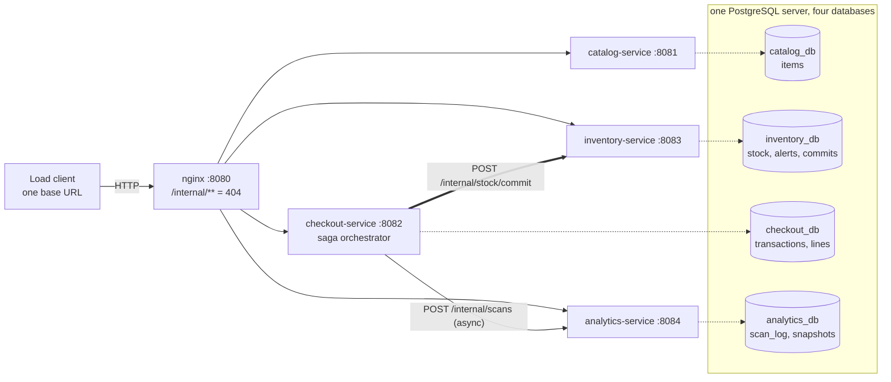
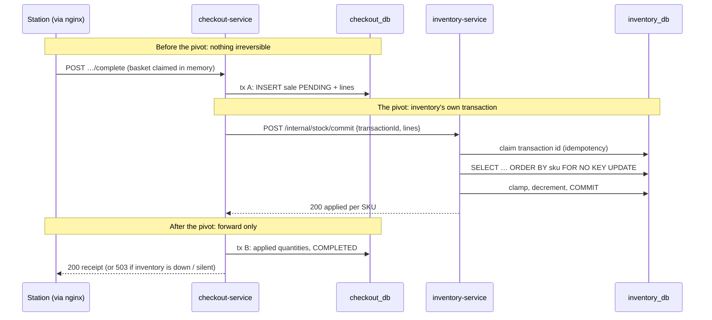
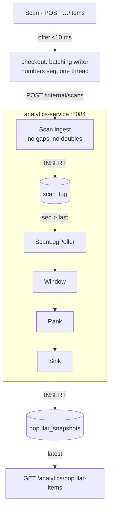

# Self-Checkout System — Microservices

A backend for a supermarket self-checkout: customers start a transaction at a station, scan
items one unit at a time, then pay. Stock is decremented at payment, low-stock alerts are
recorded as they happen, and item popularity is tracked over a hopping window. The same
system is rebuilt each week in a different architecture style against one unchanged API
contract (`CS6510-2026/spec/self-checkout-openapi.yaml`).

**This branch is Week 5: microservices.** Four independently deployable services each have
**their own database**. A payment, which changes data owned by two of them, is coordinated
as a **saga**. Spring Boot 4.1.1, Java 21, PostgreSQL 16, nginx.

> ## Week 5 submission
>
> - **Load-test reports** in [`reports/`](reports/):
>   - [`report-default-10stations-60s.json`](reports/report-default-10stations-60s.json): 10 stations, 60 s, **852.4 tx/s, 0 errors**
>   - [`report-stress-100stations-120s.json`](reports/report-stress-100stations-120s.json): 100 stations, 120 s, **806.0 tx/s, 0 errors**
> - **The services, their data stores, and how the multi-database update is coordinated:** [MICROSERVICES.md](MICROSERVICES.md)
> - Every raw run, check output and failure test is in [`reports/microservices/`](reports/microservices/).

---

## Architecture

[](docs/diagrams/architecture.png)

<details>
<summary>Text version (Mermaid), if the image does not load</summary>



</details>

Interactive versions for local viewing are in [`docs/diagrams/interactive/`](docs/diagrams/interactive/); click an image for its high-resolution PNG.

---

## The services and their data stores

| Service | Business function | Public endpoints | Port | Own database | Tables |
|---|---|---|---|---|---|
| **catalog-service** | What the store sells | `GET /items` | 8081 | `catalog_db` | `items` |
| **checkout-service** | Running a sale; orchestrates payment | `POST /transactions`<br>`POST /transactions/{id}/items`<br>`POST /transactions/{id}/complete`<br>`GET /transactions/{id}` | 8082 | `checkout_db` | `transactions`, `transaction_items` |
| **inventory-service** | Stock and low-stock alerts | `GET /inventory/low-stock` | 8083 | `inventory_db` | `stock`, `low_stock_alerts`, `stock_commits`, `stock_commit_lines` |
| **analytics-service** | Top 10 of the last 1,000 scans, every 500 | `GET /analytics/popular-items` | 8084 | `analytics_db` | `scan_log`, `popular_snapshots` |
| *gateway (nginx)* | Routing only | all of the above | 8080 | — | — |

**No service can read another's data.** `db/reset.sh` creates four databases on one
PostgreSQL server. Each database can be opened by **one role only**: `CONNECT` is revoked
from `PUBLIC` and granted to that service's role. So `psql -U checkout_svc inventory_db` is
refused. Data a service doesn't own, it asks the owner for over HTTP, directly on the
owner's port:
- **Prices and names:** checkout, inventory and analytics load `GET /items` from catalog once at startup and cache it.
- **Stock:** checkout asks inventory to commit it with `POST /internal/stock/commit`.
- **Scans:** checkout pushes them to analytics with `POST /internal/scans`.

The `/internal/**` endpoints are service-to-service only. nginx answers them with 404.

---

## Paying: a saga across two databases

[](docs/diagrams/flow-payment-saga.png)

Stock lives in inventory's database and sales live in checkout's, so paying can't be one
database transaction any more. Checkout **orchestrates** it in four steps:

1. **Claim the basket in memory.** The basket goes from OPEN to COMPLETING, so a second payment or a late scan gets 409.
2. **Save the sale as PENDING (tx A).** This happens *before* anything irreversible.
3. **Call inventory: the pivot.** Inventory does all of the following in one transaction of its own:
   - claims the transaction id;
   - locks the basket's rows in SKU order;
   - takes `min(asked, in stock)`;
   - decrements stock and records what it took.
4. **Record the result (tx B).** Checkout stores what inventory took and marks the sale COMPLETED.

**What keeps this correct:**
- **Idempotency.** Inventory's commit is keyed on the transaction id, so re-sending it can never take stock twice.
- **Forward recovery.** If checkout dies between steps 3 and 4, it finds the PENDING row on restart and finishes the payment.

**What the client sees when inventory has a problem:**

| Inventory... | Client gets | Then |
|---|---|---|
| is stopped, or answers with an error | **503 `SERVICE_UNAVAILABLE`** (with `Retry-After: 1`) after about 1.6 s | the basket is **open again** and stock is untouched, so the client can simply pay again |
| takes the request but **doesn't answer** (the ambiguous case) | **503** after about 5 s | inventory may already have taken the stock, so the basket stays closed and a **retry gets 409**. Checkout keeps re-sending the same commit in the background and **completes the sale shortly after inventory answers**. `GET /transactions/{id}` shows the real outcome, **COMPLETED**, once resolved. |

All three cases are tested in [`scripts/test-failures.sh`](scripts/test-failures.sh):
inventory stopped, inventory frozen with `SIGSTOP`, and checkout halted between the two
databases with a test hook that is off by default. The results are in
[`reports/microservices/failure-tests.txt`](reports/microservices/failure-tests.txt).

<details>
<summary>Text version (Mermaid)</summary>



</details>

---

## Scans to analytics

[](docs/diagrams/flow-scan-handoff.png)

1. A scan only offers its SKU to a bounded queue inside checkout, so **a customer never waits on analytics**.
2. One writer thread numbers the scans with a gapless `seq` and **pushes** them to analytics in batches of up to 1,000 or 50 ms.
3. Analytics stores each batch in its own `scan_log`, ignoring any `seq` it already has, and only then answers. Checkout sends the next batch only after that answer.
4. From the table on, the Week 3 window → rank → sink pipeline is unchanged.

If analytics is down, checkout keeps serving and counts any scans it has to drop. It can even
**start** while analytics is down: it buffers scans and continues the numbering once analytics
answers.

<details>
<summary>Text version (Mermaid)</summary>



</details>

---

## Results

| | Week 4 (`service-based-v1`) | **Week 5 (this branch)** |
|---|---|---|
| Default, 10 stations × 60 s | 1015.8 tx/s | **852.4 tx/s** (−16.1 %) |
| Stress, 100 stations × 120 s | 960.1 tx/s | **806.0 tx/s** (−16.0 %) |
| Errors | 0 | **0** |
| Stock invariant | PASS | **PASS** across two databases ([`check-invariant-micro.sh`](scripts/check-invariant-micro.sh)) |

The submitted reports are the better of two runs each. The second runs were 826.9 and
764.8 tx/s, also with 0 errors and the invariant passing. In all four runs:
- the saga needed no retries, rollbacks or recoveries;
- no scan was dropped;
- every popularity window matched a brute-force recount;
- the test hook was off.

**Re-run (2026-10-24).** The same version was run 4 more times the next day, with the same
procedure:
- default: **803.2 and 809.5 tx/s**;
- stress: **817.0 and 814.2 tx/s**;
- 0 errors, and the cross-database invariant passed in every run.

That is within the submitted runs' spread, so the result reproduces. Group commit
(`commit_delay`) was also tried then, but not on an idle machine, so it is inconclusive and
not adopted. Details and raw runs:
[`reports/microservices/experiments/`](reports/microservices/experiments/README.md).

**Where the 16 % went.** A payment now costs one HTTP call and **three durable commits**
instead of one. Inventory's commit happens while it holds the most popular SKU's row lock,
and it shares the database server's write-ahead log with checkout's two commits. So every
basket containing that SKU waits a little longer. At 10 stations a payment's stock call
averaged 7.7 ms: 6.2 ms waiting for that row lock, 1.2 ms holding it, and the rest the HTTP
round trip. Full tables (latencies, analytics lag, CPU per service) are in
[ARCHITECTURE.md § W5.6](ARCHITECTURE.md#w56-results).

---

## Key design decisions

**Stock moved to inventory-service.** With a database per service, stock needs one owner.
Inventory now does everything that touches it in one local transaction: the lock in SKU order
(no deadlocks), the clamp (never negative) and the low-stock alerts.

**Orchestration, not choreography.** `complete` must return the receipt, with the quantities
inventory actually took, in the same HTTP response. With checkout as the single orchestrator,
the saga's state is in one place. A chain of events (PaymentRequested → StockCommitted → …)
fits next week's event-driven design better.

**A saga log, idempotency, and forward recovery instead of compensation.** The PENDING row is
written *before* the pivot, so a crash never loses what is needed to finish a sale. The
inventory commit is keyed on the transaction id, so it can always be safely re-sent. After the
pivot the saga only goes forward. Stock is never "put back": undoing a commit would be a
second distributed step that could itself fail halfway, and could overtake the original
request.

**503 for an unavailable dependency.** The contract has no 5xx response at all, but 409 would
wrongly say the basket is in the wrong state. 503 with `Retry-After` is HTTP's own word for
"temporarily unavailable, try again", and it only appears while inventory is unreachable.

**Batched HTTP push for scans, not a broker.** It needs nothing installed and keeps every
Week 4 guarantee: gapless, no duplicates, never blocking a customer. A durable broker would
add crash-safety for scans still in checkout's queue, and is next week's subject.

---

## Known limitations

- **Checkout is pinned to one instance.** Open baskets live in its memory, and one thread numbers scans.
- **The ambiguous case reaches the client.** A 503 whose sale may still complete moments later. It is documented and tested, and only possible while inventory is unreachable.
- **A payment in progress reads as OPEN** if checkout crashed mid-saga and hasn't restarted yet. The contract has no "being paid" status.
- **Scans still in checkout's queue are lost if checkout is killed.** Analytics stays gapless, because numbering resumes from what it stored.
- **`scan_log` grows without pruning** in analytics_db.
- **The hottest SKU's row lock is still the throughput ceiling.** Splitting into services moved it into inventory, but didn't remove it.
- **Two database-side ideas were explored but not measured on an idle machine:**
  - group commit (PostgreSQL `commit_delay` with `commit_siblings`, `synchronous_commit` left on);
  - `inventory_db` on a separate PostgreSQL instance, so its WAL isn't shared with checkout's commits.

  The load runs for these overlapped other work on the same laptop, so the numbers can't be compared with the results above. Neither is part of this version. The group-commit runs are in [`reports/microservices/experiments/`](reports/microservices/experiments/README.md); the separate instance was never load-tested.

---

## How to run

**Prerequisites:**
- JDK 21 (a full JDK; the load client needs `javac`);
- PostgreSQL 16 (Homebrew);
- nginx (Homebrew: `brew install nginx`).

Maven comes with `./mvnw`. The Homebrew default PostgreSQL user may create databases and roles.

```bash
# 1. Databases: creates catalog_db, inventory_db, checkout_db, analytics_db, their roles
#    and grants, and seeds 2,000 items and 10,000 units each. Run before every load test.
brew services start postgresql@16
db/reset.sh

# 2. Services (catalog first, then the other three), then nginx on :8080.
scripts/start-all.sh --build        # logs in logs/<service>.log
scripts/stop-all.sh

# 3. Load test, from the course repo, against the gateway.
cd ../CS6510-2026/load-client && bash build.sh
bash run.sh --baseUrl=http://localhost:8080 --stations=10  --duration=60    # default
bash run.sh --baseUrl=http://localhost:8080 --stations=100 --duration=120   # stress

# 4. Correctness, after a run and before the next reset.
scripts/check-invariant-micro.sh    # stock, checkout vs inventory, gapless scans, windows
```

Reset and restart before every load run:
`scripts/stop-all.sh && db/reset.sh && scripts/start-all.sh`.

Performance runs use the packaged jars (`java -jar`, which is what `start-all.sh` does).

Other checks:
- `./mvnw test`: unit and ArchUnit tests (54).
- `scripts/test-*.py`: the five behavioural scripts.
- `scripts/test-failures.sh`: the failure tests.
- `scripts/test-service-restart.sh`: stops and restarts each service.
- `python3 scripts/golden.py diff reports/golden/single-app.txt`: 29 responses, identical to the single application.

---

## Project history

| Week | Style | Tag |
|---|---|---|
| 1 | Monolith | [`monolith`](https://github.com/Vatsalya2003/self_checkout_system/tree/monolith) |
| 2 | Layered architecture | [`layered-v1`](https://github.com/Vatsalya2003/self_checkout_system/tree/layered-v1) |
| 3 | Pipelined analytics, then checkout performance work | [`pipeline-v1`](https://github.com/Vatsalya2003/self_checkout_system/tree/pipeline-v1) / [`pipeline-v2`](https://github.com/Vatsalya2003/self_checkout_system/tree/pipeline-v2) |
| 4 | Service-based, one shared database | [`service-based-v1`](https://github.com/Vatsalya2003/self_checkout_system/tree/service-based-v1) |
| 5 | Microservices, a database each, payment saga (this branch) | [`microservices-v1`](https://github.com/Vatsalya2003/self_checkout_system/tree/microservices-v1) |

---

## More detail

- [MICROSERVICES.md](MICROSERVICES.md): the one-page description (services, data stores, the saga).
- [ARCHITECTURE.md](ARCHITECTURE.md): trade-offs and measured results, week by week; Week 5 is [§ Week 5](ARCHITECTURE.md#week-5-microservices).
- [DEVELOPER_GUIDE.md](DEVELOPER_GUIDE.md): a code walkthrough, starting with a payment and a scan crossing the services.
- [PIPELINE.md](PIPELINE.md): the analytics filters (Week 3; now inside analytics-service).
- [SERVICES.md](SERVICES.md): the Week 4 service list (one shared database), kept for history.
