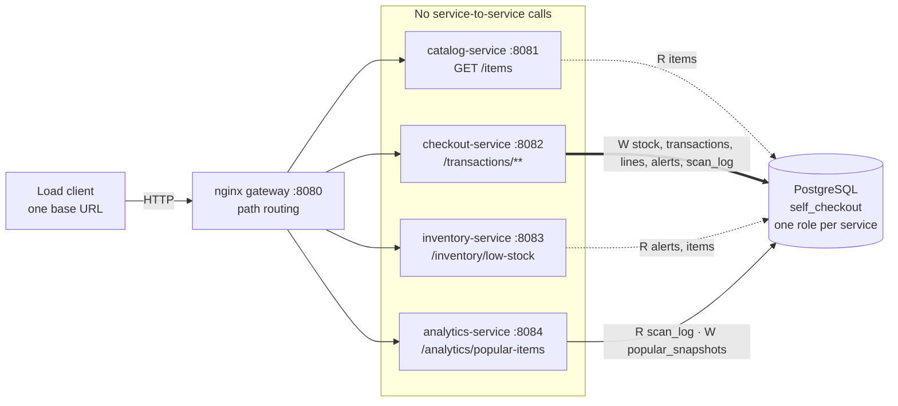
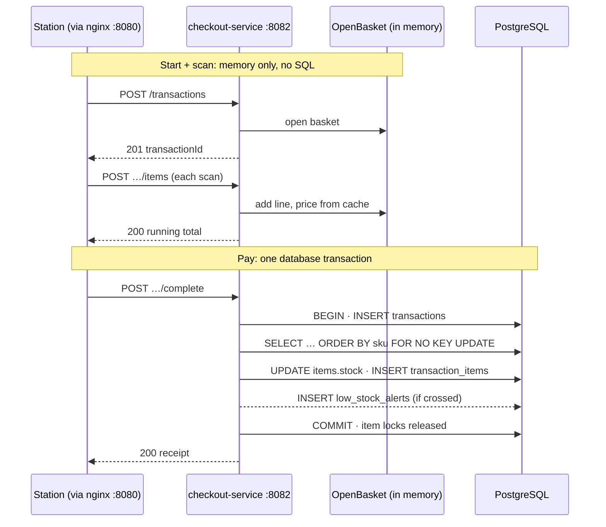
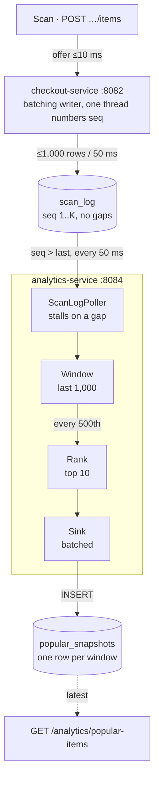

# Self-Checkout System — Service-Based Architecture

A backend for a supermarket self-checkout: customers start a transaction at a station,
scan items one unit at a time, then pay. Stock is decremented at payment, low-stock alerts
are recorded as they happen, and item popularity is tracked over a hopping window. The
same system is rebuilt each week in a different architecture style against one unchanged
API contract (`CS6510-2026/spec/self-checkout-openapi.yaml`). **This branch is Week 4:
service-based.** Four services run as separate processes behind one gateway and share one
PostgreSQL database. Spring Boot 4.1.1, Java 21, PostgreSQL 16, nginx.

> ## Week 4 submission
>
> - **Load-test reports** in [`reports/`](reports/):
>   - [`report-default-10stations-60s.json`](reports/report-default-10stations-60s.json): 10 stations, 60 s, **1015.8 tx/s, 0 errors**
>   - [`report-stress-100stations-120s.json`](reports/report-stress-100stations-120s.json): 100 stations, 120 s, **960.1 tx/s, 0 errors**
> - **Service list:** [SERVICES.md](SERVICES.md)
> - Every raw run, check output and measurement is in [`reports/service-based/`](reports/service-based/).

---

## Architecture

[](docs/diagrams/architecture.png)

<details>
<summary>Text version (Mermaid), if the image does not load</summary>



</details>

Interactive versions (pan, zoom, search) for local viewing:
[`docs/diagrams/interactive/`](docs/diagrams/interactive/). PNG copies sit next to each
SVG in [`docs/diagrams/`](docs/diagrams/).

---

## The services

| Service | Business function | Endpoints | Port | Writes | Reads |
|---|---|---|---|---|---|
| **catalog-service** | What the store sells | `GET /items` | 8081 | — | `items` |
| **checkout-service** | Running a sale: start, scan, pay | `POST /transactions`<br>`POST /transactions/{id}/items`<br>`POST /transactions/{id}/complete`<br>`GET /transactions/{id}` | 8082 | `items.stock`, `transactions`, `transaction_items`, `low_stock_alerts`, `scan_log` | `items`, `transactions`, `scan_log` |
| **inventory-service** | Which SKUs have fallen below the threshold | `GET /inventory/low-stock` | 8083 | — | `low_stock_alerts`, `items` |
| **analytics-service** | Top 10 of the last 1,000 scans, every 500 | `GET /analytics/popular-items` | 8084 | `popular_snapshots` | `scan_log`, `popular_snapshots`, `items` |
| *gateway (nginx)* | Routes by path, no business logic | all of the above | 8080 | — | — |

---

## One database, no service-to-service calls

There is no HTTP client between services, no message broker and no shared memory. The
database is the only coupling, and these rules keep that coupling under control.

- **One writer per table.** Every table has exactly one service that writes it. `items` is
  read by every service but written only by checkout, and only its `stock` column.
- **The scan_log hand-off.** Checkout appends every scan to `scan_log` with a gapless
  sequence number. Analytics polls `WHERE seq > :last ORDER BY seq` and computes the
  popularity windows from what it reads. `scan_log` is therefore always written; the
  Week 3 `persist-raw-scans` flag is gone.
- **Per-service database roles.** Each service connects as its own PostgreSQL role
  (`catalog_svc`, `checkout_svc`, `inventory_svc`, `analytics_svc`). [`db/roles.sql`](db/roles.sql)
  grants each one only its row of the table above, so the database itself refuses a write
  from the wrong service. The ownership rules are also checked in code by ArchUnit tests,
  and no service module depends on another, so one service cannot even compile against
  another's classes.
- **What is shared in code, and why.** Two small library modules are compiled into every
  service jar; neither runs on its own.
  - [`shared-data`](shared-data/) holds the read-only catalog cache and the shared
    configuration. Every service needs names or prices, and reading them is identical
    everywhere.
  - [`shared-web`](shared-web/) holds the error JSON, the exception handler and the domain
    exceptions. This keeps every service's error responses byte-for-byte what the single
    application returned.

  Anything that *writes* lives only in the service that owns the table.

---

## Request flows

### Start, scan, pay

[](docs/diagrams/flow-scan-and-pay.png)

An unpaid basket never touches the database. Starting a transaction and every scan only
update an in-memory basket inside checkout-service, with prices taken from the cached
catalog. Paying opens one database transaction, takes one locking `SELECT … ORDER BY sku
FOR NO KEY UPDATE` for the whole basket, and writes stock, receipt lines and any low-stock
alerts. All of it commits together. Locking in ascending SKU order means two checkouts can
never deadlock. Stock is clamped at zero, so it can never go negative.

<details>
<summary>Text version (Mermaid)</summary>



</details>

### Scan hand-off to analytics

[](docs/diagrams/flow-analytics-handoff.png)

A scan never waits for analytics: it only offers its SKU to a bounded in-memory queue in
checkout. A single writer thread numbers the queued scans with a gapless `seq` and writes
up to 1,000 of them per 50 ms as one INSERT into `scan_log`. analytics-service polls
`scan_log` every 50 ms and hands rows on strictly in `seq` order; if it ever saw a gap it
would stop and wait. The Week 3 window, rank and sink filters then compute the top 10 every
500 scans and write `popular_snapshots`, which `GET /analytics/popular-items` serves.

<details>
<summary>Text version (Mermaid)</summary>



</details>

---

## Results

The submitted reports from the unmodified course load client, through the gateway, on one
laptop:

| | Week 3 (`pipeline-v2`) | **Week 4 (this branch)** |
|---|---|---|
| Default, 10 stations × 60 s | 1031.8 tx/s | **1015.8 tx/s** |
| Stress, 100 stations × 120 s | 1007.8 tx/s | **960.1 tx/s** |
| Errors | 0 | **0** |
| Stock invariant | PASS | **PASS** |

**The cost of the split.** Week 4 is within 1.6 % (default) and 4.7 % (stress) of Week 3
while doing strictly more work:
- every request crosses the gateway, measured at **+0.031 ms** median per request
  ([`gateway-hop.txt`](reports/service-based/gateway-hop.txt));
- every scan is written to `scan_log`, about 1.2 million rows per stress run. Week 3 wrote
  none, because its flag defaulted to off.

**The machine was not the cause.** The Week 3 jar, re-run between the Week 4 runs on the
same afternoon, reproduced its submitted throughput: 1000.4 and 1033.1 tx/s at 100
stations ([`week3-same-day/`](reports/service-based/week3-same-day/)).

Every Week 4 run also had:
- 0 dropped scan events;
- a gapless `scan_log`;
- every popularity window equal to a brute-force SQL recount (`scripts/check-windows.sql`).

The full tables (per-service CPU, analytics lag, restart test) are in
[ARCHITECTURE.md § W4.8](ARCHITECTURE.md#w48-results).

---

## Key design decisions

**Stock stays in checkout.** A payment changes stock, writes the transaction and its lines,
and may record a low-stock alert, and all of that must commit together. That is what keeps
`10000 − stock = Σ applied_quantity` true under 100 concurrent stations. A separate stock
service would turn one local commit into a distributed one, with a network call inside the
row lock that already bounds throughput.

**The `scan_log → items` foreign key was dropped, after measuring it.** Every FK check takes
a `FOR KEY SHARE` lock on the item row, the same hot rows every payment queues for. At 100
stations it cost about a fifth of throughput:

| 100 stations × 120 s | run 1 | run 2 |
|---|---|---|
| with the FK | 707.2 tx/s | 665.2 tx/s |
| FK dropped, measurement runs | 800.6 tx/s | 877.8 tx/s |
| FK dropped, final runs | **960.1 tx/s** | 954.7 tx/s |

The FK guarded nothing in practice: checkout logs only SKUs it has already found in the
catalog, and the catalog never changes. Raw runs are in
[`with-fk/`](reports/service-based/with-fk/) and
[`fk-measurement/`](reports/service-based/fk-measurement/).

**`scan_log` writes are batched.** The first version wrote whatever was queued the moment the
writer woke up. Under load that averaged 2 rows per INSERT, and every INSERT is a commit
competing with the payments' own commits. Collecting for up to 50 ms or 1,000 rows raised
that to 540–590 rows per INSERT. The cost is up to 50 ms of extra analytics lag, and it
changes no window.

**nginx is the gateway.** The contract and the load client have one base URL, so something
on :8080 must route by path. nginx does that with no code. It keeps HTTP/1.1 keep-alive
connections open to each service, and it sends unknown paths to a Spring service so their
404 body stays exactly what the single application returned.

---

## Known limitations

- **Checkout is pinned to one instance.** Open baskets live in its memory, and the
  `scan_log` sequence has one writer. A second instance would need sticky routing and a
  shared sequence. A checkout restart loses unpaid baskets, which then return 404; stock and
  paid transactions are unaffected.
- **`scan_log` grows without pruning.** It is append-only, about a million rows per stress
  run. Nothing trims rows older than the newest window. `db/reset.sh` clears it between
  runs, but a long-lived deployment would need a retention job.
- **The hottest item's row lock is still the throughput ceiling.** At 100 stations, almost
  all of a payment's database time is spent queueing for the most popular SKU's row (see
  [ARCHITECTURE.md §7.4](ARCHITECTURE.md#74-what-actually-limits-it-now-measured)).
  Splitting into services did not change that, and going materially faster would mean
  sharding that row.

---

## How to run

**Prerequisites:**
- JDK 21 (a full JDK; the load client needs `javac`);
- PostgreSQL 16 (Homebrew);
- nginx (Homebrew: `brew install nginx`).

Maven comes with the bundled `./mvnw`.

```bash
# 1. Database: once, then before every run.
#    db/reset.sh drops and recreates every table, seeds 2,000 items x 10,000 units,
#    and creates the per-service roles and grants (the Homebrew default user may do this).
brew services start postgresql@16
createdb self_checkout
db/reset.sh

# 2. Start the four services and then the gateway (--build compiles the jars first).
scripts/start-all.sh --build        # logs in logs/<service>.log
scripts/stop-all.sh                 # stop everything

# 3. Load test, from the course repo, against the gateway.
cd ../CS6510-2026/load-client && bash build.sh
bash run.sh --baseUrl=http://localhost:8080 --stations=10  --duration=60    # default
bash run.sh --baseUrl=http://localhost:8080 --stations=100 --duration=120   # stress

# 4. Correctness, after a run and before the next reset.
psql self_checkout -f scripts/check-invariant.sql   # no negative stock; 10000 - stock = sum(applied)
psql self_checkout -f scripts/check-windows.sql     # gapless scan_log; every window recounts exactly
```

Reset and restart before every load run:
`scripts/stop-all.sh && db/reset.sh && scripts/start-all.sh`. Restarting the services alone
no longer resets anything.

Performance runs must use the packaged jars (`java -jar`, which is what `start-all.sh`
does), not `./mvnw spring-boot:run`, which caps the JIT.

Other checks:
- `./mvnw test` runs the unit and ArchUnit tests.
- The behavioural scripts are `scripts/test-*.py`, plus `scripts/test-service-restart.sh`.
- `python3 scripts/golden.py diff reports/golden/single-app.txt` compares 29 responses
  against the single application.

---

## Project history

| Week | Style | Tag |
|---|---|---|
| 1 | Monolith | [`monolith`](https://github.com/Vatsalya2003/self_checkout_system/tree/monolith) |
| 2 | Layered architecture | [`layered-v1`](https://github.com/Vatsalya2003/self_checkout_system/tree/layered-v1) |
| 3 | Pipelined analytics, then checkout performance work | [`pipeline-v1`](https://github.com/Vatsalya2003/self_checkout_system/tree/pipeline-v1) / [`pipeline-v2`](https://github.com/Vatsalya2003/self_checkout_system/tree/pipeline-v2) |
| 4 | Service-based (this branch) | [`service-based-v1`](https://github.com/Vatsalya2003/self_checkout_system/tree/service-based-v1) |

---

## More detail

- [ARCHITECTURE.md](ARCHITECTURE.md): characteristics, trade-offs and measured results,
  week by week; Week 4 is [§ Week 4](ARCHITECTURE.md#week-4-service-based-architecture).
- [DEVELOPER_GUIDE.md](DEVELOPER_GUIDE.md): a walkthrough of the code, a file tour and
  deep dives, starting with how a scan crosses the services.
- [PIPELINE.md](PIPELINE.md): the analytics filters (Week 3; they now run inside
  analytics-service).
- [SERVICES.md](SERVICES.md): the one-page service list.
